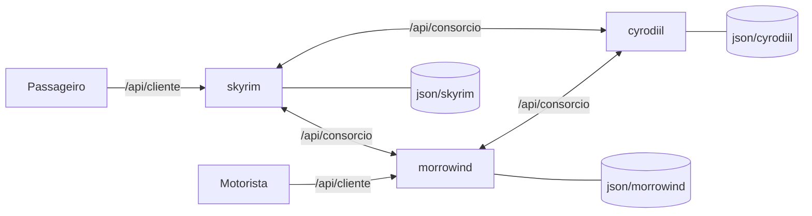
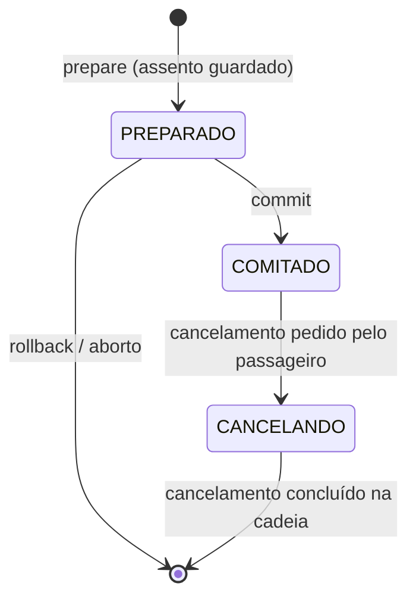
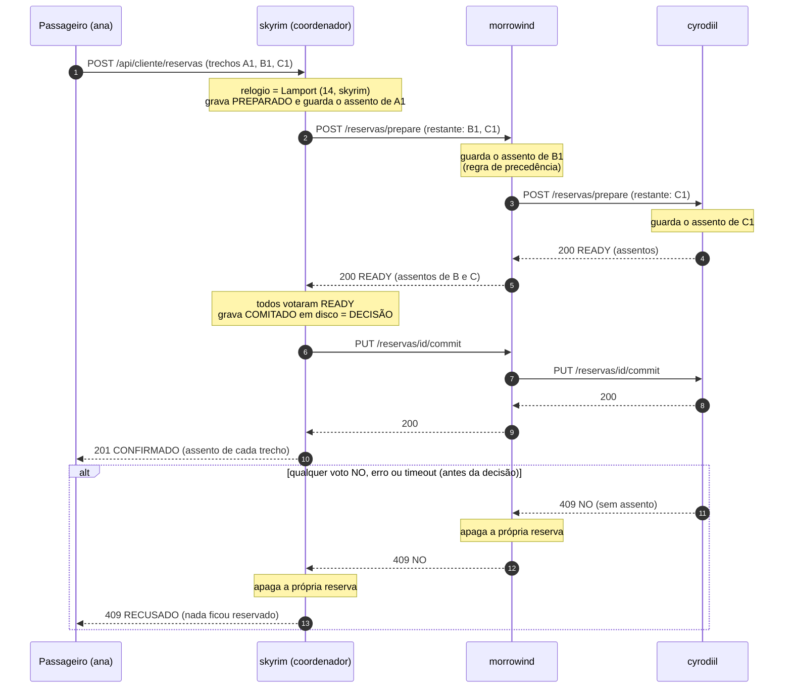
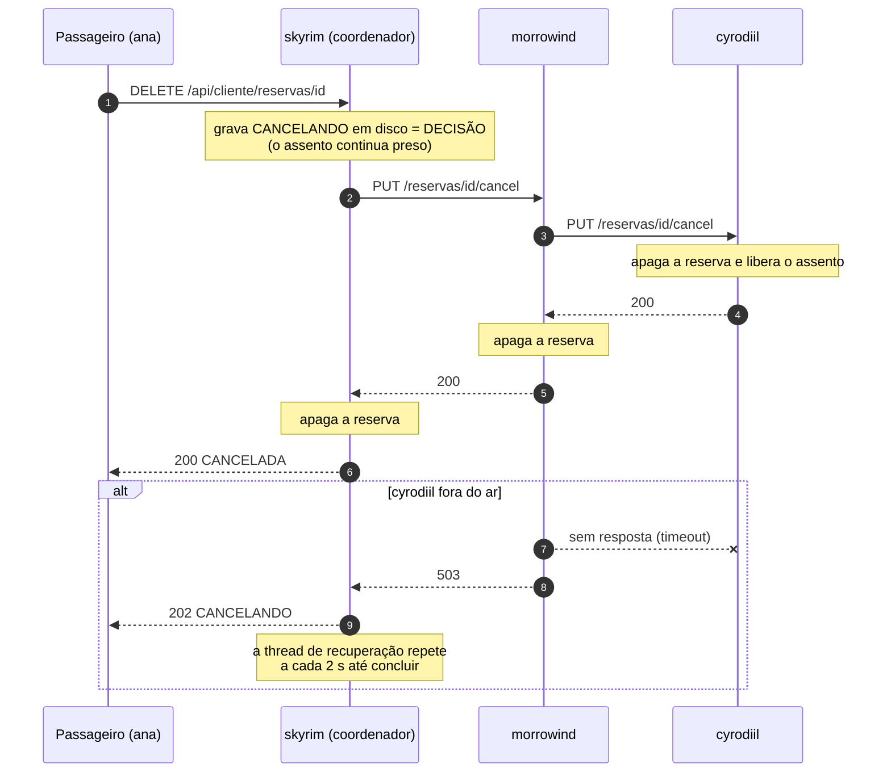
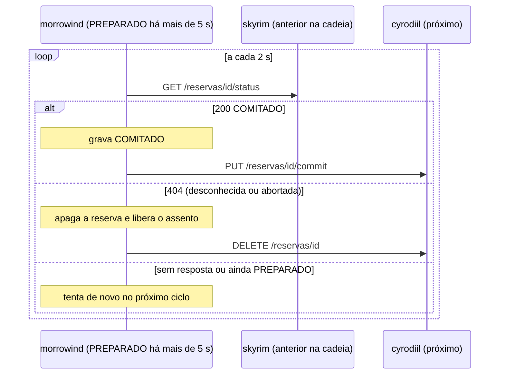

# VaiJunto: Consórcio de Caronas

Servidor P2P em C para o consórcio de caronas compartilhadas (Problema 2, TEC502).
Cada servidor representa uma empresa (uma região do mapa de Tamriel), guarda os próprios dados em disco e conversa
somente com os vizinhos de fronteira por uma API REST. Não existe servidor central, coordenador fixo nem armazenamento compartilhado.

> **Estado atual:** busca distribuída de itinerários, reserva atômica por commit em duas fases (2PC) em cadeia,
> precedência por relógio de Lamport (*wait-die*), cancelamento de reservas, autenticação com senha e recuperação de falhas.
> Ainda falta o relatório em PDF no formato SBC (veja [O que falta](#o-que-falta)).

## Sumário

1. [Funcionamento do consórcio](#funcionamento-do-consórcio)
2. [Requisitos e compilação](#requisitos-e-compilação)
3. [Como rodar](#como-rodar)
4. [Estrutura do projeto](#estrutura-do-projeto)
5. [Modelo de dados](#modelo-de-dados)
6. [API do cliente](#api-do-cliente-passageiro-e-motorista)
7. [API entre servidores (consórcio)](#api-entre-servidores-consórcio)
8. [Diagramas de sequência](#diagramas-de-sequência)
9. [Recuperação de falhas](#recuperação-de-falhas)
10. [Persistência](#persistência)
11. [Menu de testes e cliente de terminal](#menu-de-testes-e-cliente-de-terminal)
12. [Exemplo completo com curl](#exemplo-completo-com-curl)
13. [Requisitos, comparação e limitações](#requisitos-comparação-e-limitações)
14. [O que falta](#o-que-falta)

---

## Funcionamento do consórcio

Visão geral de como o sistema funciona, organizada por tema: arquitetura, comunicação, busca, concorrência, atomicidade,
falhas e testes. Os detalhes (formatos de JSON, tabelas, diagramas) ficam nas seções seguintes e são referenciados em cada tema.

| # | Tema | Onde ver |
|---|---|---|
| 1 | Arquitetura | [1. Arquitetura](#1-arquitetura) |
| 2 | Comunicação (API REST) | [2. Comunicação](#2-comunicação-api-rest) · [API entre servidores](#api-entre-servidores-consórcio) |
| 3 | Busca distribuída | [3. Busca distribuída](#3-busca-distribuída) |
| 4 | Exclusão mútua | [4. Exclusão mútua](#4-exclusão-mútua) |
| 5 | Atomicidade distribuída | [5. Atomicidade distribuída](#5-atomicidade-distribuída) · [Diagramas](#diagramas-de-sequência) |
| 6 | Precedência | [6. Precedência](#6-precedência) |
| 7 | Deadlock distribuído | [7. Deadlock distribuído](#7-deadlock-distribuído) |
| 8 | Tolerância a falhas | [8. Tolerância a falhas](#8-tolerância-a-falhas) |
| 9 | Recuperação e persistência | [9. Recuperação e persistência](#9-recuperação-e-persistência) |
| 10 | Testes | [10. Testes](#10-testes) |

### 1. Arquitetura

**Componentes e papéis.**

| Componente | Papel |
|---|---|
| `servidor <região>` | uma empresa do consórcio. Guarda os próprios dados em disco e fala só com os vizinhos de fronteira |
| `cliente` | programa do motorista ou do passageiro. Fala **somente** com o servidor da própria empresa |
| Vizinhos de fronteira | outros servidores, acessados pela API `/api/consorcio` (HTTP + JSON) |

Não existe servidor central, coordenador fixo nem armazenamento compartilhado.



**Como as responsabilidades foram divididas.** Cada servidor exerce quatro papéis ao mesmo tempo, conforme o pedido:

- **Dono:** é o único que conhece e decide os assentos das caronas publicadas por seus motoristas.
- **Coordenador:** o servidor que recebe o pedido de reserva de um passageiro coordena aquela transação e grava a decisão.
  Pedidos em servidores diferentes têm coordenadores diferentes.
- **Participante:** guarda assentos de suas caronas quando outro servidor coordena e repassa o pedido ao próximo da cadeia.
- **Buscador:** consulta os vizinhos para montar itinerários que passam por outras empresas.

**Dados que cada servidor mantém:** usuários, caronas e a participação dele em cada transação, sempre em disco e só dele (veja [Persistência](#persistência)).

**Como motorista e passageiro se relacionam com os servidores.** Cada usuário é cadastrado em **uma** empresa e só conversa com ela
(HTTP Basic). O motorista publica caronas no próprio servidor. O passageiro busca e reserva pelo próprio servidor, que passa a ser o
coordenador e consulta os demais.

**Comparação com o Problema 1 (centralizado).**

| | Problema 1 | Problema 2 |
|---|---|---|
| O que deixou de ser possível | trava única sobre todos os assentos; visão global instantânea do estoque; ordem única de eventos por fila; relógio único | os mesmos mecanismos não existem mais, porque nenhum processo enxerga todos os assentos nem compartilha relógio com os outros |
| O que passou a ser necessário | n/a | commit atômico entre servidores (2PC), relógio lógico, detecção de falhas por timeout, idempotência, recuperação após queda, prevenção de deadlock |

A tabela completa está em [Arquitetura centralizada × distribuída](#arquitetura-centralizada-problema-1--distribuída-problema-2).

### 2. Comunicação (API REST)

A especificação completa (recursos, métodos, formatos, códigos) está em [API entre servidores](#api-entre-servidores-consórcio).
Rotas: `GET /health`, `GET /trechos`, `POST /reservas/prepare`, `PUT /reservas/{id}/commit`, `DELETE /reservas/{id}` (rollback),
`GET /reservas/{id}/status` e `PUT /reservas/{id}/cancel`.

- **Formato:** JSON. Toda requisição leva `X-Server-Id` e `X-Lamport-Clock`, e toda resposta devolve os mesmos cabeçalhos.
- **Códigos:** 200 (READY/sucesso), 400 (pedido inválido), 404 (inexistente), 409 (sem assento, ou rollback de reserva já confirmada),
  500 (falha ao gravar em disco), 502 (alguém da cadeia não respondeu), 503 (cancelamento não concluído adiante).

**Quando uma requisição não recebe resposta.** O chamador usa timeouts ([tabela](#tempos-limite)): 1,5 s de conexão, 3 s por requisição, e
no `prepare` o prazo cresce com o tamanho da cadeia. O efeito depende do momento:

| Momento | Comportamento |
|---|---|
| Antes da decisão (busca ou `prepare`) | o vizinho vira "suspeito" por 5 s, a transação é recusada (**502 RECUSADO**, o `motivo` diz quem não respondeu) e quem já guardou assento faz rollback |
| Depois da decisão COMMIT (já gravada em disco) | a transação **não** é desfeita: a resposta traz `propagacao_pendente: true` e a thread de recuperação reenvia o aviso até a empresa voltar |
| Cancelamento | responde **202 CANCELANDO** e a recuperação conclui depois |
| Cliente de terminal sem resposta do servidor | avisa que o resultado é **desconhecido** e orienta conferir em "Minhas reservas" |

**Quando a mesma requisição é repetida.** `prepare`, `commit`, `rollback` e `cancel` são **idempotentes**: reenviar o `prepare` devolve
READY sem ocupar outro assento; repetir `commit` ou `cancel` não tem novo efeito; apagar uma reserva que não existe responde 200.
O rollback de uma reserva já `COMITADO` ou `CANCELANDO` responde **409**, para que um aborto atrasado nunca desfaça uma transação
confirmada. É essa propriedade que permite à recuperação simplesmente tentar de novo.

### 3. Busca distribuída

**Estratégia: consulta em tempo real, sem catálogo replicado.** Cada servidor só conhece as próprias caronas. Para a busca
`GET /itinerarios?origem=&destino=`, o servidor faz uma busca em profundidade a partir da origem:

1. Em cada cidade, oferece as faixas das caronas **locais** que partem dela.
2. Pergunta aos vizinhos (`GET /trechos`) o restante do caminho, enviando a lista `visitados` para evitar ciclos.
3. Combina os trechos em itinerários em que o destino de uma faixa é a origem da seguinte.

Há limites para a busca não explodir: 30 itinerários, 40 consultas e 8 trechos. O resultado é uma **fotografia**: a disponibilidade
real só é decidida no `prepare`, e um assento pode acabar entre a busca e a reserva (o `POST /reservas` responde 409).

**Por que não um catálogo replicado:** a replicação exigiria manter cópias consistentes de assentos em todas as empresas, o que
traria de volta o problema de consenso e exporia os dados das empresas. A consulta em tempo real mantém cada dado só no dono.

**Quando uma empresa está fora do ar.** A consulta a ela falha por timeout e ela fica "suspeita" por 5 s. Nesse período a busca
**pula** o vizinho e responde em dezenas de milissegundos, em vez de esperar o timeout a cada consulta. O resultado é *best effort*:
itinerários que dependem da empresa caída somem da lista, mas todos os outros continuam disponíveis.

### 4. Exclusão mútua

**Mecanismo:** o assento só é decidido pelo **servidor dono da carona**, dentro de uma região crítica (trava local) que verifica
os assentos livres, escolhe o assento e **grava a reserva em disco** (`reservaPreparar`). Como só o dono conhece os assentos e a
decisão é atômica sob a trava, dois pedidos simultâneos nunca recebem o mesmo assento, venham de onde vierem.

- O assento é identificado por **(carona, trecho, número)**. Uma reserva ocupa o mesmo número ao longo da faixa e só nos trechos
  dela, então o mesmo assento pode ser vendido para quem viaja antes ou depois.
- Pedidos chegando por servidores diferentes convergem para o mesmo dono e são serializados pela trava dele.

**Justificativa:** como cada assento tem um único dono, a exclusão mútua pode ser **local** a ele. Algoritmos distribuídos
de exclusão mútua (Ricart-Agrawala, token) exigiriam que todos os servidores participassem de cada decisão, com mais mensagens e
mais pontos de falha, sem ganho de correção. O teste de concorrência (seção 10) audita "nenhum assento duplicado".

### 5. Atomicidade distribuída

**Protocolo:** commit em duas fases (2PC) **em cadeia**. Os trechos de um itinerário ficam em servidores diferentes, então nenhuma
trava local os protege juntos. A topologia em cadeia respeita a restrição de falar só com vizinhos de fronteira e dispensa o
coordenador de conhecer todos os participantes. Não há replicação de dados, então consenso (Paxos, Raft) não é necessário.

**Mensagens trocadas** (cadeia skyrim → morrowind → cyrodiil, coordenador = skyrim): o passageiro envia `POST /api/cliente/reservas`; o
coordenador recebe um carimbo de Lamport, grava `PREPARADO` com o próprio assento e envia `POST /reservas/prepare` pela cadeia (A → B → C).
Cada servidor guarda seu assento e repassa o restante; o último responde **READY**, e o voto volta (C → B → A), com cada servidor só
votando sim se todos adiante votaram sim. Com todos READY, o coordenador grava `COMITADO` em disco e envia `PUT /commit` pela mesma
cadeia; só então responde **201 CONFIRMADO** ao passageiro.

**Quem decide:** o **coordenador** (o servidor que recebeu o pedido), e a decisão é o ato de gravar `COMITADO` em disco. Antes disso,
o resultado ainda pode ser aborto; depois, ele é irrevogável e será propagado mesmo que alguém esteja fora do ar.

**Quando um participante recusa** (voto NO, erro ou timeout): ele apaga a própria reserva e responde NO; cada servidor anterior na
cadeia também apaga a sua, até o coordenador, que responde **RECUSADO** ao passageiro. **Nenhum trecho fica reservado.**

**Diagrama de sequência:** veja [Reserva com trechos de três empresas](#reserva-com-trechos-de-três-empresas), que inclui o ramo de
recusa, e o de [Cancelamento](#cancelamento-de-uma-reserva-confirmada).

### 6. Precedência

**Critério:** cada transação recebe, no coordenador, o carimbo **(relógio de Lamport, id do coordenador, id da transação)**.
É uma **ordem total** que:

- respeita a causalidade (quem recebe uma mensagem atualiza o relógio com `max(local, recebido) + 1`);
- **não depende de relógios de parede sincronizados**: só de contadores lógicos trocados nos cabeçalhos `X-Lamport-Clock`;
- é desempatada de forma determinística (coordenador e id), então todos os servidores concordam sobre quem é mais antigo.

**Quem fica com o último assento.** A regra tem dois níveis:

1. Se ainda há assento livre na faixa, atende-se o primeiro pedido a chegar ao dono. Chegar ao dono é o único ponto de linearização
   possível, porque só ele conhece os assentos.
2. Se **não** há assento livre mas existem reservas `PREPARADO` (ainda indecisas) na faixa, vale o *wait-die* pelo carimbo: a
   transação **mais antiga** espera até 0,8 s pela decisão delas, que pode liberar o assento; a **mais nova** é recusada na hora.

**Por que serve com relógios dessincronizados e mensagens atrasadas.** Não existe um "instante real" confiável para comparar, então
a precedência é definida pelo carimbo lógico, que todos os servidores veem do mesmo jeito. Um atraso de rede só altera quem chega
primeiro ao dono, e isso é aceito pela regra 1. Quando a disputa é decidida pela regra 2, a comparação usa o carimbo gravado na
transação e não a hora de chegada, então o atraso não muda o resultado.

### 7. Deadlock distribuído

**Cenário:** duas reservas pedem as mesmas caronas em ordens opostas (uma trava c1 e espera c2, a outra trava c2 e espera c1).

**Mecanismo: prevenção por *wait-die*** com os carimbos de Lamport da seção 6:

- se a transação é **mais antiga** que todas as que seguram o assento, ela **espera** (até `ESPERA_MAX_MS` = 0,8 s);
- se é **mais nova** que alguma, ela **morre** (recusa imediata, 409 RECUSADO).

Quem espera é sempre mais antigo que quem é esperado, então **o grafo de espera não tem ciclos**: o deadlock não pode se formar,
em vez de ser detectado e desfeito depois. O prazo de 0,8 s é um limite adicional de segurança. Um voto READY já dado nunca é
retirado, pois isso quebraria o 2PC.

**Consequências para o desempenho:**

- Sem disputa, não há espera: o custo é zero.
- Em disputa, a transação mais antiga pode ficar até 0,8 s parada, e a mais nova é recusada mesmo que o assento fosse liberado depois.
  A nova tentativa fica por conta do passageiro ou do cliente.
- Não há detector de ciclos, gerenciador global de travas nem troca de mensagens extra para coordenar travas.
- A espera máxima é constante de compilação, não adaptativa (veja [Limitações](#limitações-conhecidas)).

O cenário `cruzado` do teste de concorrência reproduz exatamente esse caso (seção 10).

### 8. Tolerância a falhas

**Detecção.** Por timeout de conexão e de requisição, sem depender de relógios sincronizados. O vizinho sem resposta vira "suspeito"
por 5 s: a busca o pula e o 2PC continua tentando. O `GET /health` permite sondagem explícita.

**O que acontece quando o servidor de uma empresa falha:**

| Momento da falha | O que acontece com a reserva em andamento | Resultado |
|---|---|---|
| **Antes** da confirmação (participante cai antes ou durante o `prepare`) | o `prepare` não obtém resposta e a cadeia faz rollback | **RECUSADO (502)**, nada fica preso, os outros servidores liberam seus assentos |
| **Durante** (coordenador cai antes de gravar a decisão) | participantes ficam `PREPARADO`; ao passar de 5 s, cada um pergunta o estado ao servidor anterior na cadeia (o primeiro pergunta ao coordenador); se a resposta ainda é PREPARADO ou não vem, tenta de novo no ciclo seguinte | assentos **daquela** transação ficam presos só até o coordenador voltar; ao voltar, vale *presumed abort* e tudo é liberado |
| **Durante** (participante travado, `SIGSTOP`) | timeout | recusa limpa, nada preso |
| **Depois** (coordenador cai após gravar `COMITADO`) | os participantes consultam `GET /status` e recebem `COMITADO` | todos **convergem para confirmada** |
| **Depois** (empresa cai ao receber o commit) | resposta com `propagacao_pendente: true` | a empresa conclui sozinha ao voltar, perguntando o estado a quem lhe enviou o `prepare` |
| Cancelamento com empresa fora do ar | decisão `CANCELANDO` já gravada | **202**; a recuperação repete até concluir |

**Como as demais empresas continuam operando.** Cada empresa é dona dos próprios dados e não depende de um ponto central. Falha
de uma empresa só afeta as caronas e os itinerários que passam por ela. Buscas e reservas que não envolvem a empresa caída seguem
normalmente, e a busca pula o suspeito.

### 9. Recuperação e persistência

**O que é armazenado** (um JSON por registro, em `json/<servidor>/`): usuários (com hash da senha), caronas, e, para cada
transação, o estado local (`PREPARADO`, `COMITADO` ou `CANCELANDO`), o coordenador, o `anterior` e o `proximo` na cadeia, os assentos
deste servidor e o relógio lógico. No coordenador, também o itinerário completo.

**Quando é armazenado.** Toda mudança de estado é gravada com arquivo temporário, `fsync` e `rename` **antes** de qualquer resposta.
Isso inclui a decisão do coordenador, que é gravada antes de ser anunciada. É isso que torna a decisão recuperável.

**Como o servidor recupera o estado ao voltar:**

1. Recarrega usuários, caronas e reservas do disco; apaga sobras `.tmp`.
2. Reinicia o relógio de Lamport a partir do maior valor visto nas reservas.
3. A thread de recuperação (a cada 2 s) trata as reservas pendentes:
   - `PREPARADO` há mais de 5 s e sem requisição ativa: *coordenador* aborta (*presumed abort*, pois não há COMMIT gravado) e repassa
     o rollback; *participante* pergunta `GET /status` a quem enviou o `prepare`: `COMITADO` → confirma e repassa, `404` → aborta e
     repassa, sem resposta → tenta de novo.
   - `CANCELANDO` coordenado aqui: repete o cancelamento pela cadeia até concluir.
   - A reserva tem um indicador `ativo` enquanto uma requisição a conduz, para a recuperação não interferir.

**Como a consistência do consórcio é garantida:** (a) a decisão é única e durável (só existe em um lugar, o coordenador);
(b) todos os participantes convergem para essa decisão perguntando o estado; (c) as mensagens são idempotentes, então repetir é
seguro; (d) o rollback nunca desfaz uma reserva confirmada (409). Os diagramas estão em
[Recuperação de um participante sem decisão](#recuperação-de-um-participante-sem-decisão) e na seção
[Recuperação de falhas](#recuperação-de-falhas).

### 10. Testes

| Teste | O que verifica | Como rodar |
|---|---|---|
| `testes/concorrencia.py` | **concorrência entre servidores**: reservas simultâneas por coordenadores diferentes disputando assentos de capacidade 1 | `python3 testes/concorrencia.py 20` |
| `testes/carga.py` | **carga contínua**: dezenas de passageiros virtuais buscando, reservando e cancelando sem parar, com latência, vazão e auditoria das invariantes | `python3 testes/carga.py --passageiros 30 --duracao 30` |
| `testes/falhas.py` | **carga + falhas**: sobe os três servidores sozinho, derruba ou trava um deles durante a carga, espera a recuperação e audita | `python3 testes/falhas.py` |
| `INJETAR_FALHA` | **injeção de falhas**: encerra o servidor de forma abrupta antes da decisão, depois da decisão e depois de gravar `CANCELANDO` | veja [Injeção de falha](#injeção-de-falha-para-testes) |
| `SIGSTOP`/`SIGCONT` | servidor travado (não caído), para testar timeouts | `pkill -STOP -f "servidor morrowind"` |
| Roteiro com `curl` | fluxo completo de cadastro, busca, reserva e cancelamento | [Exemplo completo](#exemplo-completo-com-curl) |

O `concorrencia.py` precisa de `skyrim`, `morrowind` e `cyrodiil` rodando em localhost e, a cada rodada, cria caronas novas com **um único assento**.
Cenários: `unico` (três coordenadores disputam o último assento), `cruzado` (duas reservas travam as mesmas
caronas em ordem oposta, o caso de deadlock da seção 7) e `sobreposto` (quatro reservas com cadeias que se sobrepõem). Ao fim de cada
rodada o script audita: nenhum assento duplicado, nenhum overbooking, nenhuma reserva `PREPARADO` sobrando e nenhuma reserva
confirmada pela metade. O resultado esperado é `confirmadas_por_rodada={1: N}` e `violacoes=0`.

**`carga.py`.** Também exige os três servidores rodando. Cadastra motoristas e passageiros numa malha com cidades únicas por
rodada (`skyrim: A→B→C`, `morrowind: B→C→D`, `cyrodiil: C→D`, o que gera itinerários de A a D com 1, 2 ou 3 empresas em ordens
diferentes) e liga um passageiro virtual por usuário. Cada um repete: busca, reserva (metade das vezes a 1ª opção, para criar um ponto
quente; no resto, uma opção qualquer) e, com chance `--cancelar`, cancela, devolvendo assentos. Há sempre mais passageiros que assentos,
então as disputas não param. Mede latência (p50/p95/p99), vazão e a distribuição de códigos HTTP. Opções: `--passageiros`, `--duracao`,
`--capacidade`, `--cancelar`, `--pensar`, `--host`, `--semente` e `--saida arquivo.json`.

**`falhas.py`.** Não precisa de servidores rodando: ele sobe os seus (`--binario ./servidor`) num diretório temporário limpo a cada
cenário, liga a mesma carga e age durante ela:

| Cenário | Falha |
|---|---|
| `participante_cai` | `SIGKILL` no morrowind no meio da carga; volta 6 s depois |
| `participante_trava` | `SIGSTOP` no cyrodiil por 6 s, depois `SIGCONT` |
| `coordenador_antes_decisao` | skyrim cai depois dos votos READY e antes de gravar o COMMIT (`INJETAR_FALHA`) |
| `coordenador_depois_decisao` | skyrim cai depois de gravar o COMMIT e antes de avisar os participantes |
| `cancelamento_interrompido` | skyrim cai depois de gravar `CANCELANDO`, antes de propagar |
| `caos` | a cada 3 a 6 s um servidor aleatório cai ou trava |

Ao fim de cada cenário religa tudo, espera a recuperação e audita. O resumo mostra se a falha **de fato ocorreu** durante a carga:
um cenário em que ela não disparou não prova nada. Rode `python3 testes/falhas.py --cenarios caos --duracao 60` para um
cenário só, e `--semente N` para repetir uma execução.

**O que a auditoria confere** (lendo `GET /api/consorcio/reservas` de cada servidor, sem confiar só no que os passageiros viram):

- nenhum assento vendido duas vezes e nenhum trecho com mais reservas que assentos;
- nenhuma reserva presa em `PREPARADO` ou `CANCELANDO` depois da recuperação;
- atomicidade: toda reserva `COMITADO` no coordenador está `COMITADO` em **todas** as empresas do itinerário, e nenhuma
  empresa guarda cópia de reserva que o coordenador não tem;
- durabilidade: toda reserva confirmada ao passageiro (201) existe `COMITADO`; e nenhuma reserva cancelada (200 ou 202) sobrou;
- nenhuma reserva confirmada que o passageiro não conhece, a não ser as explicadas por requisições que ficaram sem resposta
  durante uma queda.

Os dois scripts terminam com código 0 se tudo se manteve e 1 caso contrário, então servem em integração contínua.

**Resultados obtidos:** *(preencher com a saída real das execuções)*

| Execução | Parâmetros | Reservas confirmadas | Latência da reserva (p50 / p95) | Violações |
|---|---|---|---|---|
| `concorrencia.py` | _ rodadas | _ | _ | _ |
| `carga.py` | _ passageiros, _ s | _ | _ | _ |

| Cenário de `falhas.py` | Falha ocorreu | Tempo até estabilizar | Violações |
|---|---|---|---|
| `participante_cai` | _ | _ | _ |
| `participante_trava` | _ | _ | _ |
| `coordenador_antes_decisao` | _ | _ | _ |
| `coordenador_depois_decisao` | _ | _ | _ |
| `cancelamento_interrompido` | _ | _ | _ |
| `caos` | _ | _ | _ |

> A autenticação (PBKDF2 com 100 mil iterações) roda a **cada requisição** do cliente, então ela pesa na vazão medida e
> limita o `carga.py` mais do que a rede ou o 2PC. Vale mencionar isso ao comparar com o Problema 1.

---

## Requisitos e compilação

```bash
sudo apt install build-essential libmicrohttpd-dev libcurl4-openssl-dev libssl-dev
make clean && make
```

O `make` gera dois binários:

| Binário | Função |
|---|---|
| `servidor` | servidor de uma empresa do consórcio |
| `cliente` | cliente de terminal para passageiros e motoristas (fala só com o servidor da própria empresa) |

## Como rodar

O servidor recebe a região como argumento e, opcionalmente, a porta. Sem argumentos, lista as regiões válidas.

| Região | Porta | Vizinhos |
|---|---|---|
| skyrim | 3001 | high_rock, hammerfell, cyrodiil, morrowind |
| morrowind | 3002 | skyrim, cyrodiil, black_marsh |
| cyrodiil | 3003 | skyrim, hammerfell, morrowind, black_marsh, elsweyr, valenwood, summerset_islands |
| high_rock | 3004 | skyrim, hammerfell |
| hammerfell | 3005 | high_rock, skyrim, cyrodiil, valenwood, summerset_islands |
| black_marsh | 3006 | morrowind, cyrodiil, elsweyr |
| elsweyr | 3007 | valenwood, cyrodiil, black_marsh |
| valenwood | 3008 | elsweyr, cyrodiil, hammerfell, summerset_islands |
| summerset_islands | 3009 | hammerfell, cyrodiil, valenwood |

Os vizinhos são procurados em `localhost` por padrão. Para apontar um vizinho para outra máquina ou contêiner, use a
variável `HOST_<REGIAO>` (nome em maiúsculas, com `_`): `HOST_SKYRIM`, `HOST_HIGH_ROCK`, `HOST_SUMMERSET_ISLANDS`...
A porta de cada vizinho é sempre a padrão da tabela.

### Cenário 1: uma máquina (vários terminais)

```bash
./servidor skyrim          # porta 3001
./servidor morrowind       # porta 3002
./servidor cyrodiil        # porta 3003
```

Só sobem os servidores que você iniciar. Vizinhos que não estiverem rodando aparecem como `FALHOU ... [TIMEOUT]`,
o que também serve como teste de falha.

### Cenário 2: uma máquina com Docker Compose

O `docker-compose.yml` define **um serviço por região** (nove) em uma rede interna `tamriel_net`, onde os contêineres se
enxergam pelo nome do serviço (as variáveis `HOST_*` já têm esse padrão). Suba só os que quiser:

```bash
docker compose up --build -d skyrim morrowind cyrodiil   # sobe os três
docker compose logs -f skyrim                            # acompanha os logs
docker attach skyrim                                     # abre o menu do servidor (sair: Ctrl+P, Ctrl+Q)
docker compose stop morrowind                            # simula a queda de uma empresa
docker compose start morrowind                           # ela volta e se recupera
docker compose down                                      # derruba tudo
```

Os volumes `./data/<regiao>:/app/json` mantêm o armazenamento entre execuções. Sem eles, as reservas somem quando o
contêiner é recriado e o consórcio fica inconsistente.

### Cenário 3: várias máquinas (um contêiner por computador)

Cada empresa roda no seu computador e precisa saber o IP dos vizinhos que estão em outras máquinas.

```bash
# 1. descubra o IP de cada máquina
hostname -I                    # ex.: A = 192.168.0.10, B = 192.168.0.20, C = 192.168.0.30

# 2. libere as portas (se houver firewall)
sudo ufw allow 3001/tcp        # na máquina A (skyrim); 3002 na B; 3003 na C

# 3. em cada máquina, suba só o seu serviço apontando para os vizinhos remotos
HOST_MORROWIND=192.168.0.20 HOST_CYRODIIL=192.168.0.30 docker compose up --build -d skyrim   # máquina A
HOST_SKYRIM=192.168.0.10 HOST_CYRODIIL=192.168.0.30 docker compose up --build -d morrowind   # máquina B
HOST_SKYRIM=192.168.0.10 HOST_MORROWIND=192.168.0.20 docker compose up --build -d cyrodiil   # máquina C

# 4. teste a comunicação
curl -i 192.168.0.20:3002/api/consorcio/health
```

Sem Docker é igual, trocando o `docker compose up` por `./servidor <regiao>`. Se aparecer `FALHOU ... [TIMEOUT]`,
confira o IP, o firewall e se o outro servidor está no ar.

### Cliente de terminal

```bash
./cliente skyrim                       # usa localhost:3001 (ou o host da variável CLIENTE_HOST)
./cliente 192.168.0.10:3001            # endereço explícito
./cliente http://192.168.0.10:3001
```

---

## Estrutura do projeto

```
main.c                 inicialização do servidor
Makefile               gera `servidor` e `cliente`
Dockerfile             imagem Ubuntu 22.04 com as dependências
docker-compose.yml     um serviço por região, rede interna e volumes de dados
headers/               cabeçalhos de todos os módulos (documentados)
cliServidor/
  cli.c                menu de texto do servidor (testes)
cliUsuario/
  terminal.c           cliente interativo de passageiros e motoristas
  apiConsorcio.c       chamadas à API do cliente (libcurl)
http/
  httpServidor.c       rotas /api/consorcio e /api/cliente (libmicrohttpd)
  httpCliente.c        chamadas aos vizinhos (libcurl, timeouts, detector de falhas)
consorcio/
  cadastro.c           usuários e caronas (regras de negócio)
  busca.c              busca distribuída de itinerários entre empresas
  transacao.c          2PC: coordenador, participante em cadeia, cancelamento e recuperação
util/
  configuracoes.c      regiões, portas e fronteiras
  lamport.c            relógio lógico de Lamport (thread-safe)
  persistencia.c       armazenamento em json/<servidor>/{usuarios,caronas,reservas}/
  auth.c               senhas (PBKDF2-HMAC-SHA256) e HTTP Basic
  json.c               parser JSON (árvore em memória)
  util.c               buffer de texto, UUID, validação de ids, tempo
testes/
  concorrencia.py      disputa simultânea por assentos (veja [Testes](#10-testes))
  carga.py             simulador de passageiros com carga contínua e auditoria das invariantes
  falhas.py            carga combinada com queda e trava de servidores, e auditoria depois da recuperação
  comum.py             HTTP, preparação do cenário, métricas e auditoria (usado por carga.py e falhas.py)
```

---

## Modelo de dados

- **Carona** = uma **rota** de 2 a 10 cidades, publicada em **um** servidor (a empresa do motorista), que é a única dona
  dos assentos dela. Cada **trecho** (cidade i → cidade i+1) tem horário, preço e capacidade (1 a 60 assentos) próprios.
  As cidades de uma rota não se repetem.
- **Reserva de uma faixa:** o passageiro pega uma **faixa** da rota (origem → destino, nomes sem diferenciar maiúsculas).
  O assento escolhido tem o **mesmo número em todos os trechos da faixa** e só fica ocupado nesses trechos, então o mesmo
  assento pode ser vendido para quem viaja antes ou depois.
- **Itinerário** = sequência de faixas de caronas (de empresas diferentes) em que o destino de uma é a origem da seguinte.
  No máximo 8 faixas por transação, uma faixa por carona.
- **Usuário** é cadastrado em **uma** empresa e só fala com o servidor dela. O servidor dele vira o **coordenador** das reservas que ele fizer.
- Os servidores só conversam com **vizinhos de fronteira** (tabela de regiões).

Estados de uma reserva em cada servidor: `PREPARADO` (assento guardado, aguardando decisão), `COMITADO` (confirmada)
e `CANCELANDO` (cancelamento decidido, ainda se propagando). Uma reserva abortada ou cancelada é simplesmente apagada.



---

## API do cliente (passageiro e motorista)

Prefixo: `/api/cliente`. Corpos em JSON. **Tudo exige HTTP Basic** (`Authorization: Basic base64(id:senha)`), exceto `POST /usuarios`.
Credenciais inválidas retornam **401** (com atraso de 0,3 s contra força bruta). Perfil errado para a rota retorna **403**.

| Método e rota | Perfil | Função | Respostas |
|---|---|---|---|
| `POST /usuarios` | público | cadastra `{id, nome, tipo, senha}`; tipo = `motorista` ou `passageiro`; senha de 4 a 72 caracteres | 201, 400, 409 (já existe), 500 |
| `GET /eu` | ambos | dados do usuário logado | 200, 401 |
| `GET /itinerarios?origem=&destino=` | ambos | busca distribuída (consulta os vizinhos) | 200, 400 |
| `POST /rotas` ou `POST /caronas` | motorista | publica uma carona com vários trechos (os dois caminhos fazem o mesmo) | 201, 400, 403, 500 |
| `GET /caronas` | motorista | lista as caronas do motorista com `assentos_livres` | 200 |
| `DELETE /caronas/{id}` | motorista | exclui a carona (só sem reservas) | 200, 400, 403 (de outro motorista), 404, 409 (tem reservas) |
| `POST /reservas` | passageiro | reserva um itinerário (2PC) | 201, 400, 403, 404, 409, 502, 500 |
| `GET /reservas` | passageiro | reservas do passageiro em que este servidor é o coordenador | 200 |
| `DELETE /reservas/{id}` | passageiro | cancela uma reserva confirmada | 200, 202, 404, 409, 500 |

### Cadastro e publicação

`POST /usuarios`

```json
{"id": "ana", "nome": "Ana", "tipo": "passageiro", "senha": "1234"}
```

`POST /rotas` (o motorista vem da autenticação; as cidades saem de `origem`/`destino`, e os trechos devem se encadear):

```json
{"trechos": [
  {"origem": "Whiterun", "destino": "Windhelm",  "horario": "08:00", "preco": 20.00, "assentos": 3},
  {"origem": "Windhelm", "destino": "Riften",     "horario": "10:30", "preco": 15.00, "assentos": 2}
]}
```

Também é aceito o formato simples de rota com duas cidades: `{"origem", "destino", "horario", "preco", "assentos"}`.
Resposta 201 (carona criada; `preco` e `assentos` do topo são a soma e o mínimo dos trechos):

```json
{"id": "skyrim-3a43db7b", "servidor": "skyrim", "motorista": "mot-s",
 "origem": "Whiterun", "destino": "Riften", "horario": "08:00", "preco": 35.00, "assentos": 2, "assentos_livres": 2,
 "cidades": ["Whiterun", "Windhelm", "Riften"],
 "trechos": [{"origem": "Whiterun", "destino": "Windhelm", "horario": "08:00", "preco": 20.00, "assentos": 3, "assentos_livres": 3},
             {"origem": "Windhelm", "destino": "Riften",   "horario": "10:30", "preco": 15.00, "assentos": 2, "assentos_livres": 2}]}
```

### Busca de itinerários

`GET /itinerarios?origem=Whiterun&destino=Imperial%20City` devolve até 30 itinerários com assentos livres em todas as faixas:

```json
{"servidor": "skyrim", "total": 1, "itinerarios": [{
  "itinerario_id": "skyrim-1", "preco_total": 95.00,
  "trechos": [
    {"servidor": "skyrim",    "id_carona": "skyrim-3a43db7b",    "origem": "Whiterun", "destino": "Windhelm",
     "horario": "08:00", "preco": 20.00, "assentos_livres": 2},
    {"servidor": "morrowind", "id_carona": "morrowind-aad879a0", "origem": "Windhelm", "destino": "Mournhold",
     "horario": "10:00", "preco": 30.00, "assentos_livres": 2},
    {"servidor": "cyrodiil",  "id_carona": "cyrodiil-f21542c0",  "origem": "Mournhold", "destino": "Imperial City",
     "horario": "13:00", "preco": 45.00, "assentos_livres": 1}]}]}
```

A busca é uma fotografia: os assentos podem acabar antes da reserva, e aí o `POST /reservas` responde 409.

### Reserva

`POST /reservas` (o passageiro vem da autenticação; basta copiar os trechos do itinerário escolhido):

```json
{"trechos": [
  {"servidor": "skyrim",    "id_carona": "skyrim-3a43db7b",    "origem": "Whiterun",  "destino": "Windhelm"},
  {"servidor": "morrowind", "id_carona": "morrowind-aad879a0", "origem": "Windhelm",  "destino": "Mournhold"},
  {"servidor": "cyrodiil",  "id_carona": "cyrodiil-f21542c0",  "origem": "Mournhold", "destino": "Imperial City"}
]}
```

Regras de validação (400 se violadas): de 1 a 8 trechos; servidores existentes no mapa; sem carona repetida; os trechos de cada servidor
vêm juntos (um único bloco consecutivo); os trechos **deste** servidor, se houver, vêm primeiro; e a sequência de servidores segue as
fronteiras do mapa (`eu → g1 → g2 → ...`, cada um vizinho do anterior).

Resposta **201 CONFIRMADO**:

```json
{"id_transacao": "567d6271-0f4d-474e-8faa-abbf42abed7c", "status": "CONFIRMADO", "passageiro": "ana",
 "relogio_logico": 26, "propagacao_pendente": false,
 "trechos": [
   {"servidor": "skyrim",    "id_carona": "skyrim-3a43db7b",    "origem": "Whiterun",  "destino": "Windhelm",      "assento": 1},
   {"servidor": "morrowind", "id_carona": "morrowind-aad879a0", "origem": "Windhelm",  "destino": "Mournhold",     "assento": 1},
   {"servidor": "cyrodiil",  "id_carona": "cyrodiil-f21542c0",  "origem": "Mournhold", "destino": "Imperial City", "assento": 1}]}
```

Recusa (nada fica reservado em nenhum servidor):

```json
{"status": "RECUSADO", "motivo": "sem assento disponivel na carona cyrodiil-f21542c0 (cyrodiil)"}
```

| Código | Significado |
|---|---|
| 201 | confirmada em todas as empresas |
| 400 | pedido inválido, ou origem/destino fora da rota de uma carona (`RECUSADO`) |
| 403 / 404 | usuário não é passageiro / passageiro ou carona inexistente |
| 409 | sem assento disponível (`RECUSADO`) |
| 502 | alguma empresa da cadeia não respondeu (`RECUSADO`, o `motivo` diz qual) |
| 500 | falha ao gravar em disco |

`propagacao_pendente: true` significa que a decisão foi **COMMIT** (já gravada em disco), mas alguma empresa estava fora do ar
na hora de receber o aviso. Ela conclui sozinha ao voltar (veja [Recuperação de falhas](#recuperação-de-falhas)).

### Listagem e cancelamento

`GET /reservas` devolve `{"servidor", "reservas": [...], "total"}`, cada reserva no formato descrito em [Persistência](#persistência).

`DELETE /reservas/{id}` só funciona no servidor coordenador e para o dono da reserva:

| Código | Corpo | Significado |
|---|---|---|
| 200 | `{"id_transacao", "status": "CANCELADA"}` | cancelada em todas as empresas, assentos liberados |
| 202 | `{"id_transacao", "status": "CANCELANDO", "mensagem"}` | decisão registrada, mas alguma empresa está fora do ar; a recuperação conclui depois |
| 404 | erro | reserva inexistente, de outro passageiro ou de outro coordenador |
| 409 | erro | reserva ainda em andamento (`PREPARADO`); tente de novo em instantes |
| 500 | erro | falha ao gravar o cancelamento em disco |

---

## API entre servidores (consórcio)

Prefixo: `/api/consorcio`. Usada só entre servidores vizinhos.

**Cabeçalhos.** Toda requisição leva `X-Server-Id` (quem envia), `X-Lamport-Clock` e `Accept: application/json`; as que têm corpo levam
`Content-Type: application/json`. Toda resposta devolve `Content-Type: application/json`, `X-Server-Id` e `X-Lamport-Clock`.
Quem recebe atualiza o relógio com `max(local, recebido) + 1`. As respostas também trazem cabeçalhos CORS, e `OPTIONS` responde 200.

| Método e rota | Função | Respostas |
|---|---|---|
| `GET /health` (ou `/vivo`) | detecção de falha | 200 |
| `GET /trechos?origem=&destino=&visitados=a,b` | itinerários cujo 1º trecho é uma carona deste servidor | 200, 400 |
| `GET /reservas` | reservas guardadas neste servidor | 200 |
| `POST /reservas/prepare` | fase 1: tranca assentos, repassa à cadeia e vota | 200 READY, 400, 404, 409, 500, 502 |
| `PUT /reservas/{id}/commit` | fase 2: confirma e repassa à cadeia | 200, 404, 500 |
| `DELETE /reservas/{id}` | rollback: apaga a reserva e repassa à cadeia (idempotente) | 200, 409 (já confirmada), 500 |
| `GET /reservas/{id}/status` | estado da transação (usado na recuperação) | 200, 404 |
| `PUT /reservas/{id}/cancel` | cancela uma reserva confirmada e repassa à cadeia (idempotente) | 200, 503, 404 |

Rotas desconhecidas retornam 404. Identificadores com caracteres fora de letras, números, `-`, `_` e `.` são rejeitados.

### `GET /health`

```json
{"status": "skyrim ta on", "relogio": 42}
```

### `GET /trechos`

Devolve os itinerários que **começam** com uma carona deste servidor em `origem` e chegam a `destino`, podendo continuar em outras empresas.
`visitados` lista os servidores já percorridos (quem pergunta se inclui), evitando ciclos. O formato da resposta é o mesmo do
`GET /itinerarios` do cliente (veja acima).

### `POST /reservas/prepare`

`trechos_solicitados` é o que **resta** percorrer. Quem recebe trata os trechos que são dele (que vêm primeiro) e repassa o resto
ao próximo servidor, que precisa ser seu vizinho.

```json
{"id_transacao": "567d6271-0f4d-474e-8faa-abbf42abed7c", "coordenador_id": "skyrim", "passageiro": "ana", "relogio_logico": 14,
 "trechos_solicitados": [
   {"servidor": "morrowind", "id_carona": "morrowind-aad879a0", "origem": "Windhelm",  "destino": "Mournhold"},
   {"servidor": "cyrodiil",  "id_carona": "cyrodiil-f21542c0",  "origem": "Mournhold", "destino": "Imperial City"}]}
```

| Código | Significado | Corpo |
|---|---|---|
| 200 | **READY**: este servidor e todos adiante votaram sim | `{"id_transacao", "status": "READY", "servidor", "assentos": [{"servidor", "id_carona", "origem", "destino", "assento"}]}` |
| 400 | corpo inválido, id inseguro, 1º trecho não é deste servidor, servidor repetido na cadeia, próximo não é vizinho, ou origem/destino fora da rota da carona | `{"erro"}` ou `{"id_transacao", "status": "NO", "servidor", "motivo"}` |
| 404 | carona inexistente neste servidor | `{"id_transacao", "status": "NO", "servidor", "motivo"}` |
| 409 | sem assento disponível | idem |
| 502 | alguém adiante na cadeia não respondeu (o `motivo` diz quem) | idem |
| 500 | falha ao gravar em disco | idem |

Reenviar o mesmo `prepare` é **idempotente**: devolve READY sem ocupar outro assento. Se algo falha adiante na cadeia, este
servidor apaga a própria reserva antes de responder NO.

### `PUT /reservas/{id}/commit`

200 `{"id_transacao", "mensagem", "propagacao_pendente"}`. 404 se nunca houve `prepare`. Grava `COMITADO` e repassa ao próximo.

### `DELETE /reservas/{id}` (rollback)

200 sempre que a reserva não está confirmada (apagar algo que não existe também dá 200). **409** se já está `COMITADO` ou `CANCELANDO`,
para que um aborto atrasado nunca desfaça uma transação confirmada.

### `GET /reservas/{id}/status`

200 `{"id_transacao", "status": "PREPARADO" | "COMITADO" | "CANCELANDO", "coordenador_id"}` ou 404 (desconhecida ou abortada).

### `PUT /reservas/{id}/cancel`

Repassa o cancelamento adiante **primeiro** e só então apaga a cópia local, então os assentos são liberados do fim da cadeia para o começo.
200 `{"id_transacao", "mensagem"}` (também se a reserva já não existe aqui). **503** se não conseguiu concluir adiante; quem chamou tenta de novo.

### Tempos limite

| Constante | Valor | Uso |
|---|---|---|
| `TIMEOUT_CONEXAO` | 1,5 s | estabelecer a conexão com um vizinho |
| `TIMEOUT_REQUISICAO` | 3 s | requisição comum |
| `prepare` | (3 s + 0,8 s) × servidores restantes | a chamada é encadeada, então o prazo cresce com a cadeia |
| cancelamento | 8 s | propaga pela cadeia inteira |
| `ESPERA_MAX_MS` | 0,8 s | espera máxima por um assento disputado |
| `SUSPEITA_MS` | 5 s | quanto tempo um vizinho sem resposta fica "suspeito" |
| `TIMEOUT_PREPARADO_S` | 5 s | idade mínima de uma reserva `PREPARADO` para a recuperação agir |
| `INTERVALO_RECUPERACAO_S` | 2 s | intervalo entre ciclos da thread de recuperação |

---

## Diagramas de sequência

### Reserva com trechos de três empresas



Cada servidor grava quem veio antes (`anterior`) e quem vem depois (`proximo`) na cadeia. Assim commit, rollback e cancelamento
percorrem o mesmo caminho sem o coordenador falar com todo mundo, e cada participante sabe a quem perguntar se o aviso não chegar.

### Cancelamento de uma reserva confirmada



### Recuperação de um participante sem decisão



---

## Recuperação de falhas

Detecção, gravação e a thread de recuperação estão descritas em [Tolerância a falhas](#8-tolerância-a-falhas) e
[Recuperação e persistência](#9-recuperação-e-persistência). Aqui ficam os cenários cobertos e a injeção de falhas.

Cenários cobertos: participante caído no meio da cadeia (recusa limpa, nada preso); participante travado com `SIGSTOP` (timeout, nada preso);
coordenador morto **antes** da decisão (assentos presos só até ele voltar, depois liberados); coordenador morto **depois** da decisão
(participantes convergem para `COMITADO`); empresa fora do ar durante um cancelamento (202, concluído quando ela voltar).

### Injeção de falha (para testes)

A variável `INJETAR_FALHA` faz o servidor encerrar de forma abrupta (como uma queda real) em pontos definidos:

```bash
INJETAR_FALHA=antes_decisao      ./servidor skyrim   # após todos votarem READY, antes de gravar o COMMIT
INJETAR_FALHA=depois_decisao     ./servidor skyrim   # após gravar o COMMIT, antes de avisar os participantes
INJETAR_FALHA=depois_cancelando  ./servidor skyrim   # após gravar CANCELANDO, antes de propagar o cancelamento
```

Reinicie sem a variável e acompanhe o log (`[RECUPERACAO] ...`) para ver a convergência.

---

## Persistência

Cada servidor tem três pastas, **um arquivo JSON por registro**, e nada é compartilhado entre empresas:

```
json/<servidor>/
  usuarios/<id>.json             usuários desta empresa (com salt e hash da senha, nunca a senha)
  caronas/<id>.json              caronas publicadas aqui (dados fixos; assentos livres são calculados)
  reservas/<id_transacao>.json   participação deste servidor em cada transação
```

Exemplo de `reservas/<id>.json` em morrowind, no meio da cadeia skyrim → morrowind → cyrodiil:

```json
{"id_transacao": "567d6271-...", "estado": "COMITADO", "coordenador_id": "skyrim",
 "anterior": "skyrim", "proximo": "cyrodiil", "passageiro": "ana", "relogio_logico": 26, "criado_em": 1792183577,
 "trechos": [{"servidor": "morrowind", "id_carona": "morrowind-aad879a0", "origem": "Windhelm", "destino": "Mournhold",
              "de": 0, "ate": 1, "assento": 1}],
 "itinerario": []}
```

`trechos` são as faixas que pertencem a **este servidor** (`de`/`ate` são os índices na rota da carona); `itinerario` só é
preenchido no coordenador. As gravações são atômicas (temporário + `fsync` + `rename`) e sobras `.tmp` são apagadas ao iniciar.
Em Docker, monte `json/` como volume (já feito no `docker-compose.yml`).

**Senhas:** PBKDF2-HMAC-SHA256 com 100 000 iterações e salt aleatório de 128 bits por usuário. A conferência usa comparação em tempo constante.

---

## Menu de testes e cliente de terminal

Ao iniciar, cada **servidor** abre um menu no terminal (em Docker, `docker attach <servidor>`). As opções 1 a 8 chamam a API entre
servidores; as 10 a 14 operam no próprio servidor com a mesma lógica da API do cliente.

| Opção | Ação |
|---|---|
| 1 / 2 | `GET /health` de um vizinho / de todos |
| 3 | `GET /trechos` |
| 4 | `POST /reservas/prepare` (id vazio gera UUID; precisa de uma carona existente no vizinho) |
| 5 / 6 / 7 | commit / rollback / status de uma transação |
| 8 | `GET /reservas` de um vizinho |
| 9 | ver as reservas guardadas neste servidor |
| 10 | cadastrar usuário |
| 11 | publicar carona (cada trecho vira uma carona de duas cidades) |
| 12 | listar usuários e caronas |
| 13 | buscar itinerários (distribuído) |
| 14 | reservar itinerário (este servidor coordena o 2PC) |
| 0 | sair |

O **cliente** (`./cliente`) é o programa do usuário final: cadastro, login (senha sem eco), e depois um menu de motorista
(publicar rota com vários trechos, listar e excluir caronas) ou de passageiro (buscar e reservar, listar e cancelar reservas).
Se a rede cair no meio de uma reserva ou de um cancelamento, ele avisa que o resultado é **desconhecido** e manda conferir em "Minhas reservas".

---

## Exemplo completo com curl

Três servidores locais (`skyrim`, `morrowind`, `cyrodiil`) e um itinerário Whiterun → Imperial City que usa as três empresas.
Requer `jq`.

```bash
S=localhost:3001/api/cliente; M=localhost:3002/api/cliente; C=localhost:3003/api/cliente

# usuários (cada um no servidor da sua empresa)
curl -X POST $S/usuarios -d '{"id":"ana","nome":"Ana","tipo":"passageiro","senha":"1234"}'
curl -X POST $S/usuarios -d '{"id":"mot-s","nome":"Motorista S","tipo":"motorista","senha":"1234"}'
curl -X POST $M/usuarios -d '{"id":"mot-m","nome":"Motorista M","tipo":"motorista","senha":"1234"}'
curl -X POST $C/usuarios -d '{"id":"mot-c","nome":"Motorista C","tipo":"motorista","senha":"1234"}'

# caronas (guarda o id de cada uma)
ID_S=$(curl -s -u mot-s:1234 -X POST $S/rotas -d '{"origem":"Whiterun","destino":"Windhelm","horario":"08:00","preco":20,"assentos":2}' | jq -r .id)
ID_M=$(curl -s -u mot-m:1234 -X POST $M/rotas -d '{"origem":"Windhelm","destino":"Mournhold","horario":"10:00","preco":30,"assentos":2}' | jq -r .id)
ID_C=$(curl -s -u mot-c:1234 -X POST $C/rotas -d '{"origem":"Mournhold","destino":"Imperial City","horario":"13:00","preco":45,"assentos":1}' | jq -r .id)

# a ana (de skyrim) busca e reserva
curl -u ana:1234 "$S/itinerarios?origem=Whiterun&destino=Imperial%20City"
curl -u ana:1234 -X POST $S/reservas -d '{"trechos":[
  {"servidor":"skyrim",    "id_carona":"'$ID_S'", "origem":"Whiterun",  "destino":"Windhelm"},
  {"servidor":"morrowind", "id_carona":"'$ID_M'", "origem":"Windhelm",  "destino":"Mournhold"},
  {"servidor":"cyrodiil",  "id_carona":"'$ID_C'", "origem":"Mournhold", "destino":"Imperial City"}]}'

# conferir em cada servidor
curl localhost:3001/api/consorcio/reservas
curl localhost:3002/api/consorcio/reservas
curl localhost:3003/api/consorcio/reservas

# cancelar (use o id_transacao devolvido na reserva)
curl -u ana:1234 -X DELETE $S/reservas/<id_transacao>

# cabeçalhos do relógio de Lamport
curl -i -H "X-Server-Id: teste" -H "X-Lamport-Clock: 50" localhost:3001/api/consorcio/health
```

Teste de falha: dê `Ctrl+C` em um servidor e tente reservar um itinerário que passe por ele. A resposta é `RECUSADO` (502) e os assentos
dos outros servidores voltam a ficar livres. Para simular um servidor travado:
`pkill -STOP -f "servidor morrowind"` e depois `pkill -CONT -f "servidor morrowind"`.

---

## Requisitos, comparação e limitações

### Requisitos do enunciado e onde são atendidos

| Requisito | Solução | Código |
|---|---|---|
| 1. Atomicidade do itinerário | commit em duas fases em cadeia; ponto de não retorno = gravar a decisão em disco no coordenador | `transacao.c` |
| 2. Um assento, um passageiro | escolha e gravação do assento sob uma trava única no servidor dono da carona | `persistencia.c` (`reservaPreparar`) |
| 3. Precedência em disputas | ordem total `(relógio de Lamport, coordenador, id)` + regra *wait-die* | `persistencia.c`, `lamport.c` |
| 4. Falhas | gravação durável, timeouts, detector de suspeitos e thread de recuperação (*presumed abort*) | `persistencia.c`, `httpCliente.c`, `transacao.c` |
| Sem componente central | cada transação tem o próprio coordenador (o servidor que recebeu o pedido); dados só na empresa dona | todo o projeto |
| API REST entre servidores | HTTP + JSON entre vizinhos de fronteira, com cabeçalhos de relógio lógico | `httpServidor.c`, `httpCliente.c` |
| Coordenação própria | 2PC, exclusão mútua e recuperação implementados aqui, sem bancos nem serviços de coordenação | `transacao.c`, `persistencia.c` |
| Contêiner por empresa | `Dockerfile` e `docker-compose.yml` com volume de dados por servidor | raiz do projeto |

### Arquitetura centralizada (Problema 1) × distribuída (Problema 2)

| Aspecto | Centralizada | Distribuída (este projeto) |
|---|---|---|
| Atomicidade de um itinerário | uma trava dentro do servidor central | 2PC entre servidores, com a decisão gravada em disco |
| Dono dos dados | um servidor para todos | cada empresa é dona exclusiva das suas caronas e usuários |
| Falha do servidor | o sistema inteiro para | só as caronas que dependem do servidor que caiu ficam indisponíveis |
| Ordem de eventos | relógio e fila de um só processo | relógio lógico de Lamport e desempate determinístico |
| Latência de uma reserva | uma chamada local | cresce com o tamanho da cadeia (uma rodada de rede por empresa, duas vezes) |
| Privacidade e independência | todas as empresas cedem os dados | nenhum dado sai do servidor da empresa dona |
| Complexidade | baixa | alta: parcialidade de falhas, recuperação e idempotência |

A comparação quantitativa (latência e vazão sob carga) deve ser preenchida com as medições do `testes/carga.py`.

### Limitações conhecidas

- **Bloqueio do 2PC:** se o coordenador cair depois de os participantes votarem READY e antes de decidir, os assentos **daquela** transação
  ficam presos até ele voltar (a decisão só existe nele). Os demais assentos e as demais empresas não são afetados.
- **Cadeia por fronteiras:** os servidores de um itinerário precisam formar um caminho de vizinhos no mapa. É uma decisão de projeto, não do enunciado.
- **Segurança:** o HTTP Basic trafega sem TLS e as rotas `/api/consorcio` não são autenticadas; o projeto assume uma rede entre
  empresas protegida por firewall. Em produção seria preciso TLS (mTLS entre servidores).
- **Disponibilidade da busca:** a busca é *best effort*; empresas suspeitas são puladas e podem faltar opções nos resultados.
- **Prazos fixos:** os timeouts são constantes de compilação, não adaptativos.

### Referências

- Lamport, L. *Time, Clocks, and the Ordering of Events in a Distributed System.* Communications of the ACM, 21(7), 1978.
- Gray, J. *Notes on Data Base Operating Systems.* In: Operating Systems: An Advanced Course, LNCS 60, Springer, 1978.
- Rosenkrantz, D. J.; Stearns, R. E.; Lewis, P. M. *System Level Concurrency Control for Distributed Database Systems.* ACM TODS, 3(2), 1978.
- Mohan, C.; Lindsay, B.; Obermarck, R. *Transaction Management in the R\* Distributed Database Management System.* ACM TODS, 11(4), 1986.
- Bernstein, P. A.; Hadzilacos, V.; Goodman, N. *Concurrency Control and Recovery in Database Systems.* Addison-Wesley, 1987.
- Fielding, R. T. *Architectural Styles and the Design of Network-based Software Architectures.* Tese de doutorado, UC Irvine, 2000.
- Tanenbaum, A. S.; Van Steen, M. *Distributed Systems.* 3. ed., 2017.
- Moriarty, K.; Kaliski, B.; Rusch, A. *PKCS #5: Password-Based Cryptography Specification Version 2.1.* RFC 8018, 2017.
- Reschke, J. *The 'Basic' HTTP Authentication Scheme.* RFC 7617, 2015.

---

## O que falta

- Relatório em PDF no formato SBC e comparação quantitativa com a arquitetura centralizada do Problema 1
