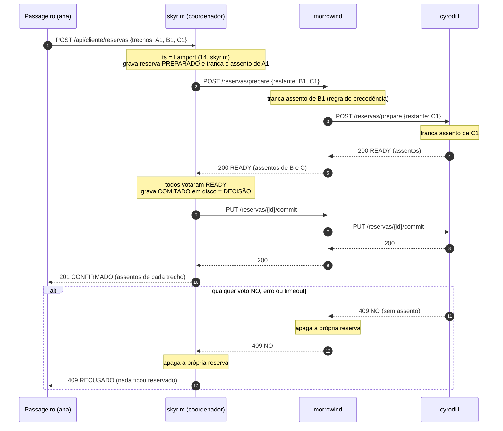

# VaiJunto: Consórcio de Caronas

Servidor P2P em C para o consórcio de caronas compartilhadas (Problema 2, TEC502).
Cada servidor representa uma região do mapa de Tamriel, guarda os próprios dados em disco, além de enviar e receber requisições somente dos vizinhos de fronteira por uma API REST, sem servidor central.

> **Estado atual:** API REST completa (busca distribuída de itinerários, reserva atômica por commit em duas fases,
> precedência por relógio de Lamport e recuperação de falhas) e persistência em três pastas por servidor.
> Ainda faltam o simulador de carga, o teste automatizado completo com injeção de falhas e o relatório (veja [O que falta](#o-que-falta)).

## Requisitos

```bash
sudo apt install build-essential libmicrohttpd-dev libcurl4-openssl-dev
```

## Compilar

```bash
make clean && make
```

## Rodar

O programa recebe a região como argumento (e, opcionalmente, a porta). Sem argumentos, lista as regiões válidas.

| Região | Porta | Vizinhos |
|---|---|---|
| skyrim | 3001 | high_rock, hammerfell, cyrodiil, morrowind |
| morrowind | 3002 | skyrim, cyrodiil, black_marsh |
| cyrodiil | 3003 | skyrim, hammerfell, morrowind, black_marsh, elsweyr, valenwood, summerset_islands |
| high_rock | 3004 | skyrim, hammerfell |
| hammerfell | 3005 | high_rock, skyrim, cyrodiil, valenwood, summerset_islands |
| black_marsh | 3006 | morrowind, cyrodiil, elsweyr |
| elsweyr | 3007 | valenwood, cyrodiil, black_marsh |
| valenwood | 3008 | elsweyr, cyrodiil, hammerfell, summerset_islands |
| summerset_islands | 3009 | hammerfell, cyrodiil, valenwood |

Os vizinhos são procurados em `localhost` por padrão. Para apontar um vizinho para outra máquina ou container,
use a variável `HOST_<REGIAO>` (nome da região em maiúsculas, com `_`), por exemplo
`HOST_SKYRIM`, `HOST_HIGH_ROCK`, `HOST_SUMMERSET_ISLANDS`. A porta de cada vizinho é sempre a padrão da tabela.

### Cenário 1: uma máquina (vários terminais)

Todos os servidores rodam na mesma máquina e se encontram por `localhost`. Não precisa configurar nada.

```bash
make clean && make

# um terminal por servidor
./servidor skyrim          # porta 3001
./servidor morrowind       # porta 3002
./servidor cyrodiil        # porta 3003
```

Para testar, use o menu de qualquer terminal (opção 2 = `health` de todos os vizinhos) ou `curl`
(veja [Testes rápidos com curl](#testes-rápidos-com-curl)).

Só sobem os servidores que você iniciar. Os vizinhos que não estiverem rodando aparecem como
`FALHOU ... [TIMEOUT]`, o que também serve como teste de falha.

### Cenário 2: uma máquina com Docker Compose

O `docker-compose.yml` sobe `skyrim`, `morrowind` e `cyrodiil` em uma rede interna (`tamriel_net`).
Dentro dessa rede os containers se enxergam pelo **nome do serviço**, então é preciso dizer isso ao
servidor com as variáveis `HOST_*`. Use este `docker-compose.yml`:

```yaml
x-hosts: &hosts
  HOST_SKYRIM: ${HOST_SKYRIM:-skyrim}
  HOST_MORROWIND: ${HOST_MORROWIND:-morrowind}
  HOST_CYRODIIL: ${HOST_CYRODIIL:-cyrodiil}

services:
  skyrim:
    build: .
    container_name: skyrim
    ports:
      - "3001:3001"
    command: ["./servidor", "skyrim"]
    environment: *hosts
    stdin_open: true      # para usar o menu com docker attach
    tty: true
    volumes:
      - ./data/skyrim:/app/json
    networks:
      - tamriel_net

  morrowind:
    build: .
    container_name: morrowind
    ports:
      - "3002:3002"
    command: ["./servidor", "morrowind"]
    environment: *hosts
    stdin_open: true
    tty: true
    volumes:
      - ./data/morrowind:/app/json
    networks:
      - tamriel_net

  cyrodiil:
    build: .
    container_name: cyrodiil
    ports:
      - "3003:3003"
    command: ["./servidor", "cyrodiil"]
    environment: *hosts
    stdin_open: true
    tty: true
    volumes:
      - ./data/cyrodiil:/app/json
    networks:
      - tamriel_net

networks:
  tamriel_net:
    driver: bridge
```

```bash
docker compose up --build -d     # sobe os três
docker compose logs -f skyrim    # acompanha os logs de um servidor
docker attach skyrim             # abre o menu de testes (sair sem parar: Ctrl+P, Ctrl+Q)
docker compose down              # derruba tudo
```

Os volumes em `./data/<regiao>` mantêm o `json/` entre execuções. Sem eles, as reservas somem quando o container é recriado.
Também dá para testar de fora com `curl localhost:3001/api/consorcio/health`.

Para simular a queda de um servidor: `docker compose stop morrowind` (e `docker compose start morrowind` para voltar).

### Cenário 3: duas máquinas

Exemplo: a **máquina A** roda `skyrim` e a **máquina B** roda `morrowind`. Cada máquina precisa
saber o IP da outra e ter a porta liberada.

**1. Em ambas:** clone o projeto, instale as dependências e compile (`make clean && make`).

**2. Descubra o IP de cada máquina** (as duas devem estar na mesma rede ou se alcançar por IP):

```bash
hostname -I        # ex.: A = 192.168.0.10, B = 192.168.0.20
```

**3. Libere a porta do servidor no firewall** (se houver firewall ativo):

```bash
sudo ufw allow 3001/tcp     # na máquina A (skyrim)
sudo ufw allow 3002/tcp     # na máquina B (morrowind)
```

**4. Suba cada servidor, apontando o vizinho para o IP da outra máquina:**

```bash
# máquina A (192.168.0.10)
HOST_MORROWIND=192.168.0.20 ./servidor skyrim

# máquina B (192.168.0.20)
HOST_SKYRIM=192.168.0.10 ./servidor morrowind
```

**5. Teste a comunicação.** No menu, opção 1 (`health` de um vizinho) e escolha o vizinho remoto,
ou de fora do servidor:

```bash
# da máquina A, falando com B
curl -i 192.168.0.20:3002/api/consorcio/health
```

Se aparecer `FALHOU ... [TIMEOUT]`, confira o IP, o firewall e se o outro servidor está rodando.

**Mais de dois servidores:** cada máquina pode rodar vários servidores. Basta que, em cada processo,
todo vizinho que estiver em *outra* máquina tenha seu `HOST_<REGIAO>` definido. Por exemplo, com A rodando
`skyrim` e `cyrodiil`, e B rodando `morrowind`:

```bash
# máquina A (192.168.0.10), um terminal por servidor
HOST_MORROWIND=192.168.0.20 ./servidor skyrim
HOST_MORROWIND=192.168.0.20 ./servidor cyrodiil

# máquina B (192.168.0.20)
HOST_SKYRIM=192.168.0.10 HOST_CYRODIIL=192.168.0.10 ./servidor morrowind
```

Entre `skyrim` e `cyrodiil`, que estão na mesma máquina, o padrão `localhost` já funciona.

**Duas máquinas com Docker:** em cada máquina suba só os serviços que ficam nela e passe o IP da outra
pela variável de ambiente (o `${HOST_...:-padrão}` do compose usa o valor do shell):

```bash
# máquina A
HOST_MORROWIND=192.168.0.20 docker compose up --build -d skyrim

# máquina B
HOST_SKYRIM=192.168.0.10 docker compose up --build -d morrowind
```

As portas `3001`, `3002` e `3003` já são publicadas pelo compose, então o outro lado acessa por `IP_DA_MAQUINA:PORTA`.
O firewall do passo 3 continua valendo.

## Estrutura

```
main.c                 inicialização
Makefile               compila o binário `servidor`
Dockerfile             imagem Ubuntu 22.04 com as dependências
docker-compose.yml     skyrim, morrowind e cyrodiil em uma rede interna
cliServidor/
  cli.*                menu de texto para testes
http/
  httpServidor.*       rotas /api/consorcio e /api/cliente (libmicrohttpd)
  httpCliente.*        chamadas aos vizinhos (libcurl, timeouts, detector de falhas)
consorcio/
  cadastro.*           usuários e caronas (API do cliente)
  busca.*              busca recursiva de itinerários entre empresas
  transacao.*          2PC: coordenador, participante em cadeia e recuperação
util/
  configuracoes.*      regiões, portas e fronteiras
  lamport.*            relógio lógico de Lamport (thread-safe)
  persistencia.*       armazenamento em json/<servidor>/{usuarios,caronas,reservas}/
  json.*               parser JSON (árvore em memória)
  util.*               buffer de texto, UUID, validação de ids
testes/
  concorrencia.py      disputa simultânea por assentos (veja "Testes")
```

## Modelo

- **Carona** = um trecho `origem -> destino` com N assentos, publicada em **um** servidor (a empresa do motorista),
  que é a única dona dos assentos dela.
- **Itinerário** = sequência de caronas (de empresas diferentes) em que o destino de uma é a origem da seguinte.
- O passageiro fala **somente com o servidor da própria empresa**, que vira o **coordenador** daquela reserva.
  Não há coordenador fixo: cada transação tem o seu.
- Os servidores só conversam com vizinhos de fronteira (tabela de regiões acima).

## API do cliente (passageiro/motorista → servidor da própria empresa)

Prefixo: `/api/cliente`. Corpos em JSON.

| Método e rota | Função | Respostas |
|---|---|---|
| `POST /usuarios` | cadastra `{id, nome, tipo}`; tipo = `motorista` ou `passageiro` | 201, 400, 409 (já existe), 500 |
| `GET /usuarios` | lista os usuários deste servidor | 200 |
| `POST /caronas` | publica `{motorista, origem, destino, horario, preco, assentos}` | 201, 400, 403 (não é motorista), 404 (motorista inexistente), 500 |
| `GET /caronas` | lista as caronas daqui com `assentos_livres` | 200 |
| `GET /itinerarios?origem=&destino=` | busca distribuída (consulta os vizinhos) | 200, 400 |
| `POST /reservas` | reserva um itinerário: `{passageiro, trechos:[{servidor, id_carona}]}` (2PC) | 201 CONFIRMADO, 400, 403, 404, 409, 502, 500 |
| `GET /reservas?passageiro=` | reservas em que este servidor é o coordenador | 200 |

Resposta de `POST /reservas` (201):

```json
{
  "id_transacao": "567d6271-0f4d-474e-8faa-abbf42abed7c",
  "status": "CONFIRMADO",
  "passageiro": "ana",
  "relogio_logico": 26,
  "propagacao_pendente": false,
  "trechos": [
    {"servidor": "skyrim",    "id_carona": "skyrim-3a43db7b",    "assento": 1},
    {"servidor": "morrowind", "id_carona": "morrowind-aad879a0", "assento": 1},
    {"servidor": "cyrodiil",  "id_carona": "cyrodiil-f21542c0",  "assento": 1}
  ]
}
```

Recusa (409 sem assento, 404 carona inexistente, 502 servidor da cadeia indisponível), sem nada reservado:

```json
{"status": "RECUSADO", "motivo": "sem assento disponivel na carona cyrodiil-f21542c0 (cyrodiil)"}
```

`propagacao_pendente: true` significa que a decisão foi **COMMIT** (já gravada em disco), mas algum participante estava fora
do ar na hora de receber o aviso; ele conclui sozinho ao voltar (veja [Recuperação](#recuperação-de-falhas)).

A cadeia do `POST /reservas` precisa seguir fronteiras: `eu -> g1 -> g2 -> ...`, com os trechos deste servidor primeiro,
cada servidor aparecendo em um único bloco consecutivo. Caso contrário a resposta é 400.

## API entre servidores (consórcio)

Prefixo: `/api/consorcio`.

**Cabeçalhos.** Toda requisição leva `X-Server-Id` (quem envia) e `X-Lamport-Clock`; requisições com corpo levam
`Content-Type: application/json`, e todas levam `Accept: application/json`. Toda resposta devolve `Content-Type: application/json`,
`X-Server-Id` e `X-Lamport-Clock`. Quem recebe atualiza o relógio com `max(local, recebido) + 1`.

| Método e rota | Função | Respostas |
|---|---|---|
| `GET /health` | detecção de falha | 200 |
| `GET /trechos?origem=&destino=&visitados=a,b` | itinerários cujo 1º trecho é uma carona deste servidor | 200, 400 |
| `GET /reservas` | reservas guardadas neste servidor | 200 |
| `POST /reservas/prepare` | fase 1: tranca assentos, repassa à cadeia e vota | 200 READY, 400, 404, 409, 500, 502 |
| `PUT /reservas/{id}/commit` | fase 2: confirma e repassa à cadeia | 200, 404, 500 |
| `DELETE /reservas/{id}` | rollback: apaga a reserva e repassa à cadeia (idempotente) | 200, 409 (já COMITADA), 500 |
| `GET /reservas/{id}/status` | estado da transação (usado na recuperação) | 200, 404 |

### `GET /trechos`

Resposta 200 (`visitados` evita voltar a servidores já percorridos; quem pergunta se inclui na lista):

```json
{
  "servidor": "morrowind",
  "total": 1,
  "itinerarios": [{
    "itinerario_id": "morrowind-1",
    "preco_total": 75.00,
    "trechos": [
      {"servidor": "morrowind", "id_carona": "morrowind-aad879a0", "origem": "Windhelm", "destino": "Mournhold",
       "horario": "10:00", "preco": 30.00, "assentos_livres": 2},
      {"servidor": "cyrodiil", "id_carona": "cyrodiil-f21542c0", "origem": "Mournhold", "destino": "Imperial City",
       "horario": "13:00", "preco": 45.00, "assentos_livres": 1}
    ]
  }]
}
```

### `POST /reservas/prepare`

`trechos_solicitados` é o que **resta** percorrer. O servidor que recebe trata os trechos que são dele (que vêm primeiro)
e repassa o resto ao próximo servidor, que precisa ser seu vizinho.

```json
{
  "id_transacao": "uuid",
  "coordenador_id": "skyrim",
  "passageiro": "ana",
  "relogio_logico": 14,
  "trechos_solicitados": [
    {"servidor": "morrowind", "id_carona": "morrowind-aad879a0"},
    {"servidor": "cyrodiil",  "id_carona": "cyrodiil-f21542c0"}
  ]
}
```

| Código | Significado | Corpo |
|---|---|---|
| 200 | **READY**: este servidor e todos adiante votaram sim | `{"id_transacao", "status": "READY", "servidor", "assentos": [{"servidor", "id_carona", "assento"}]}` |
| 400 | corpo inválido, id inseguro, 1º trecho não é deste servidor, próximo não é vizinho | `{"erro": "..."}` |
| 404 | carona inexistente | `{"id_transacao", "status": "NO", "servidor", "motivo"}` |
| 409 | sem assento disponível | idem |
| 502 | alguém adiante na cadeia não respondeu (o `motivo` diz quem) | idem |
| 500 | falha ao gravar em disco | idem |

Reenviar o mesmo `prepare` é idempotente: devolve READY sem ocupar outro assento.

### `PUT /reservas/{id}/commit` e `DELETE /reservas/{id}`

- `commit` → 200 `{"id_transacao", "mensagem", "propagacao_pendente"}`; 404 se nunca houve `prepare`.
- `DELETE` → 200 sempre que a reserva não está COMITADA (apagar algo que não existe também dá 200); **409** se já está
  COMITADA, para que um aborto atrasado nunca desfaça uma transação confirmada.

### `GET /reservas/{id}/status`

200 `{"id_transacao", "status": "PREPARADO" | "COMITADO", "coordenador_id"}` ou 404 (desconhecida ou abortada).

## Diagrama de sequência: reserva com trechos de três empresas



Cada servidor grava quem veio antes (`anterior`) e quem vem depois (`proximo`) na cadeia; é assim que commit e
rollback percorrem o mesmo caminho sem o coordenador precisar falar com todo mundo.

## Como os requisitos são atendidos

**1. Atomicidade.** Commit em duas fases implementado nos próprios servidores. O ponto de não retorno é gravar `COMITADO`
no disco do coordenador. Antes dele, qualquer NO, erro ou timeout aborta tudo (cada servidor que já tinha votado apaga a sua
reserva). Depois dele, a transação sempre termina em commit, mesmo que alguém esteja fora do ar agora.

**2. Um assento, um passageiro.** Cada carona pertence a um único servidor. Nele, "ver se há assento livre + ocupar +
gravar em disco" é uma operação indivisível (uma trava única na persistência), então duas requisições simultâneas nunca
recebem o mesmo assento, vindas de onde vierem. Os assentos têm número (1..N) e são gravados na reserva.

**3. Precedência em disputas.** Cada transação nasce com um carimbo `(relogio_logico, coordenador_id, id_transacao)`
tirado do relógio de Lamport do coordenador. Ele define uma **ordem total** que respeita causalidade e não depende de
relógios de parede sincronizados nem da ordem de chegada das mensagens (que atrasos podem trocar). Quando uma transação
encontra todos os assentos de uma carona presos por transações ainda não decididas, vale a regra *wait-die*:

- se ela é **mais antiga** que todas as que seguram o assento, **espera** (até `ESPERA_MAX_MS` = 800 ms) a decisão delas;
- se é **mais nova** que alguma, **recusa na hora** (voto NO).

Quem espera é sempre mais antigo que quem é esperado, então não existe ciclo de espera: **não há deadlock**, nem mesmo
quando duas reservas travam as mesmas caronas em ordem oposta (A: skyrim→morrowind, B: morrowind→skyrim). A mais antiga
leva a vantagem quando a outra aborta; se a outra confirmar primeiro, a mais antiga recebe NO, porque um voto READY já
dado nunca é retirado (retirar quebraria o 2PC). Em qualquer caso o assento nunca é confirmado duas vezes.

**4. Falhas.** Veja a seção abaixo.

## Recuperação de falhas

- **Detecção:** timeout de requisição (3 s, escalonado pela cadeia no `prepare`) e de conexão (1,5 s). Um vizinho que falha
  fica "suspeito" por 5 s: a busca de itinerários o pula (responde em dezenas de ms em vez de esperar timeout) e o 2PC
  continua tentando. As demais empresas seguem operando normalmente para o que não depende dele.
- **Gravação:** toda reserva é gravada (arquivo temporário + `fsync` + `rename`) **antes** de responder. Ao reiniciar, o servidor
  recarrega tudo e o relógio de Lamport recomeça do maior valor visto.
- **Thread de recuperação** (a cada 2 s), para reservas `PREPARADO` que ninguém está conduzindo e com mais de 5 s:
  - *sou o coordenador*: não existe decisão COMMIT gravada, então **aborta** (presumed abort) e repassa o rollback;
  - *sou participante*: pergunta o `status` a quem me mandou o `prepare`:
    `COMITADO` → confirma aqui e repassa; `404` → aborta aqui e repassa; sem resposta ou ainda `PREPARADO` → tenta de novo.

Resultados verificados nos testes: participante caído no meio da cadeia (recusa limpa, nada preso); participante **travado**
com `SIGSTOP` (timeout, nada preso); coordenador morto **antes** da decisão (assentos presos só até ele voltar, depois liberados);
coordenador morto **depois** da decisão (participantes convergem para `COMITADO`). Limitação inerente ao 2PC: enquanto quem
decide está fora do ar, os assentos *daquela* transação ficam bloqueados até ele voltar.

### Injeção de falha (para testes)

A variável `INJETAR_FALHA` faz o coordenador encerrar o processo de forma abrupta (como uma queda real):

```bash
INJETAR_FALHA=antes_decisao  ./servidor skyrim   # morre depois de todos votarem READY, antes de gravar o COMMIT
INJETAR_FALHA=depois_decisao ./servidor skyrim   # morre depois de gravar o COMMIT, antes de avisar os participantes
```

Reinicie sem a variável e acompanhe o log (`[RECUPERACAO] ...`) para ver a convergência.

## Persistência

Cada servidor tem três pastas, **um arquivo JSON por registro**, e nada é compartilhado entre empresas:

```
json/<servidor>/
  usuarios/<id>.json          motoristas e passageiros cadastrados nesta empresa
  caronas/<id>.json           caronas publicadas aqui (dados fixos; os assentos livres são calculados)
  reservas/<id_transacao>.json   participação deste servidor em cada transação
```

Exemplo de `reservas/<id>.json` (em morrowind, no meio da cadeia skyrim → morrowind → cyrodiil):

```json
{"id_transacao": "567d6271-...", "estado": "COMITADO", "coordenador_id": "skyrim",
 "anterior": "skyrim", "proximo": "cyrodiil", "passageiro": "ana", "relogio_logico": 26, "criado_em": 1792183577,
 "trechos": [{"servidor": "morrowind", "id_carona": "morrowind-aad879a0", "assento": 1}], "itinerario": []}
```

`trechos` são os assentos que pertencem **a este servidor**; `itinerario` só é preenchido no coordenador. Uma reserva abortada
é simplesmente apagada. Em Docker, monte `json/` como volume (já feito no `docker-compose.yml` acima).

## Menu de testes

Ao iniciar, cada servidor abre um menu no terminal. As opções 1-8 chamam a API entre servidores; as 10-14 operam no
próprio servidor com a mesma lógica da API do cliente.

| Opção | Ação |
|---|---|
| 1 | `GET /health` de um vizinho |
| 2 | `GET /health` de todos os vizinhos |
| 3 | `GET /trechos` |
| 4 | `POST /reservas/prepare` (vazio gera UUID; precisa de uma carona existente no vizinho) |
| 5 | `PUT /reservas/{id}/commit` |
| 6 | `DELETE /reservas/{id}` |
| 7 | `GET /reservas/{id}/status` |
| 8 | `GET /reservas` de um vizinho |
| 9 | ver as reservas guardadas neste servidor |
| 10 | cadastrar usuário |
| 11 | publicar carona |
| 12 | listar usuários e caronas |
| 13 | buscar itinerários (distribuído) |
| 14 | reservar itinerário (este servidor coordena) |
| 0 | sair |

Em Docker, `docker attach <servidor>` abre esse menu.

## Exemplo completo com curl

Três servidores locais (`skyrim`, `morrowind`, `cyrodiil`), um itinerário Whiterun → Imperial City que usa as três empresas:

```bash
S=localhost:3001/api/cliente; M=localhost:3002/api/cliente; C=localhost:3003/api/cliente

# usuários (cada um no servidor da sua empresa)
curl -X POST $S/usuarios -d '{"id":"ana","nome":"Ana","tipo":"passageiro"}'
curl -X POST $S/usuarios -d '{"id":"mot-s","nome":"Motorista","tipo":"motorista"}'
curl -X POST $M/usuarios -d '{"id":"mot-m","nome":"Motorista","tipo":"motorista"}'
curl -X POST $C/usuarios -d '{"id":"mot-c","nome":"Motorista","tipo":"motorista"}'

# caronas (a resposta traz o "id" de cada uma)
curl -X POST $S/caronas -d '{"motorista":"mot-s","origem":"Whiterun","destino":"Windhelm","horario":"08:00","preco":20,"assentos":2}'
curl -X POST $M/caronas -d '{"motorista":"mot-m","origem":"Windhelm","destino":"Mournhold","horario":"10:00","preco":30,"assentos":2}'
curl -X POST $C/caronas -d '{"motorista":"mot-c","origem":"Mournhold","destino":"Imperial City","horario":"13:00","preco":45,"assentos":1}'

# a ana (de skyrim) busca e reserva
curl "$S/itinerarios?origem=Whiterun&destino=Imperial%20City"
curl -X POST $S/reservas -d '{"passageiro":"ana","trechos":[
  {"servidor":"skyrim","id_carona":"<id-skyrim>"},
  {"servidor":"morrowind","id_carona":"<id-morrowind>"},
  {"servidor":"cyrodiil","id_carona":"<id-cyrodiil>"}]}'

# conferir em cada servidor
curl localhost:3001/api/consorcio/reservas
curl localhost:3002/api/consorcio/reservas
curl localhost:3003/api/consorcio/reservas

# headers do relógio de Lamport
curl -i -H "X-Server-Id: teste" -H "X-Lamport-Clock: 50" localhost:3001/api/consorcio/health
```

Teste de falha: dê `Ctrl+C` em um servidor e tente reservar um itinerário que passe por ele: a resposta é `RECUSADO` (502) e os
assentos dos outros servidores voltam a ficar livres. Para simular um servidor travado:
`pkill -STOP -f "servidor morrowind"` e depois `pkill -CONT -f "servidor morrowind"`.

## Testes

`testes/concorrencia.py` precisa de `skyrim`, `morrowind` e `cyrodiil` rodando em localhost. Para cada rodada ele cria caronas
novas com **um único assento** e dispara reservas simultâneas por coordenadores diferentes:

```bash
python3 testes/concorrencia.py 20      # 20 rodadas de cada cenário
```

Cenários: (`unico`) três coordenadores disputam o último assento da mesma carona; (`cruzado`) duas reservas travam as mesmas
duas caronas em ordem oposta; (`sobreposto`) quatro reservas com cadeias que se sobrepõem. Ao fim de cada rodada ele audita:
nenhum assento duplicado, nenhum overbooking, nenhuma reserva `PREPARADO` sobrando e nenhuma reserva confirmada pela metade.
Resultado esperado: `confirmadas_por_rodada={1: N}` e `violacoes=0`.

## O que falta

- Simulador de passageiros com carga alta e contínua (geração autônoma de buscas e reservas)
- Teste automatizado completo que combine carga **e** injeção de falhas (derrubar/travar servidores durante a carga e checar as
  três invariantes depois da recuperação); o `concorrencia.py` e o `INJETAR_FALHA` são a base
- Cancelamento de reserva confirmada (hoje uma reserva COMITADA é definitiva)
- Relatório no formato SBC e comparação com a arquitetura centralizada do Problema 1
