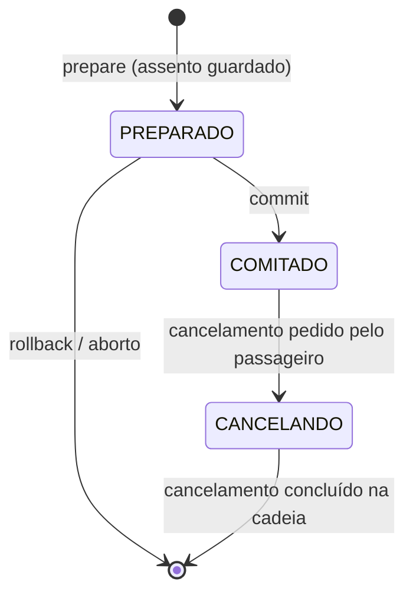
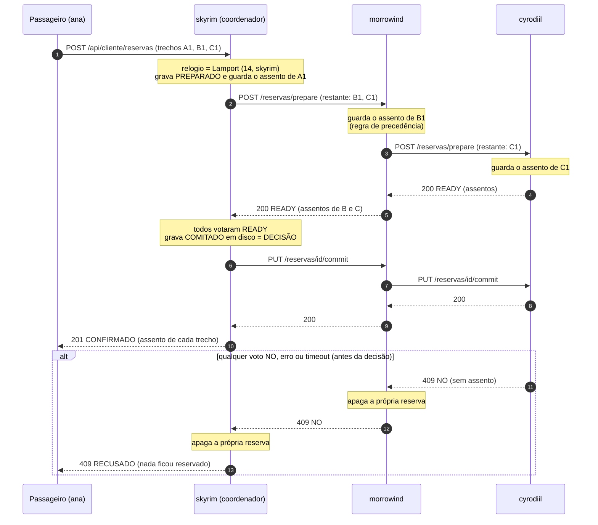
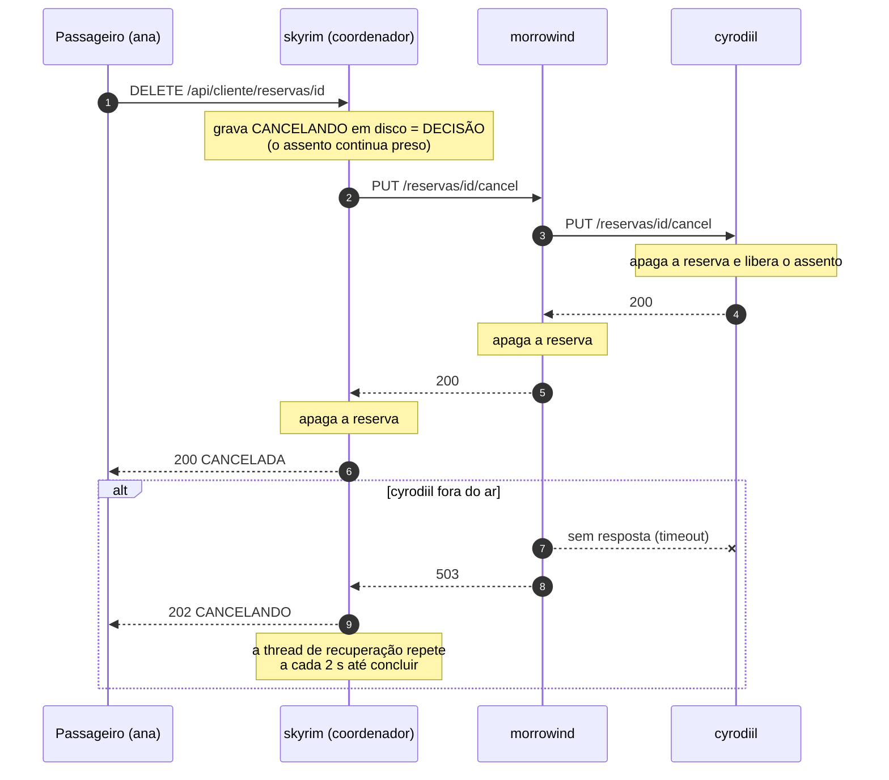
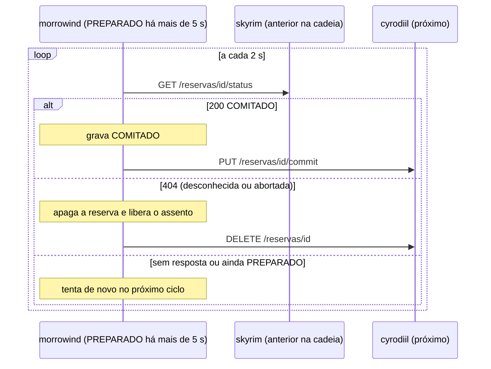

# VaiJunto: Consórcio de Caronas

Servidor P2P em C para o consórcio de caronas compartilhadas (Problema 2, TEC502).
Cada servidor representa uma empresa (uma região do mapa de Tamriel), guarda os próprios dados em disco e conversa
somente com os vizinhos de fronteira por uma API REST. Não existe servidor central, coordenador fixo nem armazenamento compartilhado.

> **Estado atual:** busca distribuída de itinerários, reserva atômica por commit em duas fases (2PC) em cadeia,
> precedência por relógio de Lamport (*wait-die*), cancelamento de reservas, autenticação com senha e recuperação de falhas.
> Ainda faltam o simulador de carga, o teste automatizado combinando carga e falhas e o relatório em PDF no formato SBC (veja [O que falta](#o-que-falta)).

## Sumário

1. [Requisitos e compilação](#requisitos-e-compilação)
2. [Como rodar](#como-rodar)
3. [Estrutura do projeto](#estrutura-do-projeto)
4. [Modelo de dados](#modelo-de-dados)
5. [API do cliente](#api-do-cliente-passageiro-e-motorista)
6. [API entre servidores (consórcio)](#api-entre-servidores-consórcio)
7. [Diagramas de sequência](#diagramas-de-sequência)
8. [Recuperação de falhas](#recuperação-de-falhas)
9. [Persistência](#persistência)
10. [Menu de testes e cliente de terminal](#menu-de-testes-e-cliente-de-terminal)
11. [Exemplo completo com curl](#exemplo-completo-com-curl)
12. [Testes](#testes)
13. [Relatório técnico](#relatório-técnico)
14. [O que falta](#o-que-falta)

---

## Requisitos e compilação

```bash
sudo apt install build-essential libmicrohttpd-dev libcurl4-openssl-dev libssl-dev
make clean && make
```

O `make` gera dois binários:

| Binário | Função |
|---|---|
| `servidor` | servidor de uma empresa do consórcio |
| `cliente` | cliente de terminal para passageiros e motoristas (fala só com o servidor da própria empresa) |

## Como rodar

O servidor recebe a região como argumento e, opcionalmente, a porta. Sem argumentos, lista as regiões válidas.

| Região | Porta | Vizinhos |
|---|---|---|
| skyrim | 3001 | high_rock, hammerfell, cyrodiil, morrowind |
| morrowind | 3002 | skyrim, cyrodiil, black_marsh |
| cyrodiil | 3003 | skyrim, hammerfell, morrowind, black_marsh, elsweyr, valenwood, summerset_islands |
| high_rock | 3004 | skyrim, hammerfell |
| hammerfell | 3005 | high_rock, skyrim, cyrodiil, valenwood, summerset_islands |
| black_marsh | 3006 | morrowind, cyrodiil, elsweyr |
| elsweyr | 3007 | valenwood, cyrodiil, black_marsh |
| valenwood | 3008 | elsweyr, cyrodiil, hammerfell, summerset_islands |
| summerset_islands | 3009 | hammerfell, cyrodiil, valenwood |

Os vizinhos são procurados em `localhost` por padrão. Para apontar um vizinho para outra máquina ou contêiner, use a
variável `HOST_<REGIAO>` (nome em maiúsculas, com `_`): `HOST_SKYRIM`, `HOST_HIGH_ROCK`, `HOST_SUMMERSET_ISLANDS`...
A porta de cada vizinho é sempre a padrão da tabela.

### Cenário 1: uma máquina (vários terminais)

```bash
./servidor skyrim          # porta 3001
./servidor morrowind       # porta 3002
./servidor cyrodiil        # porta 3003
```

Só sobem os servidores que você iniciar. Vizinhos que não estiverem rodando aparecem como `FALHOU ... [TIMEOUT]`,
o que também serve como teste de falha.

### Cenário 2: uma máquina com Docker Compose

O `docker-compose.yml` define **um serviço por região** (nove) em uma rede interna `tamriel_net`, onde os contêineres se
enxergam pelo nome do serviço (as variáveis `HOST_*` já têm esse padrão). Suba só os que quiser:

```bash
docker compose up --build -d skyrim morrowind cyrodiil   # sobe os três
docker compose logs -f skyrim                            # acompanha os logs
docker attach skyrim                                     # abre o menu do servidor (sair: Ctrl+P, Ctrl+Q)
docker compose stop morrowind                            # simula a queda de uma empresa
docker compose start morrowind                           # ela volta e se recupera
docker compose down                                      # derruba tudo
```

Os volumes `./data/<regiao>:/app/json` mantêm o armazenamento entre execuções. Sem eles, as reservas somem quando o
contêiner é recriado e o consórcio fica inconsistente.

### Cenário 3: várias máquinas (um contêiner por computador)

Cada empresa roda no seu computador e precisa saber o IP dos vizinhos que estão em outras máquinas.

```bash
# 1. descubra o IP de cada máquina
hostname -I                    # ex.: A = 192.168.0.10, B = 192.168.0.20, C = 192.168.0.30

# 2. libere as portas (se houver firewall)
sudo ufw allow 3001/tcp        # na máquina A (skyrim); 3002 na B; 3003 na C

# 3. em cada máquina, suba só o seu serviço apontando para os vizinhos remotos
HOST_MORROWIND=192.168.0.20 HOST_CYRODIIL=192.168.0.30 docker compose up --build -d skyrim   # máquina A
HOST_SKYRIM=192.168.0.10 HOST_CYRODIIL=192.168.0.30 docker compose up --build -d morrowind   # máquina B
HOST_SKYRIM=192.168.0.10 HOST_MORROWIND=192.168.0.20 docker compose up --build -d cyrodiil   # máquina C

# 4. teste a comunicação
curl -i 192.168.0.20:3002/api/consorcio/health
```

Sem Docker é igual, trocando o `docker compose up` por `./servidor <regiao>`. Se aparecer `FALHOU ... [TIMEOUT]`,
confira o IP, o firewall e se o outro servidor está no ar.

### Cliente de terminal

```bash
./cliente skyrim                       # usa localhost:3001 (ou o host da variável CLIENTE_HOST)
./cliente 192.168.0.10:3001            # endereço explícito
./cliente http://192.168.0.10:3001
```

---

## Estrutura do projeto

```
main.c                 inicialização do servidor
Makefile               gera `servidor` e `cliente`
Dockerfile             imagem Ubuntu 22.04 com as dependências
docker-compose.yml     um serviço por região, rede interna e volumes de dados
headers/               cabeçalhos de todos os módulos (documentados)
cliServidor/
  cli.c                menu de texto do servidor (testes)
cliUsuario/
  terminal.c           cliente interativo de passageiros e motoristas
  apiConsorcio.c       chamadas à API do cliente (libcurl)
http/
  httpServidor.c       rotas /api/consorcio e /api/cliente (libmicrohttpd)
  httpCliente.c        chamadas aos vizinhos (libcurl, timeouts, detector de falhas)
consorcio/
  cadastro.c           usuários e caronas (regras de negócio)
  busca.c              busca distribuída de itinerários entre empresas
  transacao.c          2PC: coordenador, participante em cadeia, cancelamento e recuperação
util/
  configuracoes.c      regiões, portas e fronteiras
  lamport.c            relógio lógico de Lamport (thread-safe)
  persistencia.c       armazenamento em json/<servidor>/{usuarios,caronas,reservas}/
  auth.c               senhas (PBKDF2-HMAC-SHA256) e HTTP Basic
  json.c               parser JSON (árvore em memória)
  util.c               buffer de texto, UUID, validação de ids, tempo
testes/
  concorrencia.py      disputa simultânea por assentos (veja "Testes")
```

---

## Modelo de dados

- **Carona** = uma **rota** de 2 a 10 cidades, publicada em **um** servidor (a empresa do motorista), que é a única dona
  dos assentos dela. Cada **trecho** (cidade i → cidade i+1) tem horário, preço e capacidade (1 a 60 assentos) próprios.
  As cidades de uma rota não se repetem.
- **Reserva de uma faixa:** o passageiro pega uma **faixa** da rota (origem → destino, nomes sem diferenciar maiúsculas).
  O assento escolhido tem o **mesmo número em todos os trechos da faixa** e só fica ocupado nesses trechos, então o mesmo
  assento pode ser vendido para quem viaja antes ou depois.
- **Itinerário** = sequência de faixas de caronas (de empresas diferentes) em que o destino de uma é a origem da seguinte.
  No máximo 8 faixas por transação, uma faixa por carona.
- **Usuário** é cadastrado em **uma** empresa e só fala com o servidor dela. O servidor dele vira o **coordenador** das reservas que ele fizer.
- Os servidores só conversam com **vizinhos de fronteira** (tabela de regiões).

Estados de uma reserva em cada servidor: `PREPARADO` (assento guardado, aguardando decisão), `COMITADO` (confirmada)
e `CANCELANDO` (cancelamento decidido, ainda se propagando). Uma reserva abortada ou cancelada é simplesmente apagada.



---

## API do cliente (passageiro e motorista)

Prefixo: `/api/cliente`. Corpos em JSON. **Tudo exige HTTP Basic** (`Authorization: Basic base64(id:senha)`), exceto `POST /usuarios`.
Credenciais inválidas retornam **401** (com atraso de 0,3 s contra força bruta). Perfil errado para a rota retorna **403**.

| Método e rota | Perfil | Função | Respostas |
|---|---|---|---|
| `POST /usuarios` | público | cadastra `{id, nome, tipo, senha}`; tipo = `motorista` ou `passageiro`; senha de 4 a 72 caracteres | 201, 400, 409 (já existe), 500 |
| `GET /eu` | ambos | dados do usuário logado | 200, 401 |
| `GET /itinerarios?origem=&destino=` | ambos | busca distribuída (consulta os vizinhos) | 200, 400 |
| `POST /rotas` ou `POST /caronas` | motorista | publica uma carona com vários trechos (os dois caminhos fazem o mesmo) | 201, 400, 403, 500 |
| `GET /caronas` | motorista | lista as caronas do motorista com `assentos_livres` | 200 |
| `DELETE /caronas/{id}` | motorista | exclui a carona (só sem reservas) | 200, 400, 403 (de outro motorista), 404, 409 (tem reservas) |
| `POST /reservas` | passageiro | reserva um itinerário (2PC) | 201, 400, 403, 404, 409, 502, 500 |
| `GET /reservas` | passageiro | reservas do passageiro em que este servidor é o coordenador | 200 |
| `DELETE /reservas/{id}` | passageiro | cancela uma reserva confirmada | 200, 202, 404, 409, 500 |

### Cadastro e publicação

`POST /usuarios`

```json
{"id": "ana", "nome": "Ana", "tipo": "passageiro", "senha": "1234"}
```

`POST /rotas` (o motorista vem da autenticação; as cidades saem de `origem`/`destino`, e os trechos devem se encadear):

```json
{"trechos": [
  {"origem": "Whiterun", "destino": "Windhelm",  "horario": "08:00", "preco": 20.00, "assentos": 3},
  {"origem": "Windhelm", "destino": "Riften",     "horario": "10:30", "preco": 15.00, "assentos": 2}
]}
```

Também é aceito o formato simples de rota com duas cidades: `{"origem", "destino", "horario", "preco", "assentos"}`.
Resposta 201 (carona criada; `preco` e `assentos` do topo são a soma e o mínimo dos trechos):

```json
{"id": "skyrim-3a43db7b", "servidor": "skyrim", "motorista": "mot-s",
 "origem": "Whiterun", "destino": "Riften", "horario": "08:00", "preco": 35.00, "assentos": 2, "assentos_livres": 2,
 "cidades": ["Whiterun", "Windhelm", "Riften"],
 "trechos": [{"origem": "Whiterun", "destino": "Windhelm", "horario": "08:00", "preco": 20.00, "assentos": 3, "assentos_livres": 3},
             {"origem": "Windhelm", "destino": "Riften",   "horario": "10:30", "preco": 15.00, "assentos": 2, "assentos_livres": 2}]}
```

### Busca de itinerários

`GET /itinerarios?origem=Whiterun&destino=Imperial%20City` devolve até 30 itinerários com assentos livres em todas as faixas:

```json
{"servidor": "skyrim", "total": 1, "itinerarios": [{
  "itinerario_id": "skyrim-1", "preco_total": 95.00,
  "trechos": [
    {"servidor": "skyrim",    "id_carona": "skyrim-3a43db7b",    "origem": "Whiterun", "destino": "Windhelm",
     "horario": "08:00", "preco": 20.00, "assentos_livres": 2},
    {"servidor": "morrowind", "id_carona": "morrowind-aad879a0", "origem": "Windhelm", "destino": "Mournhold",
     "horario": "10:00", "preco": 30.00, "assentos_livres": 2},
    {"servidor": "cyrodiil",  "id_carona": "cyrodiil-f21542c0",  "origem": "Mournhold", "destino": "Imperial City",
     "horario": "13:00", "preco": 45.00, "assentos_livres": 1}]}]}
```

A busca é uma fotografia: os assentos podem acabar antes da reserva, e aí o `POST /reservas` responde 409.

### Reserva

`POST /reservas` (o passageiro vem da autenticação; basta copiar os trechos do itinerário escolhido):

```json
{"trechos": [
  {"servidor": "skyrim",    "id_carona": "skyrim-3a43db7b",    "origem": "Whiterun",  "destino": "Windhelm"},
  {"servidor": "morrowind", "id_carona": "morrowind-aad879a0", "origem": "Windhelm",  "destino": "Mournhold"},
  {"servidor": "cyrodiil",  "id_carona": "cyrodiil-f21542c0",  "origem": "Mournhold", "destino": "Imperial City"}
]}
```

Regras de validação (400 se violadas): de 1 a 8 trechos; servidores existentes no mapa; sem carona repetida; os trechos de cada servidor
vêm juntos (um único bloco consecutivo); os trechos **deste** servidor, se houver, vêm primeiro; e a sequência de servidores segue as
fronteiras do mapa (`eu → g1 → g2 → ...`, cada um vizinho do anterior).

Resposta **201 CONFIRMADO**:

```json
{"id_transacao": "567d6271-0f4d-474e-8faa-abbf42abed7c", "status": "CONFIRMADO", "passageiro": "ana",
 "relogio_logico": 26, "propagacao_pendente": false,
 "trechos": [
   {"servidor": "skyrim",    "id_carona": "skyrim-3a43db7b",    "origem": "Whiterun",  "destino": "Windhelm",      "assento": 1},
   {"servidor": "morrowind", "id_carona": "morrowind-aad879a0", "origem": "Windhelm",  "destino": "Mournhold",     "assento": 1},
   {"servidor": "cyrodiil",  "id_carona": "cyrodiil-f21542c0",  "origem": "Mournhold", "destino": "Imperial City", "assento": 1}]}
```

Recusa (nada fica reservado em nenhum servidor):

```json
{"status": "RECUSADO", "motivo": "sem assento disponivel na carona cyrodiil-f21542c0 (cyrodiil)"}
```

| Código | Significado |
|---|---|
| 201 | confirmada em todas as empresas |
| 400 | pedido inválido, ou origem/destino fora da rota de uma carona (`RECUSADO`) |
| 403 / 404 | usuário não é passageiro / passageiro ou carona inexistente |
| 409 | sem assento disponível (`RECUSADO`) |
| 502 | alguma empresa da cadeia não respondeu (`RECUSADO`, o `motivo` diz qual) |
| 500 | falha ao gravar em disco |

`propagacao_pendente: true` significa que a decisão foi **COMMIT** (já gravada em disco), mas alguma empresa estava fora do ar
na hora de receber o aviso. Ela conclui sozinha ao voltar (veja [Recuperação de falhas](#recuperação-de-falhas)).

### Listagem e cancelamento

`GET /reservas` devolve `{"servidor", "reservas": [...], "total"}`, cada reserva no formato descrito em [Persistência](#persistência).

`DELETE /reservas/{id}` só funciona no servidor coordenador e para o dono da reserva:

| Código | Corpo | Significado |
|---|---|---|
| 200 | `{"id_transacao", "status": "CANCELADA"}` | cancelada em todas as empresas, assentos liberados |
| 202 | `{"id_transacao", "status": "CANCELANDO", "mensagem"}` | decisão registrada, mas alguma empresa está fora do ar; a recuperação conclui depois |
| 404 | erro | reserva inexistente, de outro passageiro ou de outro coordenador |
| 409 | erro | reserva ainda em andamento (`PREPARADO`); tente de novo em instantes |
| 500 | erro | falha ao gravar o cancelamento em disco |

---

## API entre servidores (consórcio)

Prefixo: `/api/consorcio`. Usada só entre servidores vizinhos.

**Cabeçalhos.** Toda requisição leva `X-Server-Id` (quem envia), `X-Lamport-Clock` e `Accept: application/json`; as que têm corpo levam
`Content-Type: application/json`. Toda resposta devolve `Content-Type: application/json`, `X-Server-Id` e `X-Lamport-Clock`.
Quem recebe atualiza o relógio com `max(local, recebido) + 1`. As respostas também trazem cabeçalhos CORS, e `OPTIONS` responde 200.

| Método e rota | Função | Respostas |
|---|---|---|
| `GET /health` (ou `/vivo`) | detecção de falha | 200 |
| `GET /trechos?origem=&destino=&visitados=a,b` | itinerários cujo 1º trecho é uma carona deste servidor | 200, 400 |
| `GET /reservas` | reservas guardadas neste servidor | 200 |
| `POST /reservas/prepare` | fase 1: tranca assentos, repassa à cadeia e vota | 200 READY, 400, 404, 409, 500, 502 |
| `PUT /reservas/{id}/commit` | fase 2: confirma e repassa à cadeia | 200, 404, 500 |
| `DELETE /reservas/{id}` | rollback: apaga a reserva e repassa à cadeia (idempotente) | 200, 409 (já confirmada), 500 |
| `GET /reservas/{id}/status` | estado da transação (usado na recuperação) | 200, 404 |
| `PUT /reservas/{id}/cancel` | cancela uma reserva confirmada e repassa à cadeia (idempotente) | 200, 503, 404 |

Rotas desconhecidas retornam 404. Identificadores com caracteres fora de letras, números, `-`, `_` e `.` são rejeitados.

### `GET /health`

```json
{"status": "skyrim ta on", "relogio": 42}
```

### `GET /trechos`

Devolve os itinerários que **começam** com uma carona deste servidor em `origem` e chegam a `destino`, podendo continuar em outras empresas.
`visitados` lista os servidores já percorridos (quem pergunta se inclui), evitando ciclos. O formato da resposta é o mesmo do
`GET /itinerarios` do cliente (veja acima).

### `POST /reservas/prepare`

`trechos_solicitados` é o que **resta** percorrer. Quem recebe trata os trechos que são dele (que vêm primeiro) e repassa o resto
ao próximo servidor, que precisa ser seu vizinho.

```json
{"id_transacao": "567d6271-0f4d-474e-8faa-abbf42abed7c", "coordenador_id": "skyrim", "passageiro": "ana", "relogio_logico": 14,
 "trechos_solicitados": [
   {"servidor": "morrowind", "id_carona": "morrowind-aad879a0", "origem": "Windhelm",  "destino": "Mournhold"},
   {"servidor": "cyrodiil",  "id_carona": "cyrodiil-f21542c0",  "origem": "Mournhold", "destino": "Imperial City"}]}
```

| Código | Significado | Corpo |
|---|---|---|
| 200 | **READY**: este servidor e todos adiante votaram sim | `{"id_transacao", "status": "READY", "servidor", "assentos": [{"servidor", "id_carona", "origem", "destino", "assento"}]}` |
| 400 | corpo inválido, id inseguro, 1º trecho não é deste servidor, servidor repetido na cadeia, próximo não é vizinho, ou origem/destino fora da rota da carona | `{"erro"}` ou `{"id_transacao", "status": "NO", "servidor", "motivo"}` |
| 404 | carona inexistente neste servidor | `{"id_transacao", "status": "NO", "servidor", "motivo"}` |
| 409 | sem assento disponível | idem |
| 502 | alguém adiante na cadeia não respondeu (o `motivo` diz quem) | idem |
| 500 | falha ao gravar em disco | idem |

Reenviar o mesmo `prepare` é **idempotente**: devolve READY sem ocupar outro assento. Se algo falha adiante na cadeia, este
servidor apaga a própria reserva antes de responder NO.

### `PUT /reservas/{id}/commit`

200 `{"id_transacao", "mensagem", "propagacao_pendente"}`. 404 se nunca houve `prepare`. Grava `COMITADO` e repassa ao próximo.

### `DELETE /reservas/{id}` (rollback)

200 sempre que a reserva não está confirmada (apagar algo que não existe também dá 200). **409** se já está `COMITADO` ou `CANCELANDO`,
para que um aborto atrasado nunca desfaça uma transação confirmada.

### `GET /reservas/{id}/status`

200 `{"id_transacao", "status": "PREPARADO" | "COMITADO" | "CANCELANDO", "coordenador_id"}` ou 404 (desconhecida ou abortada).

### `PUT /reservas/{id}/cancel`

Repassa o cancelamento adiante **primeiro** e só então apaga a cópia local, então os assentos são liberados do fim da cadeia para o começo.
200 `{"id_transacao", "mensagem"}` (também se a reserva já não existe aqui). **503** se não conseguiu concluir adiante; quem chamou tenta de novo.

### Tempos limite

| Constante | Valor | Uso |
|---|---|---|
| `TIMEOUT_CONEXAO` | 1,5 s | estabelecer a conexão com um vizinho |
| `TIMEOUT_REQUISICAO` | 3 s | requisição comum |
| `prepare` | (3 s + 0,8 s) × servidores restantes | a chamada é encadeada, então o prazo cresce com a cadeia |
| cancelamento | 8 s | propaga pela cadeia inteira |
| `ESPERA_MAX_MS` | 0,8 s | espera máxima por um assento disputado |
| `SUSPEITA_MS` | 5 s | quanto tempo um vizinho sem resposta fica "suspeito" |
| `TIMEOUT_PREPARADO_S` | 5 s | idade mínima de uma reserva `PREPARADO` para a recuperação agir |
| `INTERVALO_RECUPERACAO_S` | 2 s | intervalo entre ciclos da thread de recuperação |

---

## Diagramas de sequência

### Reserva com trechos de três empresas



Cada servidor grava quem veio antes (`anterior`) e quem vem depois (`proximo`) na cadeia. Assim commit, rollback e cancelamento
percorrem o mesmo caminho sem o coordenador falar com todo mundo, e cada participante sabe a quem perguntar se o aviso não chegar.

### Cancelamento de uma reserva confirmada



### Recuperação de um participante sem decisão



---

## Recuperação de falhas

- **Detecção:** timeouts de conexão e de requisição. Um vizinho que falha fica "suspeito" por 5 s: a busca de itinerários o pula
  (responde em dezenas de milissegundos em vez de esperar o timeout) e o 2PC continua tentando. As demais empresas seguem
  operando normalmente para tudo que não depende dele.
- **Gravação:** toda reserva é gravada (arquivo temporário + `fsync` + `rename`) **antes** de responder. Ao reiniciar, o servidor recarrega
  tudo e o relógio de Lamport recomeça do maior valor visto nas reservas.
- **Thread de recuperação** (a cada 2 s):
  - reservas `PREPARADO` que ninguém está conduzindo e com mais de 5 s:
    - *sou o coordenador:* não existe decisão COMMIT gravada, então **aborta** (*presumed abort*) e repassa o rollback;
    - *sou participante:* pergunta o `status` a quem enviou o `prepare`. `COMITADO` → confirma aqui e repassa. `404` → aborta aqui e repassa.
      Sem resposta ou ainda `PREPARADO` → tenta de novo.
  - reservas `CANCELANDO` que este servidor coordena: repete o cancelamento pela cadeia até concluir.
- **Requisições em andamento:** a reserva tem um indicador `ativo` enquanto uma requisição a conduz, para a recuperação não interferir.

Cenários cobertos: participante caído no meio da cadeia (recusa limpa, nada preso); participante travado com `SIGSTOP` (timeout, nada preso);
coordenador morto **antes** da decisão (assentos presos só até ele voltar, depois liberados); coordenador morto **depois** da decisão
(participantes convergem para `COMITADO`); empresa fora do ar durante um cancelamento (202, concluído quando ela voltar).

### Injeção de falha (para testes)

A variável `INJETAR_FALHA` faz o servidor encerrar de forma abrupta (como uma queda real) em pontos definidos:

```bash
INJETAR_FALHA=antes_decisao      ./servidor skyrim   # após todos votarem READY, antes de gravar o COMMIT
INJETAR_FALHA=depois_decisao     ./servidor skyrim   # após gravar o COMMIT, antes de avisar os participantes
INJETAR_FALHA=depois_cancelando  ./servidor skyrim   # após gravar CANCELANDO, antes de propagar o cancelamento
```

Reinicie sem a variável e acompanhe o log (`[RECUPERACAO] ...`) para ver a convergência.

---

## Persistência

Cada servidor tem três pastas, **um arquivo JSON por registro**, e nada é compartilhado entre empresas:

```
json/<servidor>/
  usuarios/<id>.json             usuários desta empresa (com salt e hash da senha, nunca a senha)
  caronas/<id>.json              caronas publicadas aqui (dados fixos; assentos livres são calculados)
  reservas/<id_transacao>.json   participação deste servidor em cada transação
```

Exemplo de `reservas/<id>.json` em morrowind, no meio da cadeia skyrim → morrowind → cyrodiil:

```json
{"id_transacao": "567d6271-...", "estado": "COMITADO", "coordenador_id": "skyrim",
 "anterior": "skyrim", "proximo": "cyrodiil", "passageiro": "ana", "relogio_logico": 26, "criado_em": 1792183577,
 "trechos": [{"servidor": "morrowind", "id_carona": "morrowind-aad879a0", "origem": "Windhelm", "destino": "Mournhold",
              "de": 0, "ate": 1, "assento": 1}],
 "itinerario": []}
```

`trechos` são as faixas que pertencem a **este servidor** (`de`/`ate` são os índices na rota da carona); `itinerario` só é
preenchido no coordenador. As gravações são atômicas (temporário + `fsync` + `rename`) e sobras `.tmp` são apagadas ao iniciar.
Em Docker, monte `json/` como volume (já feito no `docker-compose.yml`).

**Senhas:** PBKDF2-HMAC-SHA256 com 100 000 iterações e salt aleatório de 128 bits por usuário. A conferência usa comparação em tempo constante.

---

## Menu de testes e cliente de terminal

Ao iniciar, cada **servidor** abre um menu no terminal (em Docker, `docker attach <servidor>`). As opções 1 a 8 chamam a API entre
servidores; as 10 a 14 operam no próprio servidor com a mesma lógica da API do cliente.

| Opção | Ação |
|---|---|
| 1 / 2 | `GET /health` de um vizinho / de todos |
| 3 | `GET /trechos` |
| 4 | `POST /reservas/prepare` (id vazio gera UUID; precisa de uma carona existente no vizinho) |
| 5 / 6 / 7 | commit / rollback / status de uma transação |
| 8 | `GET /reservas` de um vizinho |
| 9 | ver as reservas guardadas neste servidor |
| 10 | cadastrar usuário |
| 11 | publicar carona (cada trecho vira uma carona de duas cidades) |
| 12 | listar usuários e caronas |
| 13 | buscar itinerários (distribuído) |
| 14 | reservar itinerário (este servidor coordena o 2PC) |
| 0 | sair |

O **cliente** (`./cliente`) é o programa do usuário final: cadastro, login (senha sem eco), e depois um menu de motorista
(publicar rota com vários trechos, listar e excluir caronas) ou de passageiro (buscar e reservar, listar e cancelar reservas).
Se a rede cair no meio de uma reserva ou de um cancelamento, ele avisa que o resultado é **desconhecido** e manda conferir em "Minhas reservas".

---

## Exemplo completo com curl

Três servidores locais (`skyrim`, `morrowind`, `cyrodiil`) e um itinerário Whiterun → Imperial City que usa as três empresas.
Requer `jq`.

```bash
S=localhost:3001/api/cliente; M=localhost:3002/api/cliente; C=localhost:3003/api/cliente

# usuários (cada um no servidor da sua empresa)
curl -X POST $S/usuarios -d '{"id":"ana","nome":"Ana","tipo":"passageiro","senha":"1234"}'
curl -X POST $S/usuarios -d '{"id":"mot-s","nome":"Motorista S","tipo":"motorista","senha":"1234"}'
curl -X POST $M/usuarios -d '{"id":"mot-m","nome":"Motorista M","tipo":"motorista","senha":"1234"}'
curl -X POST $C/usuarios -d '{"id":"mot-c","nome":"Motorista C","tipo":"motorista","senha":"1234"}'

# caronas (guarda o id de cada uma)
ID_S=$(curl -s -u mot-s:1234 -X POST $S/rotas -d '{"origem":"Whiterun","destino":"Windhelm","horario":"08:00","preco":20,"assentos":2}' | jq -r .id)
ID_M=$(curl -s -u mot-m:1234 -X POST $M/rotas -d '{"origem":"Windhelm","destino":"Mournhold","horario":"10:00","preco":30,"assentos":2}' | jq -r .id)
ID_C=$(curl -s -u mot-c:1234 -X POST $C/rotas -d '{"origem":"Mournhold","destino":"Imperial City","horario":"13:00","preco":45,"assentos":1}' | jq -r .id)

# a ana (de skyrim) busca e reserva
curl -u ana:1234 "$S/itinerarios?origem=Whiterun&destino=Imperial%20City"
curl -u ana:1234 -X POST $S/reservas -d '{"trechos":[
  {"servidor":"skyrim",    "id_carona":"'$ID_S'", "origem":"Whiterun",  "destino":"Windhelm"},
  {"servidor":"morrowind", "id_carona":"'$ID_M'", "origem":"Windhelm",  "destino":"Mournhold"},
  {"servidor":"cyrodiil",  "id_carona":"'$ID_C'", "origem":"Mournhold", "destino":"Imperial City"}]}'

# conferir em cada servidor
curl localhost:3001/api/consorcio/reservas
curl localhost:3002/api/consorcio/reservas
curl localhost:3003/api/consorcio/reservas

# cancelar (use o id_transacao devolvido na reserva)
curl -u ana:1234 -X DELETE $S/reservas/<id_transacao>

# cabeçalhos do relógio de Lamport
curl -i -H "X-Server-Id: teste" -H "X-Lamport-Clock: 50" localhost:3001/api/consorcio/health
```

Teste de falha: dê `Ctrl+C` em um servidor e tente reservar um itinerário que passe por ele. A resposta é `RECUSADO` (502) e os assentos
dos outros servidores voltam a ficar livres. Para simular um servidor travado:
`pkill -STOP -f "servidor morrowind"` e depois `pkill -CONT -f "servidor morrowind"`.

---

## Testes

`testes/concorrencia.py` precisa de `skyrim`, `morrowind` e `cyrodiil` rodando em localhost. A cada rodada cria caronas novas com
**um único assento** e dispara reservas simultâneas por coordenadores diferentes:

```bash
python3 testes/concorrencia.py 20      # 20 rodadas de cada cenário
```

Cenários: (`unico`) três coordenadores disputam o último assento da mesma carona; (`cruzado`) duas reservas travam as mesmas duas
caronas em ordem oposta; (`sobreposto`) quatro reservas com cadeias que se sobrepõem. Ao fim de cada rodada audita: nenhum assento
duplicado, nenhum overbooking, nenhuma reserva `PREPARADO` sobrando e nenhuma reserva confirmada pela metade.
Resultado esperado: `confirmadas_por_rodada={1: N}` e `violacoes=0`.

---

## Relatório técnico

Resumo das decisões de projeto, base para o relatório no formato SBC.

### Requisitos do enunciado e onde são atendidos

| Requisito | Solução | Código |
|---|---|---|
| 1. Atomicidade do itinerário | commit em duas fases em cadeia; ponto de não retorno = gravar a decisão em disco no coordenador | `transacao.c` |
| 2. Um assento, um passageiro | escolha e gravação do assento sob uma trava única no servidor dono da carona | `persistencia.c` (`reservaPreparar`) |
| 3. Precedência em disputas | ordem total `(relógio de Lamport, coordenador, id)` + regra *wait-die* | `persistencia.c`, `lamport.c` |
| 4. Falhas | gravação durável, timeouts, detector de suspeitos e thread de recuperação (*presumed abort*) | `persistencia.c`, `httpCliente.c`, `transacao.c` |
| Sem componente central | cada transação tem o próprio coordenador (o servidor que recebeu o pedido); dados só na empresa dona | todo o projeto |
| API REST entre servidores | HTTP + JSON entre vizinhos de fronteira, com cabeçalhos de relógio lógico | `httpServidor.c`, `httpCliente.c` |
| Coordenação própria | 2PC, exclusão mútua e recuperação implementados aqui, sem bancos nem serviços de coordenação | `transacao.c`, `persistencia.c` |
| Contêiner por empresa | `Dockerfile` e `docker-compose.yml` com volume de dados por servidor | raiz do projeto |

### Arquitetura centralizada (Problema 1) × distribuída (Problema 2)

| Aspecto | Centralizada | Distribuída (este projeto) |
|---|---|---|
| Atomicidade de um itinerário | uma trava dentro do servidor central | 2PC entre servidores, com a decisão gravada em disco |
| Dono dos dados | um servidor para todos | cada empresa é dona exclusiva das suas caronas e usuários |
| Falha do servidor | o sistema inteiro para | só as caronas que dependem do servidor que caiu ficam indisponíveis |
| Ordem de eventos | relógio e fila de um só processo | relógio lógico de Lamport e desempate determinístico |
| Latência de uma reserva | uma chamada local | cresce com o tamanho da cadeia (uma rodada de rede por empresa, duas vezes) |
| Privacidade e independência | todas as empresas cedem os dados | nenhum dado sai do servidor da empresa dona |
| Complexidade | baixa | alta: parcialidade de falhas, recuperação e idempotência |

A comparação quantitativa (latência e vazão sob carga) será preenchida com as medições do simulador, que ainda não existe.

### Decisões de projeto

**Commit em duas fases em cadeia.** Os assentos de um itinerário estão em servidores diferentes, então nenhuma trava local os protege juntos, e é
preciso um protocolo de commit atômico. O 2PC é o mínimo suficiente: não há replicação de dados (cada assento tem um único dono), então
protocolos de consenso como Paxos ou Raft resolveriam um problema que não temos. A topologia em cadeia respeita a restrição de que
cada servidor só fala com vizinhos de fronteira (firewalls das empresas) e dispensa o coordenador de conhecer todos os participantes.
O custo é que a latência cresce com o comprimento da cadeia e os prazos precisam ser escalonados.

**Quem coordena.** Não há coordenador fixo: o servidor que recebe o pedido do passageiro coordena aquela transação e grava a decisão. Dois pedidos
em servidores diferentes têm coordenadores diferentes e nunca dependem de um ponto único.

**Exclusão mútua do assento.** O assento só é decidido pelo servidor dono da carona, dentro de uma região crítica que verifica, escolhe
e grava a reserva em disco. Isso garante que dois pedidos simultâneos, vindos de onde vierem, nunca recebam o mesmo assento.
Uma reserva só ocupa os trechos da sua faixa, e o número do assento é o mesmo ao longo dela.

**Precedência (requisito 3) e relógio de Lamport.** Relógios de parede não são confiáveis entre máquinas, então cada transação recebe no
coordenador o carimbo `(relógio de Lamport, id do coordenador, id da transação)`, uma **ordem total** que respeita a causalidade e não
depende de sincronização nem da ordem de chegada das mensagens. A regra tem dois níveis:

1. Enquanto houver assento livre na faixa, o primeiro pedido a chegar ao servidor dono é atendido. Chegar ao dono é o único ponto
   de linearização possível, porque só ele conhece os assentos.
2. Quando **não** há assento livre mas existem reservas `PREPARADO` na faixa (ainda indecisas), vale o *wait-die*: se a transação é
   **mais antiga** que todas as que seguram o assento, ela **espera** até `ESPERA_MAX_MS` pela decisão delas (que pode liberar o assento);
   se é **mais nova** que alguma, **recusa na hora**.

Quem espera é sempre mais antigo que quem é esperado, então **não há ciclo de espera nem deadlock**, mesmo quando duas reservas
travam as mesmas caronas em ordem oposta. Um voto READY já dado nunca é retirado, porque retirá-lo quebraria o 2PC; por isso, se a
transação à frente confirmar, a mais antiga recebe NO. Em todos os casos o assento nunca é confirmado duas vezes.

**Persistência durável.** Toda mudança de estado é gravada com arquivo temporário, `fsync` e `rename` antes de qualquer resposta. A decisão do
coordenador também é gravada antes de ser anunciada: é o que torna o commit recuperável após uma queda.

**Detecção e recuperação.** A queda é detectada por timeout (sem relógio sincronizado), e um vizinho sem resposta vira "suspeito" por 5 s, o que
evita esperar o timeout a cada busca. Para transações sem decisão vale o *presumed abort* (Mohan et al., 1986): na dúvida, o coordenador
aborta, e o participante pergunta o estado a quem lhe enviou o `prepare`. O cancelamento segue a mesma ideia: a decisão `CANCELANDO` é gravada
primeiro e a thread de recuperação a conclui, mesmo com empresas fora do ar.

**Idempotência.** `prepare`, `commit`, `rollback` e `cancel` podem ser repetidos sem efeito colateral, pois a rede pode entregar uma mensagem duas vezes
ou o chamador pode não ter visto a resposta. É isso que permite a recuperação simplesmente tentar de novo.

**Busca de itinerários.** Busca em profundidade a partir da origem: em cada cidade, oferece todas as faixas das caronas locais e pergunta aos vizinhos
o restante do caminho. A lista de servidores visitados evita ciclos, e há limites de itinerários (30), consultas (40) e trechos (8) para a busca
não explodir. É uma fotografia sem reserva; a disponibilidade real só é decidida no `prepare`.

**Autenticação.** Senhas guardadas só como hash com salt (PBKDF2). O servidor da empresa é o único que conhece as credenciais dos seus usuários.

### Limitações conhecidas

- **Bloqueio do 2PC:** se o coordenador cair depois de os participantes votarem READY e antes de decidir, os assentos **daquela** transação
  ficam presos até ele voltar (a decisão só existe nele). Os demais assentos e as demais empresas não são afetados.
- **Cadeia por fronteiras:** os servidores de um itinerário precisam formar um caminho de vizinhos no mapa. É uma decisão de projeto, não do enunciado.
- **Segurança:** o HTTP Basic trafega sem TLS e as rotas `/api/consorcio` não são autenticadas; o projeto assume uma rede entre
  empresas protegida por firewall. Em produção seria preciso TLS (mTLS entre servidores).
- **Disponibilidade da busca:** a busca é *best effort*; empresas suspeitas são puladas e podem faltar opções nos resultados.
- **Prazos fixos:** os timeouts são constantes de compilação, não adaptativos.

### Referências

- Lamport, L. *Time, Clocks, and the Ordering of Events in a Distributed System.* Communications of the ACM, 21(7), 1978.
- Gray, J. *Notes on Data Base Operating Systems.* In: Operating Systems: An Advanced Course, LNCS 60, Springer, 1978.
- Rosenkrantz, D. J.; Stearns, R. E.; Lewis, P. M. *System Level Concurrency Control for Distributed Database Systems.* ACM TODS, 3(2), 1978.
- Mohan, C.; Lindsay, B.; Obermarck, R. *Transaction Management in the R\* Distributed Database Management System.* ACM TODS, 11(4), 1986.
- Bernstein, P. A.; Hadzilacos, V.; Goodman, N. *Concurrency Control and Recovery in Database Systems.* Addison-Wesley, 1987.
- Fielding, R. T. *Architectural Styles and the Design of Network-based Software Architectures.* Tese de doutorado, UC Irvine, 2000.
- Tanenbaum, A. S.; Van Steen, M. *Distributed Systems.* 3. ed., 2017.
- Moriarty, K.; Kaliski, B.; Rusch, A. *PKCS #5: Password-Based Cryptography Specification Version 2.1.* RFC 8018, 2017.
- Reschke, J. *The 'Basic' HTTP Authentication Scheme.* RFC 7617, 2015.

---

## O que falta

- Simulador de passageiros com carga alta e contínua (geração autônoma de buscas e reservas)
- Teste automatizado completo que combine carga **e** injeção de falhas (derrubar ou travar servidores durante a carga e checar as três
  invariantes depois da recuperação); o `concorrencia.py` e o `INJETAR_FALHA` são a base
- Relatório em PDF no formato SBC e comparação quantitativa com a arquitetura centralizada do Problema 1
