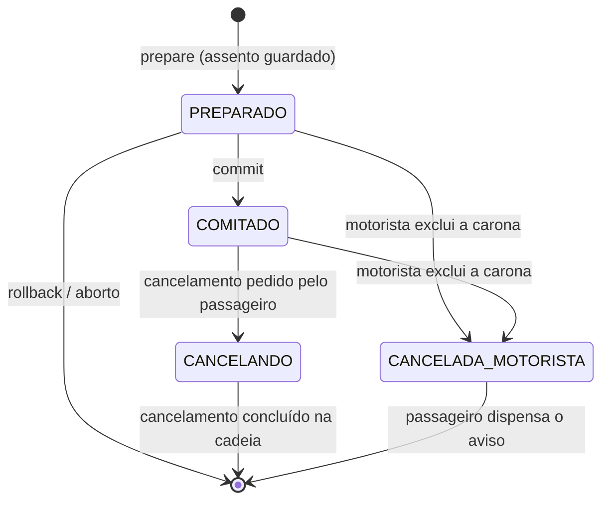
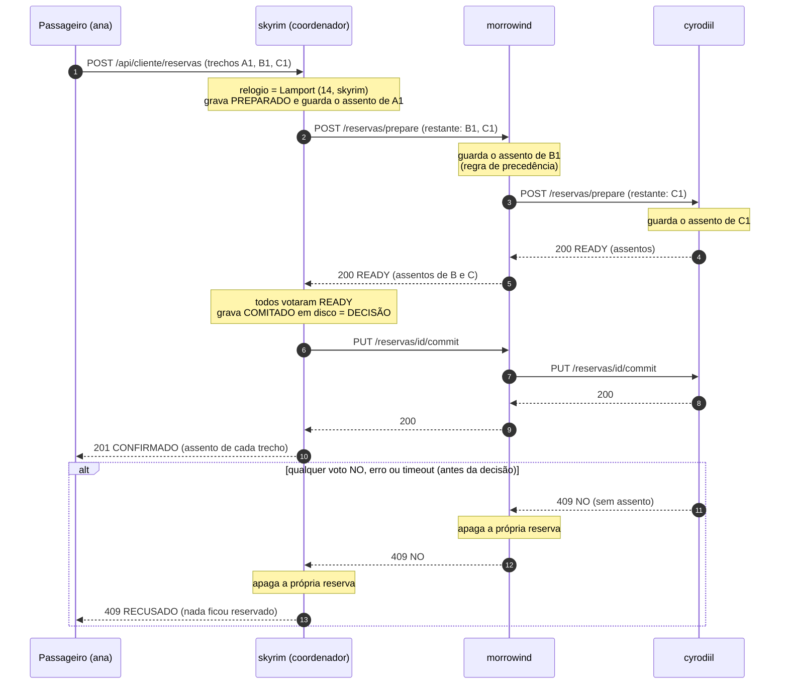
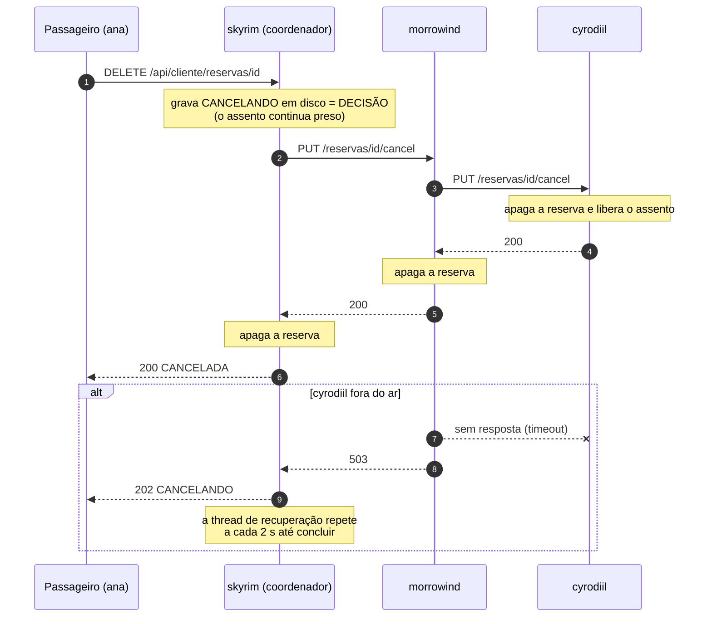
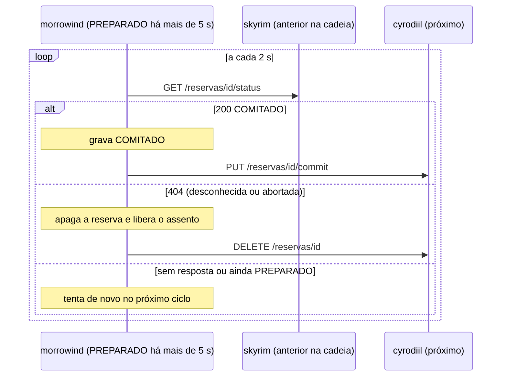

# VaiJunto: Consórcio de Caronas

Servidor P2P em C para um consórcio de caronas compartilhadas.
Cada servidor representa uma empresa (uma região do mapa de Tamriel), guarda os próprios dados em disco e conversa
somente com os vizinhos de fronteira por uma API REST. Não existe servidor central, coordenador fixo nem armazenamento compartilhado.

> **Estado atual:** busca distribuída de itinerários, reserva atômica por commit em duas fases (2PC) em cadeia,
> precedência por relógio de Lamport (*wait-die*), cancelamento de reservas, autenticação com senha e recuperação de falhas.
> Há também cancelamento de carona pelo motorista, front web, simulador de carga e testes automatizados de concorrência, carga e falhas,
> com os [resultados das execuções](#resultados-dos-testes) documentados neste README.

## Sumário

1. [Requisitos e compilação](#requisitos-e-compilação)
2. [Como rodar](#como-rodar)
3. [Estrutura do projeto](#estrutura-do-projeto)
4. [Arquitetura](#arquitetura)
5. [Modelo de dados](#modelo-de-dados)
6. [API do cliente](#api-do-cliente-passageiro-e-motorista)
7. [API entre servidores (consórcio)](#api-entre-servidores-consórcio)
8. [Busca distribuída](#busca-distribuída)
9. [Consistência: exclusão mútua, atomicidade, precedência e deadlock](#consistência-exclusão-mútua-atomicidade-precedência-e-deadlock)
10. [Diagramas de sequência](#diagramas-de-sequência)
11. [Tolerância a falhas](#tolerância-a-falhas)
12. [Persistência e recuperação](#persistência-e-recuperação)
13. [Front web](#front-web)
14. [Menu de testes e cliente de terminal](#menu-de-testes-e-cliente-de-terminal)
15. [Exemplo completo com curl](#exemplo-completo-com-curl)
16. [Testes automatizados](#testes-automatizados)
17. [Resultados dos testes](#resultados-dos-testes)
18. [Emulação com Docker em várias máquinas](#emulação-com-docker-em-várias-máquinas)
19. [Decisões de projeto e limitações](#decisões-de-projeto-e-limitações)
20. [Referências](#referências)

---

## Requisitos e compilação

```bash
sudo apt install build-essential libmicrohttpd-dev libcurl4-openssl-dev libssl-dev
make clean && make
```

O `make` gera dois binários:

| Binário | Função |
|---|---|
| `servidor` | servidor de uma empresa do consórcio |
| `cliente` | cliente de terminal para passageiros e motoristas (fala só com o servidor da própria empresa) |

## Como rodar

O servidor recebe a região como argumento e, opcionalmente, a porta. Sem argumentos, lista as regiões válidas.

| Região | Porta | Vizinhos |
|---|---|---|
| skyrim | 3001 | high_rock, hammerfell, cyrodiil, morrowind |
| morrowind | 3002 | skyrim, cyrodiil, black_marsh |
| cyrodiil | 3003 | skyrim, hammerfell, morrowind, black_marsh, elsweyr, valenwood, summerset_islands |
| high_rock | 3004 | skyrim, hammerfell |
| hammerfell | 3005 | high_rock, skyrim, cyrodiil, valenwood, summerset_islands |
| black_marsh | 3006 | morrowind, cyrodiil, elsweyr |
| elsweyr | 3007 | valenwood, cyrodiil, black_marsh |
| valenwood | 3008 | elsweyr, cyrodiil, hammerfell, summerset_islands |
| summerset_islands | 3009 | hammerfell, cyrodiil, valenwood |

Os vizinhos são procurados em `localhost` por padrão. Para apontar um vizinho para outra máquina ou contêiner, use a
variável `HOST_<REGIAO>` (nome em maiúsculas, com `_`): `HOST_SKYRIM`, `HOST_HIGH_ROCK`, `HOST_SUMMERSET_ISLANDS`...
A porta de cada vizinho é sempre a padrão da tabela.

### Cenário 1: uma máquina (vários terminais)

```bash
./servidor skyrim          # porta 3001
./servidor morrowind       # porta 3002
./servidor cyrodiil        # porta 3003
```

Só sobem os servidores que você iniciar. Vizinhos que não estiverem rodando aparecem como `FALHOU ... [TIMEOUT]`,
o que também serve como teste de falha.

### Cenário 2: uma máquina com Docker Compose

O `docker-compose.yml` define **um serviço por região** (nove) em uma rede interna `tamriel_net`, onde os contêineres se
enxergam pelo nome do serviço (as variáveis `HOST_*` já têm esse padrão). Suba só os que quiser:

```bash
docker compose up --build -d skyrim morrowind cyrodiil   # sobe os três
docker compose logs -f skyrim                            # acompanha os logs
docker attach skyrim                                     # abre o menu do servidor (sair: Ctrl+P, Ctrl+Q)
docker compose stop morrowind                            # simula a queda de uma empresa
docker compose start morrowind                           # ela volta e se recupera
docker compose down                                      # derruba tudo
```

Os volumes `./data/<regiao>:/app/json` mantêm o armazenamento entre execuções. Sem eles, as reservas somem quando o
contêiner é recriado e o consórcio fica inconsistente.

### Cenário 3: várias máquinas (um contêiner por computador)

Veja [Emulação com Docker em várias máquinas](#emulação-com-docker-em-várias-máquinas).

### Cliente de terminal

```bash
./cliente skyrim                       # usa localhost:3001 (ou o host da variável CLIENTE_HOST)
./cliente 192.168.0.10:3001            # endereço explícito
./cliente http://192.168.0.10:3001
```

---

## Estrutura do projeto

```
main.c                 inicialização do servidor
Makefile               gera `servidor` e `cliente`
Dockerfile             imagem Ubuntu 22.04 com as dependências
docker-compose.yml     um serviço por região, rede interna e volumes de dados
headers/               cabeçalhos de todos os módulos (documentados)
cli/
  cliServidor.c        menu de texto do servidor (testes)
  terminal.c           cliente interativo de passageiros e motoristas
  apiConsorcio.c       chamadas à API do cliente (libcurl)
http/
  httpServidor.c       rotas /api/consorcio e /api/cliente (libmicrohttpd)
  httpCliente.c        chamadas aos vizinhos (libcurl, timeouts, detector de falhas)
consorcio/
  cadastro.c           usuários e caronas (regras de negócio)
  busca.c              busca distribuída de itinerários entre empresas
  transacao.c          2PC: coordenador, participante em cadeia, cancelamento e recuperação
util/
  configuracoes.c      regiões, portas e fronteiras
  lamport.c            relógio lógico de Lamport (thread-safe)
  persistencia.c       armazenamento em json/<servidor>/{usuarios,caronas,reservas}/
  auth.c               senhas (PBKDF2-HMAC-SHA256) e HTTP Basic
  json.c               parser JSON (árvore em memória)
  util.c               buffer de texto, UUID, validação de ids, tempo
testes/
  comum.py             utilitários compartilhados (HTTP, preparação, auditoria, relatório)
  concorrencia.py      corridas dirigidas (disputa por assentos, deadlock, cancelamento duplo, churn, exclusão de carona)
  carga.py             passageiros virtuais com carga alta e contínua
  falhas.py            a mesma carga com injeção de falhas nos servidores
resultados/
  concorrencia.json    resultado da última execução de concorrencia.py (veja "Resultados dos testes")
  carga.json           resultado da última execução de carga.py
  falhas.json          resultado da última execução de falhas.py
```

---

## Arquitetura

### Componentes e papéis

| Componente | Papel |
|---|---|
| **Servidor de empresa** (`servidor`) | Uma instância por região. É dono exclusivo das caronas e dos usuários da sua empresa, expõe `/api/cliente` para os próprios usuários e `/api/consorcio` para os vizinhos. |
| **Cliente motorista** | Cadastra-se e publica rotas **somente** no servidor da sua empresa; lista e exclui as próprias caronas. |
| **Cliente passageiro** | Cadastra-se em **uma** empresa, busca itinerários e reserva por ela. Nunca fala com outras empresas: o servidor dele busca e reserva em nome dele. |
| **Cliente de terminal / front web** | Interfaces do usuário final. Ambos usam só `/api/cliente`, por HTTP Basic. |
| **Menu do servidor** | Console de operação e de testes de cada servidor (veja [Menu de testes](#menu-de-testes-e-cliente-de-terminal)). |

Cada servidor tem as mesmas responsabilidades, em papéis que mudam por transação:

- **Dono** de uma carona: único que conhece e decide os assentos dela.
- **Coordenador** de uma reserva: o servidor do passageiro que fez o pedido; conduz o 2PC e grava a decisão.
- **Participante**: qualquer servidor da cadeia que guarda assentos para aquela reserva.

### Dados que cada servidor mantém

| Dado | Onde fica | Observação |
|---|---|---|
| Usuários (com salt e hash da senha) | só na empresa do usuário | nenhuma outra empresa vê credenciais |
| Caronas | só na empresa que a publicou | os assentos livres são calculados a partir das reservas |
| Reservas | em **cada** servidor envolvido, apenas a parte dele | guarda estado, `anterior`, `proximo`, coordenador e os trechos locais; o itinerário completo só existe no coordenador |
| Relógio de Lamport | memória, reconstruído do disco ao reiniciar | recomeça do maior valor visto nas reservas |

Nenhum dado é replicado: cada fato (um assento, uma senha) tem um único dono.

### Comparação com a arquitetura centralizada

| Aspecto | Centralizada | Distribuída (este projeto) |
|---|---|---|
| Atomicidade de um itinerário | uma trava dentro do servidor central | 2PC entre servidores, com a decisão gravada em disco |
| Dono dos dados | um servidor para todos | cada empresa é dona exclusiva das suas caronas e usuários |
| Falha do servidor | o sistema inteiro para | só o que depende do servidor que caiu fica indisponível |
| Ordem de eventos | relógio e fila de um só processo | relógio lógico de Lamport e desempate determinístico |
| Latência de uma reserva | uma chamada local | cresce com o tamanho da cadeia (uma rodada de rede por empresa, duas vezes) |
| Privacidade e independência | todas as empresas cedem os dados | nenhum dado sai do servidor da empresa dona |
| Complexidade | baixa | alta: falhas parciais, recuperação e idempotência |

**O que deixou de ser possível:** uma trava global que protege vários trechos de uma vez; um relógio único para ordenar pedidos; uma
consulta SQL ou varredura que enxerga todas as caronas; e a ideia de que "se respondeu, está feito" (uma resposta pode se perder).

**O que passou a ser necessário:** um protocolo de commit atômico (2PC); um relógio lógico e um critério de desempate; detecção de falhas por
timeout; gravação durável de cada decisão; operações idempotentes; uma thread de recuperação; e busca em tempo real nos vizinhos.

---

## Modelo de dados

- **Carona** = uma **rota** de 2 a 10 cidades, publicada em **um** servidor (a empresa do motorista), que é a única dona
  dos assentos dela. Cada **trecho** (cidade i → cidade i+1) tem horário, preço e capacidade (1 a 60 assentos) próprios.
  As cidades de uma rota não se repetem.
- **Reserva de uma faixa:** o passageiro pega uma **faixa** da rota (origem → destino, nomes sem diferenciar maiúsculas).
  O assento escolhido tem o **mesmo número em todos os trechos da faixa** e só fica ocupado nesses trechos, então o mesmo
  assento pode ser vendido para quem viaja antes ou depois.
- **Itinerário** = sequência de faixas de caronas (de empresas diferentes) em que o destino de uma é a origem da seguinte.
  No máximo 8 faixas por transação, uma faixa por carona.
- **Usuário** é cadastrado em **uma** empresa e só fala com o servidor dela. O servidor dele vira o **coordenador** das reservas que ele fizer.
- Os servidores só conversam com **vizinhos de fronteira** (tabela de regiões).

Estados de uma reserva em cada servidor: `PREPARADO` (assento guardado, aguardando decisão), `COMITADO` (confirmada),
`CANCELANDO` (cancelamento decidido pelo passageiro, ainda se propagando) e `CANCELADA_MOTORISTA` (o motorista excluiu a carona:
a reserva deixa de ocupar assento, continua visível ao passageiro e só some quando ele a "cancela").
Uma reserva abortada ou cancelada pelo passageiro é simplesmente apagada.



---

## API do cliente (passageiro e motorista)

Prefixo: `/api/cliente`. Corpos em JSON. **Tudo exige HTTP Basic** (`Authorization: Basic base64(id:senha)`), exceto `POST /usuarios`.
Credenciais inválidas retornam **401** (com atraso de 0,3 s contra força bruta). Perfil errado para a rota retorna **403**.

| Método e rota | Perfil | Função | Respostas |
|---|---|---|---|
| `POST /usuarios` | público | cadastra `{id, nome, tipo, senha}`; tipo = `motorista` ou `passageiro`; senha de 4 a 72 caracteres | 201, 400, 409 (já existe), 500 |
| `GET /eu` | ambos | dados do usuário logado | 200, 401 |
| `GET /itinerarios?origem=&destino=` | ambos | busca distribuída (consulta os vizinhos) | 200, 400 |
| `POST /rotas` ou `POST /caronas` | motorista | publica uma carona com vários trechos (os dois caminhos fazem o mesmo) | 201, 400, 403, 500 |
| `GET /caronas` | motorista | lista as caronas do motorista com `assentos_livres` | 200 |
| `DELETE /caronas/{id}` | motorista | exclui a carona; as reservas dela viram `CANCELADA_MOTORISTA` e a cadeia é avisada | 200, 202 (alguma empresa fora do ar: repita), 400, 403 (de outro motorista), 404, 409 (entrou reserva durante a exclusão: repita), 500 |
| `POST /reservas` | passageiro | reserva um itinerário (2PC) | 201, 400, 403, 404, 409, 502, 500 |
| `GET /reservas` | passageiro | reservas do passageiro em que este servidor é o coordenador | 200 |
| `DELETE /reservas/{id}` | passageiro | cancela uma reserva confirmada | 200, 202, 404, 409, 500 |

### Cadastro e publicação

`POST /usuarios`

```json
{"id": "ana", "nome": "Ana", "tipo": "passageiro", "senha": "1234"}
```

`POST /rotas` (o motorista vem da autenticação; as cidades saem de `origem`/`destino`, e os trechos devem se encadear):

```json
{"trechos": [
  {"origem": "Whiterun", "destino": "Windhelm",  "horario": "08:00", "preco": 20.00, "assentos": 3},
  {"origem": "Windhelm", "destino": "Riften",     "horario": "10:30", "preco": 15.00, "assentos": 2}
]}
```

Também é aceito o formato simples de rota com duas cidades: `{"origem", "destino", "horario", "preco", "assentos"}`.
Resposta 201 (carona criada; `preco` e `assentos` do topo são a soma e o mínimo dos trechos):

```json
{"id": "skyrim-3a43db7b", "servidor": "skyrim", "motorista": "mot-s",
 "origem": "Whiterun", "destino": "Riften", "horario": "08:00", "preco": 35.00, "assentos": 2, "assentos_livres": 2,
 "cidades": ["Whiterun", "Windhelm", "Riften"],
 "trechos": [{"origem": "Whiterun", "destino": "Windhelm", "horario": "08:00", "preco": 20.00, "assentos": 3, "assentos_livres": 3},
             {"origem": "Windhelm", "destino": "Riften",   "horario": "10:30", "preco": 15.00, "assentos": 2, "assentos_livres": 2}]}
```

### Busca de itinerários

`GET /itinerarios?origem=Whiterun&destino=Imperial%20City` devolve até 30 itinerários com assentos livres em todas as faixas:

```json
{"servidor": "skyrim", "total": 1, "itinerarios": [{
  "itinerario_id": "skyrim-1", "preco_total": 95.00,
  "trechos": [
    {"servidor": "skyrim",    "id_carona": "skyrim-3a43db7b",    "origem": "Whiterun", "destino": "Windhelm",
     "horario": "08:00", "preco": 20.00, "assentos_livres": 2},
    {"servidor": "morrowind", "id_carona": "morrowind-aad879a0", "origem": "Windhelm", "destino": "Mournhold",
     "horario": "10:00", "preco": 30.00, "assentos_livres": 2},
    {"servidor": "cyrodiil",  "id_carona": "cyrodiil-f21542c0",  "origem": "Mournhold", "destino": "Imperial City",
     "horario": "13:00", "preco": 45.00, "assentos_livres": 1}]}]}
```

A busca é uma fotografia: os assentos podem acabar antes da reserva, e aí o `POST /reservas` responde 409.

### Reserva

`POST /reservas` (o passageiro vem da autenticação; basta copiar os trechos do itinerário escolhido):

```json
{"trechos": [
  {"servidor": "skyrim",    "id_carona": "skyrim-3a43db7b",    "origem": "Whiterun",  "destino": "Windhelm"},
  {"servidor": "morrowind", "id_carona": "morrowind-aad879a0", "origem": "Windhelm",  "destino": "Mournhold"},
  {"servidor": "cyrodiil",  "id_carona": "cyrodiil-f21542c0",  "origem": "Mournhold", "destino": "Imperial City"}
]}
```

Regras de validação (400 se violadas): de 1 a 8 trechos; servidores existentes no mapa; sem carona repetida; os trechos de cada servidor
vêm juntos (um único bloco consecutivo); os trechos **deste** servidor, se houver, vêm primeiro; e a sequência de servidores segue as
fronteiras do mapa (`eu → g1 → g2 → ...`, cada um vizinho do anterior).

Resposta **201 CONFIRMADO**:

```json
{"id_transacao": "567d6271-0f4d-474e-8faa-abbf42abed7c", "status": "CONFIRMADO", "passageiro": "ana",
 "relogio_logico": 26, "propagacao_pendente": false,
 "trechos": [
   {"servidor": "skyrim",    "id_carona": "skyrim-3a43db7b",    "origem": "Whiterun",  "destino": "Windhelm",      "assento": 1},
   {"servidor": "morrowind", "id_carona": "morrowind-aad879a0", "origem": "Windhelm",  "destino": "Mournhold",     "assento": 1},
   {"servidor": "cyrodiil",  "id_carona": "cyrodiil-f21542c0",  "origem": "Mournhold", "destino": "Imperial City", "assento": 1}]}
```

Recusa (nada fica reservado em nenhum servidor):

```json
{"status": "RECUSADO", "motivo": "sem assento disponivel na carona cyrodiil-f21542c0 (cyrodiil)"}
```

| Código | Significado |
|---|---|
| 201 | confirmada em todas as empresas |
| 400 | pedido inválido, ou origem/destino fora da rota de uma carona (`RECUSADO`) |
| 403 / 404 | usuário não é passageiro / passageiro ou carona inexistente |
| 409 | sem assento disponível (`RECUSADO`) |
| 502 | alguma empresa da cadeia não respondeu (`RECUSADO`, o `motivo` diz qual) |
| 500 | falha ao gravar em disco |

`propagacao_pendente: true` significa que a decisão foi **COMMIT** (já gravada em disco), mas alguma empresa estava fora do ar
na hora de receber o aviso. Ela conclui sozinha ao voltar (veja [Persistência e recuperação](#persistência-e-recuperação)).

### Listagem e cancelamento

`GET /reservas` devolve `{"servidor", "reservas": [...], "total"}`, cada reserva no formato descrito em [Persistência e recuperação](#persistência-e-recuperação).

`DELETE /reservas/{id}` só funciona no servidor coordenador e para o dono da reserva:

| Código | Corpo | Significado |
|---|---|---|
| 200 | `{"id_transacao", "status": "CANCELADA"}` | cancelada em todas as empresas, assentos liberados |
| 202 | `{"id_transacao", "status": "CANCELANDO", "mensagem"}` | decisão registrada, mas alguma empresa está fora do ar; a recuperação conclui depois |
| 404 | erro | reserva inexistente, de outro passageiro ou de outro coordenador |
| 409 | erro | reserva ainda em andamento (`PREPARADO`); tente de novo em instantes |
| 500 | erro | falha ao gravar o cancelamento em disco |

Se a reserva está `CANCELADA_MOTORISTA`, o `DELETE` apenas a dispensa: o estado não muda e a cadeia só apaga a cópia de cada servidor.

---

## API entre servidores (consórcio)

Prefixo: `/api/consorcio`. Usada só entre servidores vizinhos.

**Cabeçalhos.** Toda requisição leva `X-Server-Id` (quem envia), `X-Lamport-Clock` e `Accept: application/json`; as que têm corpo levam
`Content-Type: application/json`. Toda resposta devolve `Content-Type: application/json`, `X-Server-Id` e `X-Lamport-Clock`.
Quem recebe atualiza o relógio com `max(local, recebido) + 1`. As respostas também trazem cabeçalhos CORS, e `OPTIONS` responde 200.

| Método e rota | Função | Respostas |
|---|---|---|
| `GET /health` (ou `/vivo`) | detecção de falha | 200 |
| `GET /trechos?origem=&destino=&visitados=a,b` | itinerários cujo 1º trecho é uma carona deste servidor | 200, 400 |
| `GET /reservas` | reservas guardadas neste servidor | 200 |
| `POST /reservas/prepare` | fase 1: tranca assentos, repassa à cadeia e vota | 200 READY, 400, 404, 409, 500, 502 |
| `PUT /reservas/{id}/commit` | fase 2: confirma e repassa à cadeia | 200, 404, 409 (carona cancelada pelo motorista), 500 |
| `DELETE /reservas/{id}` | rollback: apaga a reserva e repassa à cadeia (idempotente) | 200, 409 (já confirmada), 500 |
| `GET /reservas/{id}/status` | estado da transação (usado na recuperação) | 200, 404 |
| `PUT /reservas/{id}/cancel` | cancela uma reserva confirmada e repassa à cadeia (idempotente) | 200, 503 |
| `PUT /reservas/{id}/cancel-motorista` | o motorista excluiu a carona: marca `CANCELADA_MOTORISTA` e avisa os dois vizinhos da cadeia (idempotente) | 200, 500, 503 |

Rotas desconhecidas retornam 404. Identificadores com caracteres fora de letras, números, `-`, `_` e `.` são rejeitados.

### `GET /health`

```json
{"status": "skyrim ta on", "relogio": 42}
```

### `GET /trechos`

Devolve os itinerários que **começam** com uma carona deste servidor em `origem` e chegam a `destino`, podendo continuar em outras empresas.
`visitados` lista os servidores já percorridos (quem pergunta se inclui), evitando ciclos. O formato da resposta é o mesmo do
`GET /itinerarios` do cliente (veja acima).

### `POST /reservas/prepare`

`trechos_solicitados` é o que **resta** percorrer. Quem recebe trata os trechos que são dele (que vêm primeiro) e repassa o resto
ao próximo servidor, que precisa ser seu vizinho.

```json
{"id_transacao": "567d6271-0f4d-474e-8faa-abbf42abed7c", "coordenador_id": "skyrim", "passageiro": "ana", "relogio_logico": 14,
 "trechos_solicitados": [
   {"servidor": "morrowind", "id_carona": "morrowind-aad879a0", "origem": "Windhelm",  "destino": "Mournhold"},
   {"servidor": "cyrodiil",  "id_carona": "cyrodiil-f21542c0",  "origem": "Mournhold", "destino": "Imperial City"}]}
```

| Código | Significado | Corpo |
|---|---|---|
| 200 | **READY**: este servidor e todos adiante votaram sim | `{"id_transacao", "status": "READY", "servidor", "assentos": [{"servidor", "id_carona", "origem", "destino", "assento"}]}` |
| 400 | corpo inválido, id inseguro, 1º trecho não é deste servidor, servidor repetido na cadeia, próximo não é vizinho, ou origem/destino fora da rota da carona | `{"erro"}` ou `{"id_transacao", "status": "NO", "servidor", "motivo"}` |
| 404 | carona inexistente neste servidor | `{"id_transacao", "status": "NO", "servidor", "motivo"}` |
| 409 | sem assento disponível | idem |
| 502 | alguém adiante na cadeia não respondeu (o `motivo` diz quem) | idem |
| 500 | falha ao gravar em disco | idem |

Reenviar o mesmo `prepare` é **idempotente**: devolve READY sem ocupar outro assento. Se algo falha adiante na cadeia, este
servidor apaga a própria reserva antes de responder NO.

### `PUT /reservas/{id}/commit`

200 `{"id_transacao", "mensagem", "propagacao_pendente"}`. 404 se nunca houve `prepare`. 409 se o motorista já cancelou a carona
(um `commit` atrasado nunca ressuscita a reserva). Grava `COMITADO` e repassa ao próximo.

### `DELETE /reservas/{id}` (rollback)

200 sempre que a reserva não está confirmada (apagar algo que não existe também dá 200). **409** se já está `COMITADO` ou `CANCELANDO`,
para que um aborto atrasado nunca desfaça uma transação confirmada.

### `GET /reservas/{id}/status`

200 `{"id_transacao", "status": "PREPARADO" | "COMITADO" | "CANCELANDO" | "CANCELADA_MOTORISTA", "coordenador_id"}` ou 404 (desconhecida ou abortada).

### `PUT /reservas/{id}/cancel`

Repassa o cancelamento adiante **primeiro** e só então apaga a cópia local, então os assentos são liberados do fim da cadeia para o começo.
200 `{"id_transacao", "mensagem"}` (também se a reserva já não existe aqui). **503** se não conseguiu concluir adiante; quem chamou tenta de novo.

### `PUT /reservas/{id}/cancel-motorista`

Chamada quando o motorista exclui uma carona. Marca a reserva como `CANCELADA_MOTORISTA` (libera os assentos) e avisa o `anterior` e o `proximo`
da cadeia, menos quem enviou o aviso (`X-Server-Id`), então o aviso anda nos dois sentidos até as pontas e para sozinho.
200 `{"id_transacao", "status": "CANCELADA_MOTORISTA"}`, ou 200 "Nada a fazer aqui" se a reserva não existe ou já está `CANCELANDO`.
**503** se algum vizinho não recebeu o aviso (o motorista repete a exclusão); 500 em falha de disco.

### Requisição sem resposta e requisição repetida

Em rede, "sem resposta" não diz se a operação aconteceu: ela pode ter sido executada e só a resposta se perdeu. Por isso:

- **Quem chama nunca presume o resultado.** Sem resposta dentro do prazo, o chamador trata como falha, marca o vizinho como suspeito e
  decide pelo protocolo: antes da decisão, **aborta**; depois da decisão, **repete até conseguir** (a thread de recuperação faz isso).
- **Toda operação do consórcio é idempotente**, então repetir é sempre seguro:

| Operação | O que acontece se for repetida |
|---|---|
| `prepare` | devolve READY sem ocupar outro assento |
| `commit` | regrava `COMITADO` e repassa; sem efeito extra |
| `DELETE` (rollback) | 200 mesmo se a reserva não existe; 409 se já confirmada, então um aborto atrasado nunca desfaz um commit |
| `cancel` / `cancel-motorista` | 200 mesmo se já aplicado ou inexistente |
| `status` | só leitura |

- **Mensagens fora de ordem** são tratadas pelo estado gravado: um `commit` atrasado após cancelamento do motorista recebe 409 e não
  ressuscita a reserva; um rollback atrasado após o commit recebe 409 e não a desfaz.
- **Para o cliente final:** se a rede cair no meio de uma reserva ou cancelamento, o resultado é **desconhecido** e deve ser conferido em
  `GET /reservas`; repetir `DELETE /reservas/{id}` é seguro.

### Tempos limite

| Constante | Valor | Uso |
|---|---|---|
| `TIMEOUT_CONEXAO` | 1,5 s | estabelecer a conexão com um vizinho |
| `TIMEOUT_REQUISICAO` | 3 s | requisição comum |
| `prepare` | (3 s + 0,8 s) × servidores restantes | a chamada é encadeada, então o prazo cresce com a cadeia |
| cancelamento (passageiro ou motorista) | 8 s | propaga pela cadeia inteira |
| `ESPERA_MAX_MS` | 0,8 s | espera máxima por um assento disputado |
| `SUSPEITA_MS` | 5 s | quanto tempo um vizinho sem resposta fica "suspeito" |
| `TIMEOUT_PREPARADO_S` | 5 s | idade mínima de uma reserva `PREPARADO` para a recuperação agir |
| `INTERVALO_RECUPERACAO_S` | 2 s | intervalo entre ciclos da thread de recuperação |

---

## Busca distribuída

**Estratégia: consulta em tempo real, sem catálogo replicado.** Cada empresa guarda só as próprias caronas; quando um passageiro busca,
o servidor dele pergunta aos vizinhos na hora. Um catálogo replicado ficaria desatualizado a cada reserva e exigiria sincronização entre
empresas, além de expor dados que hoje ficam só no dono.

**Como funciona.** É uma busca em profundidade a partir da origem:

1. O servidor que recebeu a busca lista as faixas das próprias caronas que partem da origem.
2. Para cada cidade intermediária, oferece as faixas locais e envia `GET /trechos` aos vizinhos para o restante do caminho, passando a lista
   de servidores já `visitados` (evita ciclos).
3. Cada vizinho repete o processo com os seus vizinhos e devolve os itinerários que começam com uma carona dele.
4. O servidor original junta, filtra os que têm assento livre em todas as faixas e devolve até 30 itinerários.

Há limites de itinerários (30), consultas (40) e trechos (8) para a busca não explodir. A resposta é uma fotografia, sem reserva: a
disponibilidade real só é decidida no `prepare`.

**Quando uma empresa está fora do ar.** A busca é *best effort*: um vizinho que não responde vira "suspeito" por 5 s e é **pulado**
(em dezenas de milissegundos, em vez de esperar o timeout a cada consulta). A busca devolve o que for possível com as demais empresas;
só ficam de fora os itinerários que passariam pela empresa caída.

---

## Consistência: exclusão mútua, atomicidade, precedência e deadlock

### Exclusão mútua do assento

O assento só é decidido pelo servidor **dono** da carona, dentro de uma região crítica (`reservaPreparar` em `persistencia.c`) que
verifica a disponibilidade, escolhe o assento e grava a reserva em disco, tudo sob uma trava única. Dois pedidos simultâneos, vindos de qualquer
empresa, chegam ao mesmo dono e são serializados por essa trava, então nunca recebem o mesmo assento.

**Por que assim:** o dono é o único que conhece o estado dos assentos, então é o único ponto onde a decisão pode ser linearizada. Uma
exclusão mútua distribuída (token ou votação entre todas as empresas) custaria mensagens extras e dependeria de todos estarem no ar,
sem ganho de segurança. Uma reserva só ocupa os trechos da sua faixa, e o número do assento é o mesmo ao longo dela.

### Atomicidade: commit em duas fases em cadeia

Os assentos de um itinerário estão em servidores diferentes, então nenhuma trava local os protege juntos. O protocolo é um 2PC em que os
participantes formam uma **cadeia** (`coordenador → g1 → g2 → ...`), respeitando as fronteiras do mapa:

1. **Fase 1 (prepare):** o coordenador grava `PREPARADO`, guarda os seus assentos e envia `POST /reservas/prepare` ao próximo servidor.
   Cada participante guarda os próprios assentos, grava `PREPARADO` e repassa o restante da cadeia. O voto sobe de volta: **READY** só
   se este servidor e todos adiante votaram sim; qualquer **NO**, erro ou timeout vira NO.
2. **Decisão:** quem decide é **sempre o coordenador**. Com todos READY, ele grava `COMITADO` em disco: esse é o **ponto de não retorno**.
   Com qualquer NO, decide abortar.
3. **Fase 2 (commit):** `PUT /reservas/{id}/commit` percorre a cadeia, cada servidor grava `COMITADO` e repassa.

**Quando um participante recusa:** o NO sobe pela cadeia; cada servidor que já tinha guardado assentos **apaga a própria reserva antes de
responder NO**. Ao chegar ao coordenador, ele apaga a dele e responde `RECUSADO` ao passageiro. Resultado: nenhum assento fica preso em
nenhuma empresa. Se um rollback não chegar a alguém, a recuperação o aplica (veja [Tolerância a falhas](#tolerância-a-falhas)).

Cada servidor grava quem veio antes (`anterior`) e quem vem depois (`proximo`) na cadeia. Assim commit, rollback e cancelamento percorrem o
mesmo caminho sem o coordenador falar com todo mundo, e cada participante sabe a quem perguntar se o aviso não chegar.

**Por que 2PC.** Não há replicação de dados (cada assento tem um único dono), então consenso como Paxos ou Raft resolveria um problema que
não existe aqui. O 2PC é o mínimo suficiente, e a cadeia respeita a restrição de que cada servidor só fala com vizinhos.

### Precedência: quem fica com o último assento

Relógios de parede não são confiáveis entre máquinas e as mensagens podem atrasar. Por isso cada transação recebe no coordenador um carimbo
`(relógio de Lamport, id do coordenador, id da transação)`. É uma **ordem total** que respeita a causalidade e não depende de sincronização
de relógios nem da ordem de chegada das mensagens: dois carimbos nunca empatam. O relógio é atualizado a cada mensagem com
`max(local, recebido) + 1`.

A regra tem dois níveis:

1. **Há assento livre na faixa:** o primeiro pedido a chegar ao servidor dono é atendido. Chegar ao dono é o único ponto de linearização
   possível, porque só ele conhece os assentos.
2. **Não há assento livre, mas existem reservas `PREPARADO` na faixa** (ainda indecisas, podem liberar o assento): vale a regra *wait-die*.
   Se a transação é **mais antiga** que todas as que seguram o assento, ela **espera** até `ESPERA_MAX_MS` pela decisão delas; se é
   **mais nova** que alguma, **recusa na hora**.

Um voto READY já dado nunca é retirado, porque retirá-lo quebraria o 2PC. Por isso, se a transação à frente confirmar, a mais antiga recebe NO.
Em todos os casos o assento nunca é confirmado duas vezes.

### Deadlock distribuído

O caso crítico: duas reservas travam as mesmas duas caronas em **ordens opostas** (A pede X depois Y; B pede Y depois X). Sem cuidado, A
espera B e B espera A para sempre.

**Mecanismo: *wait-die* sobre a ordem total de Lamport (prevenção).** Só espera quem é **mais antigo** do que quem segura o recurso; o mais novo
é recusado na hora ("morre") e o passageiro pode tentar de novo. Como toda espera aponta de um mais antigo para um mais novo, **nunca
se forma um ciclo de espera**, então o deadlock é impossível. Mesmo que algo trave, a espera é limitada por `ESPERA_MAX_MS` (0,8 s).

**Consequências para o desempenho:**

- Não há detector de ciclos nem troca de mensagens extra para tratar deadlock.
- Uma transação mais antiga pode esperar até 0,8 s por uma decisão alheia.
- Uma transação mais nova que perde a disputa recebe recusa imediata, mesmo que o assento viesse a ser liberado depois (recusa conservadora):
  sob alta contenção, algumas reservas são recusadas e precisam ser repetidas.
- Sem disputa, o custo é zero: nenhuma espera ou recusa extra.

---

## Diagramas de sequência

### Reserva com trechos de três empresas



### Cancelamento de uma reserva confirmada



### Recuperação de um participante sem decisão



---

## Tolerância a falhas

### Detecção

Sem relógios sincronizados, a falha é detectada por **timeout** (conexão 1,5 s, requisição 3 s). Um vizinho que falha fica "suspeito" por 5 s:
a busca o pula e o 2PC continua tentando. `GET /health` serve para checagem explícita. Um processo travado (`SIGSTOP`) e um caído
(`SIGKILL`) são tratados do mesmo jeito: ambos estouram o timeout.

### O que acontece quando uma empresa falha

| Momento da falha | Quem falhou | Resultado |
|---|---|---|
| **Antes** de confirmar (durante o `prepare`) | participante | o `prepare` não completa (timeout ou 502); quem está antes na cadeia apaga a própria reserva e o coordenador responde `RECUSADO`. Nada fica preso. |
| **Antes** da decisão, depois dos votos READY | coordenador | os participantes ficam `PREPARADO`. Ao voltar, o coordenador não encontra decisão gravada e **aborta** (*presumed abort*); os assentos são liberados. Até lá ficam presos só os assentos **dessa** transação. |
| **Depois** da decisão, antes dos avisos | coordenador | a decisão `COMITADO` já está em disco. Os participantes perguntam `status` a quem enviou o `prepare` e convergem para `COMITADO`. |
| **Durante** o commit (fase 2) | participante | a resposta traz `propagacao_pendente: true`; a decisão já vale e o participante conclui sozinho ao voltar, consultando o `status`. |
| Durante um cancelamento | qualquer | resposta 202 `CANCELANDO`; a thread de recuperação repete até concluir. |

**Reserva em andamento:** nunca é decidida por quem não tem autoridade. A decisão só existe no coordenador; participantes sem notícia
perguntam a ele (via cadeia) e só agem com a resposta: `COMITADO` confirma, `404` aborta, sem resposta tenta de novo.

**As demais empresas continuam operando.** Só o que depende do servidor caído falha: buscas o pulam, reservas que o incluem são recusadas
com `502` e dizem qual empresa não respondeu, e todas as outras reservas, buscas, cadastros e caronas seguem normalmente.

### Injeção de falha (para testes)

A variável `INJETAR_FALHA` faz o servidor encerrar de forma abrupta (como uma queda real) em pontos definidos:

```bash
INJETAR_FALHA=antes_decisao      ./servidor skyrim   # após todos votarem READY, antes de gravar o COMMIT
INJETAR_FALHA=depois_decisao     ./servidor skyrim   # após gravar o COMMIT, antes de avisar os participantes
INJETAR_FALHA=depois_cancelando  ./servidor skyrim   # após gravar CANCELANDO, antes de propagar o cancelamento
```

Reinicie sem a variável e acompanhe o log (`[RECUPERACAO] ...`) para ver a convergência.

---

## Persistência e recuperação

### O que é armazenado e quando

Cada servidor tem três pastas, **um arquivo JSON por registro**, e nada é compartilhado entre empresas:

```
json/<servidor>/
  usuarios/<id>.json             usuários desta empresa (com salt e hash da senha, nunca a senha)
  caronas/<id>.json              caronas publicadas aqui (dados fixos; assentos livres são calculados)
  reservas/<id_transacao>.json   participação deste servidor em cada transação
```

| Momento | O que é gravado |
|---|---|
| Cadastro | `usuarios/<id>.json` |
| Publicação de carona | `caronas/<id>.json` |
| `prepare` (antes de votar READY) | reserva em `PREPARADO`, com assentos, `anterior`, `proximo` e coordenador |
| Decisão de commit (coordenador) | reserva em `COMITADO`, **antes** de avisar qualquer participante |
| Commit recebido (participante) | reserva em `COMITADO` |
| Pedido de cancelamento | reserva em `CANCELANDO`, antes de propagar |
| Exclusão de carona pelo motorista | reserva em `CANCELADA_MOTORISTA` |
| Aborto ou cancelamento concluído | arquivo da reserva apagado |

Toda gravação é atômica: arquivo temporário + `fsync` + `rename`, **antes** de qualquer resposta. Sobras `.tmp` são apagadas ao iniciar.
Gravar a decisão antes de anunciá-la é o que torna o commit recuperável após uma queda.

Exemplo de `reservas/<id>.json` em morrowind, no meio da cadeia skyrim → morrowind → cyrodiil:

```json
{"id_transacao": "567d6271-...", "estado": "COMITADO", "coordenador_id": "skyrim",
 "anterior": "skyrim", "proximo": "cyrodiil", "passageiro": "ana", "relogio_logico": 26, "criado_em": 1792183577,
 "trechos": [{"servidor": "morrowind", "id_carona": "morrowind-aad879a0", "origem": "Windhelm", "destino": "Mournhold",
              "de": 0, "ate": 1, "assento": 1}],
 "itinerario": []}
```

`trechos` são as faixas que pertencem a **este servidor** (`de`/`ate` são os índices na rota da carona); `itinerario` só é
preenchido no coordenador. Em Docker, monte `json/` como volume (já feito no `docker-compose.yml`).

**Senhas:** PBKDF2-HMAC-SHA256 com 100 000 iterações e salt aleatório de 128 bits por usuário. A conferência usa comparação em tempo constante.

### Como o servidor se recupera ao voltar

1. **Recarrega** usuários, caronas e reservas do disco. Os assentos ocupados são recalculados a partir das reservas, e o relógio de Lamport
   recomeça do maior valor visto nelas.
2. **Thread de recuperação** (a cada 2 s):
   - reservas `PREPARADO` que ninguém está conduzindo e com mais de 5 s:
     - *sou o coordenador:* não existe decisão COMMIT gravada, então **aborta** (*presumed abort*) e repassa o rollback;
     - *sou participante:* pergunta o `status` a quem enviou o `prepare`. `COMITADO` → confirma aqui e repassa. `404` → aborta aqui e repassa.
       Sem resposta ou ainda `PREPARADO` → tenta de novo.
   - reservas `CANCELANDO` que este servidor coordena: repete o cancelamento pela cadeia até concluir.
3. **Requisições em andamento:** a reserva tem um indicador `ativo` enquanto uma requisição a conduz, para a recuperação não interferir.

**Por que o consórcio fica consistente:** a única decisão que importa (commit ou abort) tem um único dono, o coordenador, e é gravada em disco antes de ser
anunciada. Todos os demais estados são derivados dela, e todas as operações são idempotentes, então repetir até convergir é sempre seguro.
Na dúvida, aborta-se (*presumed abort*); depois do commit gravado, nunca se desfaz.

---

## Front web

Além do cliente de terminal, há um front web (arquivos `mapa.js`, `painel.js`, `api.js`, `login.js`, `dados.js` e `estado.js`) que fala só com
`/api/cliente` do servidor da empresa do usuário, por HTTP Basic. Os servidores devolvem cabeçalhos CORS, então a página pode ser servida
de qualquer origem (por exemplo, com `python3 -m http.server` na pasta do front).

- **Login e cadastro:** o campo SERVIDOR recebe a URL da empresa (padrão `http://localhost:3001`). A conta precisa ser do tipo escolhido (passageiro ou motorista).
- **Mapa:** imagem de Tamriel (`img/mapa.webp`) com os locais de `dados.js`; origem e destino são escolhidos clicando, com zoom e arraste.
- **Passageiro:** abas BUSCAR, ROTAS e RESERVAS (busca, escolha do itinerário, reserva e cancelamento). Reservas `CANCELADA_MOTORISTA` aparecem sinalizadas.
- **Motorista:** abas PUBLICAR (monta a rota trecho a trecho e publica com `POST /rotas`) e MINHAS CARONAS (lista e exclusão).
- **Data:** o servidor não tem campo de data. O front a grava dentro do `horario` (`"2026-11-01 08:00"`) e, na busca, filtra os trechos pela data escolhida.
- **Rota e preço das reservas** ficam no `localStorage` do navegador (o servidor só guarda ids e assentos), então não aparecem em outro navegador.
- **Resultado desconhecido:** se a rede cair no meio de uma reserva ou de um cancelamento, a tela avisa para conferir em RESERVAS.

---

## Menu de testes e cliente de terminal

Ao iniciar, cada **servidor** abre um menu no terminal (em Docker, `docker attach <servidor>`). As opções 1 a 8 chamam a API entre
servidores; as 10 a 14 operam no próprio servidor com a mesma lógica da API do cliente.

| Opção | Ação |
|---|---|
| 1 / 2 | `GET /health` de um vizinho / de todos |
| 3 | `GET /trechos` |
| 4 | `POST /reservas/prepare` (id vazio gera UUID; precisa de uma carona existente no vizinho) |
| 5 / 6 / 7 | commit / rollback / status de uma transação |
| 8 | `GET /reservas` de um vizinho |
| 9 | ver as reservas guardadas neste servidor |
| 10 | cadastrar usuário |
| 11 | publicar carona (cada trecho vira uma carona de duas cidades) |
| 12 | listar usuários e caronas |
| 13 | buscar itinerários (distribuído) |
| 14 | reservar itinerário (este servidor coordena o 2PC) |
| 0 | sair |

O **cliente** (`./cliente`) é o programa do usuário final: cadastro, login (senha sem eco), e depois um menu de motorista
(publicar rota com vários trechos, listar e excluir caronas) ou de passageiro (buscar e reservar, listar e cancelar reservas).
Se a rede cair no meio de uma reserva ou de um cancelamento, ele avisa que o resultado é **desconhecido** e manda conferir em "Minhas reservas".

---

## Exemplo completo com curl

Três servidores locais (`skyrim`, `morrowind`, `cyrodiil`) e um itinerário Whiterun → Imperial City que usa as três empresas.
Requer `jq`.

```bash
S=localhost:3001/api/cliente; M=localhost:3002/api/cliente; C=localhost:3003/api/cliente

# usuários (cada um no servidor da sua empresa)
curl -X POST $S/usuarios -d '{"id":"ana","nome":"Ana","tipo":"passageiro","senha":"1234"}'
curl -X POST $S/usuarios -d '{"id":"mot-s","nome":"Motorista S","tipo":"motorista","senha":"1234"}'
curl -X POST $M/usuarios -d '{"id":"mot-m","nome":"Motorista M","tipo":"motorista","senha":"1234"}'
curl -X POST $C/usuarios -d '{"id":"mot-c","nome":"Motorista C","tipo":"motorista","senha":"1234"}'

# caronas (guarda o id de cada uma)
ID_S=$(curl -s -u mot-s:1234 -X POST $S/rotas -d '{"origem":"Whiterun","destino":"Windhelm","horario":"08:00","preco":20,"assentos":2}' | jq -r .id)
ID_M=$(curl -s -u mot-m:1234 -X POST $M/rotas -d '{"origem":"Windhelm","destino":"Mournhold","horario":"10:00","preco":30,"assentos":2}' | jq -r .id)
ID_C=$(curl -s -u mot-c:1234 -X POST $C/rotas -d '{"origem":"Mournhold","destino":"Imperial City","horario":"13:00","preco":45,"assentos":1}' | jq -r .id)

# a ana (de skyrim) busca e reserva
curl -u ana:1234 "$S/itinerarios?origem=Whiterun&destino=Imperial%20City"
curl -u ana:1234 -X POST $S/reservas -d '{"trechos":[
  {"servidor":"skyrim",    "id_carona":"'$ID_S'", "origem":"Whiterun",  "destino":"Windhelm"},
  {"servidor":"morrowind", "id_carona":"'$ID_M'", "origem":"Windhelm",  "destino":"Mournhold"},
  {"servidor":"cyrodiil",  "id_carona":"'$ID_C'", "origem":"Mournhold", "destino":"Imperial City"}]}'

# conferir em cada servidor
curl localhost:3001/api/consorcio/reservas
curl localhost:3002/api/consorcio/reservas
curl localhost:3003/api/consorcio/reservas

# cancelar (use o id_transacao devolvido na reserva)
curl -u ana:1234 -X DELETE $S/reservas/<id_transacao>

# cabeçalhos do relógio de Lamport
curl -i -H "X-Server-Id: teste" -H "X-Lamport-Clock: 50" localhost:3001/api/consorcio/health
```

Teste de falha: dê `Ctrl+C` em um servidor e tente reservar um itinerário que passe por ele. A resposta é `RECUSADO` (502) e os assentos
dos outros servidores voltam a ficar livres. Para simular um servidor travado:
`pkill -STOP -f "servidor morrowind"` e depois `pkill -CONT -f "servidor morrowind"`.

---

## Testes automatizados

Os scripts ficam em `testes/`, usam só a biblioteca padrão do Python 3.8+ e compartilham o `comum.py` (requisições HTTP, preparação de caronas
e passageiros, auditoria das invariantes e relatório). Compile antes com `make`. Os resultados de uma execução de cada script
estão em [Resultados dos testes](#resultados-dos-testes).

| Script | Foco | Servidores | O que faz |
|---|---|---|---|
| `concorrencia.py` | exclusão mútua, deadlock e cancelamentos concorrentes | já rodando (`skyrim`, `morrowind`, `cyrodiil` em localhost) | corridas montadas de propósito, com todas as requisições liberadas no mesmo instante e um monitor lendo o estado a cada 100 ms |
| `carga.py` | desempenho e contenção | já rodando | passageiros virtuais que buscam, reservam e cancelam sem parar |
| `falhas.py` | tolerância a falhas e recuperação | **sobe os próprios** (o executável `./servidor`) | a mesma carga com queda e trava de servidores |

Os três terminam com código 0 se todas as invariantes se mantiveram e 1 caso contrário (o `concorrencia.py` ainda devolve 2 se os servidores não respondem).

### Concorrência

Cada cenário monta uma disputa específica e solta todas as requisições juntas, por uma barreira. Durante todo o cenário, um **monitor**
lê o estado dos três servidores a cada 100 ms e confere, em cada leitura, que nenhum assento foi dado a duas reservas e que nenhum trecho
passou da capacidade (vale também para reservas ainda `PREPARADO`, não só no fim). Ao final roda a auditoria de sempre.
Cada cenário roda `--rodadas` vezes (padrão 3), cada uma com cidades e caronas novas.

```bash
python3 testes/concorrencia.py
python3 testes/concorrencia.py --cenarios cruzada churn_um_assento --rodadas 5
python3 testes/concorrencia.py --passageiros 24 --duracao 20 --semente 123 --verbose --saida resultados/concorrencia.json
```

| Cenário | O que testa |
|---|---|
| `ultimo_assento` | N passageiros, nos 3 servidores, disputam ao mesmo tempo os mesmos assentos de um trecho: nunca pode vender mais do que existe |
| `cruzada` | reservas que seguram assentos em ordens **opostas** (skyrim→morrowind e morrowind→skyrim): precisa resolver sem travar (deadlock) |
| `cancelamento_duplo` | vários `DELETE` da **mesma** reserva ao mesmo tempo: nada de erro 5xx e o assento tem de ficar livre em todas as empresas |
| `churn_um_assento` | reservar e cancelar sem parar disputando **um** assento |
| `exclusao_carona` | o motorista exclui a carona enquanto passageiros reservam nela |

Resultado esperado: todas as rodadas `OK` e nenhuma linha `[PROBLEMA]`. Opções úteis: `--passageiros` (padrão 12), `--duracao` dos cenários
contínuos (padrão 10 s), `--semente` para repetir uma execução e `--verbose` para o relatório completo de todas as rodadas.

### Carga contínua

```bash
python3 testes/carga.py
python3 testes/carga.py --passageiros 60 --duracao 60 --capacidade 15 --saida resultados/carga.json
```

Sobe N passageiros espalhados pelos três servidores; cada um fica em laço buscando itinerários, reservando e, com probabilidade `--cancelar`,
cancelando. Há mais passageiros que assentos, então as disputas pelos últimos assentos são constantes. Ao fim espera a recuperação e imprime
vazão e latência (p50, p95, p99 e máximo) por operação, os códigos HTTP e a auditoria. Use `--semente` para repetir uma execução.

### Falhas durante a carga

```bash
python3 testes/falhas.py
python3 testes/falhas.py --cenarios participante_cai caos --duracao 40 --semente 123 --saida resultados/falhas.json
```

O script sobe `skyrim`, `morrowind` e `cyrodiil` num diretório temporário limpo, liga a carga e injeta a falha. **Encerre antes qualquer servidor ou
contêiner que use as portas 3001 a 3003** (por exemplo, `docker compose down`): o teste aborta se encontrar a porta em uso. Os dados e logs de um cenário
reprovado ficam no diretório temporário indicado na saída.

| Cenário | Falha |
|---|---|
| `participante_cai` | `SIGKILL` no `morrowind` no meio da carga; ele volta 6 s depois |
| `participante_trava` | `SIGSTOP` no `cyrodiil` por 6 s (travado, não caído) |
| `coordenador_antes_decisao` | `skyrim` cai após os votos READY e antes de gravar o COMMIT |
| `coordenador_depois_decisao` | `skyrim` cai após gravar o COMMIT e antes de avisar os participantes |
| `cancelamento_interrompido` | `skyrim` cai após gravar `CANCELANDO`, antes de propagar |
| `caos` | a cada poucos segundos, um servidor aleatório cai ou trava |

### O que a auditoria confere

Depois da recuperação, o `comum.py` lê o estado de cada servidor e confere: todos responderam; nenhum assento vendido duas vezes; nenhum trecho com mais reservas
que assentos; nenhuma reserva presa em `PREPARADO`/`CANCELANDO`; nenhuma reserva confirmada pela metade ou órfã; toda reserva confirmada ao passageiro existe;
toda reserva cancelada sumiu de todas as empresas; e nenhuma confirmação que o passageiro não conhece.

---

## Resultados dos testes

Esta seção registra uma execução de cada script, com os três servidores (`skyrim`, `morrowind`, `cyrodiil`) em `localhost`. Os arquivos
`resultados/*.json` guardam os números completos; os logs de cada execução aparecem abaixo, dentro de blocos recolhíveis.

### Resumo

| Script | Correção (invariantes) | Desempenho | Observação principal |
|---|---|---|---|
| `concorrencia.py` | **aprovado** (5 cenários × 3 rodadas) | duas anomalias de latência | `exclusao_carona` muito mais lento que o previsto e com 5xx; `churn_um_assento` rodada 3 com pico de latência |
| `falhas.py` | **aprovado** (6 cenários, a falha ocorreu em todos) | p99 de ~3 a 4 s nas janelas de falha | nenhuma invariante violada, mesmo com o coordenador caindo nos pontos críticos do 2PC |
| `carga.py` | **aprovado** | **ruim nesta execução** | 57 s em vez de 30 s, 0,81 buscas/s e timeouts de 30 s |

**Conclusão geral.** A *segurança* (correção) se manteve em todas as execuções: nenhum assento vendido duas vezes, nenhum overbooking, nenhuma reserva
presa ou pela metade, mesmo com quedas e travas nos pontos mais críticos do commit em duas fases. A *vivacidade* (desempenho sob estresse) tem
três pontos a investigar: a execução do `carga.py`, a `exclusao_carona` e a rodada 3 do `churn_um_assento`. Os três têm o mesmo sintoma
(esperas longas, algumas até o timeout). Uma causa comum, como contenção de trava ou espera por um participante, é uma **hipótese**: os resultados
mostram o sintoma, não a origem.

### Como ler os números

| Campo | Significado |
|---|---|
| `p50` / `p95` / `p99` / `máx` | latência: o caso típico, os piores casos e a requisição mais lenta |
| `201` | reserva criada e confirmada |
| `200` | busca ou cancelamento concluído |
| `202` | cancelamento aceito, com propagação ainda pendente |
| `409` | recusa normal (sem assento ou conflito) |
| `502` / `500` | erro falando com outra empresa / erro do servidor |
| `rede` | sem resposta (timeout ou conexão falhou): o resultado real da operação é **desconhecido** |
| `buscas sem itinerário` | buscas que não acharam nada porque as caronas lotaram (esperado com mais passageiros que assentos) |

### Concorrência (`concorrencia.py`)

Semente `819097283`. Cada cenário foi executado em 3 rodadas, todas aprovadas.

| Cenário | Rodadas | Resultado | O que os números mostram |
|---|---|---|---|
| `ultimo_assento` | 3 | APROVADO | com 2, 3 e 1 assento(s) para 12 passageiros, ganharam **exatamente** 2, 3 e 1 (201); os demais receberam 409 |
| `cruzada` | 3 | APROVADO | 1 vencedor e 5 recusas por rodada, em ~0,4 a 0,5 s: nenhuma requisição travou (sem deadlock) |
| `cancelamento_duplo` | 3 | APROVADO | 8 `DELETE` simultâneos devolveram 200 em todas as rodadas, sem 5xx, e o assento ficou livre nas três empresas |
| `churn_um_assento` | 3 | APROVADO | 13, 11 e 8 reservas confirmadas e canceladas no assento disputado; **rodada 3 mais lenta** |
| `exclusao_carona` | 3 | APROVADO | reservas da carona excluída ficaram `CANCELADA_MOTORISTA` em todas as empresas; **muito lento e com 5xx** |

**Pontos de atenção**

- **`churn_um_assento`, rodada 3:** durou 17,9 s (as outras, ~10,5 s), com vazão de 18 reservas/s (contra ~39/s), p99 de 6,0 s e máximo de 7,1 s.
  Nenhuma regra foi violada.
- **`exclusao_carona`:** o cenário deveria durar ~10 s e levou 29,6 s, 45,7 s e 13,2 s. Houve latências de até 18 s, erros 502 (7 na rodada 1, 2 na rodada 3)
  e um 500 na rodada 3. O teste não trata 5xx como problema neste cenário (só confere consistência), então passa mesmo assim.
- O aviso "N reservas usavam a carona quando ela foi excluída" é só informativo: todas terminaram consistentes entre as empresas.

<details>
<summary>Log completo de <code>concorrencia.py</code></summary>

```text
Semente: 819097283 (use --semente 819097283 para repetir)

==============================================================================
CENÁRIO ultimo_assento: N passageiros disputam o mesmo trecho ao mesmo tempo
  rodada 1: OK  (4 leituras do monitor, 1.1s)
  rodada 2: OK  (3 leituras do monitor, 0.8s)
  rodada 3: OK  (3 leituras do monitor, 0.8s)

==============================================================================
CENÁRIO cruzada: reservas segurando assentos em ordens opostas (risco de deadlock)
  rodada 1: OK  (3 leituras do monitor, 0.4s)
  rodada 2: OK  (4 leituras do monitor, 0.5s)
  rodada 3: OK  (3 leituras do monitor, 0.4s)

==============================================================================
CENÁRIO cancelamento_duplo: vários DELETE simultâneos da mesma reserva
  rodada 1: OK  (8 leituras do monitor, 1.2s)
  rodada 2: OK  (7 leituras do monitor, 1.1s)
  rodada 3: OK  (8 leituras do monitor, 1.0s)

==============================================================================
CENÁRIO churn_um_assento: reservar e cancelar sem parar disputando um assento
  rodada 1: OK  (44 leituras do monitor, 10.9s)
    aviso: 13 reservas confirmadas e canceladas no assento disputado
  rodada 2: OK  (40 leituras do monitor, 10.6s)
    aviso: 11 reservas confirmadas e canceladas no assento disputado
  rodada 3: OK  (26 leituras do monitor, 17.9s)
    aviso: 8 reservas confirmadas e canceladas no assento disputado

==============================================================================
CENÁRIO exclusao_carona: motorista exclui a carona enquanto passageiros reservam
  rodada 1: OK  (16 leituras do monitor, 29.6s)
    aviso: 3 reserva(s) usavam a carona quando ela foi excluída
  rodada 2: OK  (53 leituras do monitor, 45.7s)
    aviso: 18 reserva(s) usavam a carona quando ela foi excluída
  rodada 3: OK  (32 leituras do monitor, 13.2s)
    aviso: 11 reserva(s) usavam a carona quando ela foi excluída

==============================================================================
RESUMO
------------------------------------------------------------------------------
cenário                   rodadas  aprovadas   resultado
ultimo_assento                  3          3   APROVADO
cruzada                         3          3   APROVADO
cancelamento_duplo              3          3   APROVADO
churn_um_assento                3          3   APROVADO
exclusao_carona                 3          3   APROVADO

Resultados gravados em resultados/concorrencia.json
```

</details>

### Falhas durante a carga (`falhas.py`)

Semente `628653643`; 20 passageiros, 8 assentos por trecho, ~30 s de carga por cenário. Em **todos** os cenários a falha de fato aconteceu
durante a carga e as 8 invariantes da auditoria passaram.

| Cenário | Falha injetada | Confirmadas (201) | Violações | Resultado |
|---|---|---|---|---|
| `participante_cai` | `SIGKILL` no morrowind; volta 6 s depois | 55 | 0 | APROVADO |
| `participante_trava` | `SIGSTOP` no cyrodiil por 6 s | 54 | 0 | APROVADO |
| `coordenador_antes_decisao` | skyrim cai após os votos READY, antes do COMMIT | 80 | 0 | APROVADO |
| `coordenador_depois_decisao` | skyrim cai após gravar o COMMIT, antes de avisar | 67 | 0 | APROVADO |
| `cancelamento_interrompido` | skyrim cai após gravar `CANCELANDO`, antes de propagar | 244 | 0 | APROVADO |
| `caos` | quedas e travas aleatórias ao longo da carga | 57 | 0 | APROVADO |

**Latência e vazão por cenário**

| Cenário | Duração | Buscas/s | Reservas (201 / 409 / 502 / rede) | Cancelamentos (200 / 202 / rede) | p99 busca | máx busca |
|---|---|---|---|---|---|---|
| `participante_cai` | 30,4 s | 59,15 | 55 / 40 / 0 / 0 | 22 / 0 / 0 | 469 ms | 743 ms |
| `participante_trava` | 30,3 s | 40,95 | 54 / 33 / 0 / 0 | 24 / 0 / 0 | 3132 ms | 6276 ms |
| `coordenador_antes_decisao` | 30,4 s | 34,14 | 80 / 19 / 3 / 7 | 44 / 0 / 0 | 600 ms | 826 ms |
| `coordenador_depois_decisao` | 30,3 s | 41,58 | 67 / 35 / 1 / 4 | 35 / 0 / 0 | 525 ms | 613 ms |
| `cancelamento_interrompido` | 30,9 s | 29,39 | 244 / 171 / 0 / 0 | 214 / 2 / 6 | 493 ms | 577 ms |
| `caos` | 33,1 s | 35,60 | 57 / 33 / 1 / 0 | 27 / 0 / 0 | 4093 ms | 4374 ms |

**Como cada falha se refletiu nos resultados**

- **`participante_cai`:** as 210 buscas com erro de `rede` são as feitas ao morrowind enquanto ele estava fora. Reservas e cancelamentos não tiveram erro de rede.
- **`participante_trava`:** nenhum erro de rede. As requisições ao servidor congelado ficaram esperando e voltaram ao descongelar, o que aparece no máximo de 6,3 s nas buscas.
- **`coordenador_antes_decisao`:** 7 reservas sem resposta e 3 com 502, efeito direto da queda do coordenador. Ao final nenhuma reserva ficou presa em `PREPARADO`
  e o disco bate com o que foi confirmado (36 = 36).
- **`coordenador_depois_decisao`:** uma reserva ficou confirmada no disco sem o passageiro saber (33 em disco, 32 confirmadas ao passageiro). É o
  comportamento esperado para este ponto de falha: a decisão `COMITADO` já era durável, então a reserva vale mesmo que a resposta tenha se perdido.
- **`cancelamento_interrompido`** (aqui a chance de cancelar foi de 90%): o `202` (2 vezes) é o sistema informando que o cancelamento foi aceito mas a propagação está pendente.
  Ao final, nenhuma reserva presa em `CANCELANDO` e toda reserva cancelada sumiu de todas as empresas.
- **`caos`:** o p50 continua normal, mas o p99 sobe para ~4 s nas janelas de falha. Mesmo com quatro falhas em sequência, nenhuma invariante foi violada.

**Limites desta execução**

- O "tempo de recuperação até estabilizar" aparece como 0,0 s em todos os cenários, mas isso provavelmente **não mede a recuperação de verdade**: o script
  já espera os servidores ficarem saudáveis (`curar()`) antes de medir.
- Cada falha é injetada uma única vez por cenário (exceto no `caos`). Falhas repetidas ou simultâneas em dois servidores só são cobertas de forma aleatória.
- A auditoria olha o estado só no **fim**: uma inconsistência que aparecesse e sumisse durante a carga não seria vista (o `concorrencia.py`, com monitor contínuo, cobre melhor isso).
- A "busca sem itinerário" é alta (por exemplo 1491 de 1796) porque 20 passageiros e 8 assentos lotam as caronas rápido. É esperado, mas reduz o tempo útil de disputa por assentos.

<details>
<summary>Log completo de <code>falhas.py</code></summary>

```text
Semente: 628653643 (use --semente 628653643 para repetir)

==============================================================================
CENÁRIO participante_cai: SIGKILL no morrowind (participante) no meio da carga
  dados e logs em /tmp/vaijunto-participante_cai-j6fnt44e
  carona skyrim-cbce9300 em skyrim: A-lrd39 -> B-lrd39 -> C-lrd39
  carona morrowind-84ea11dd em morrowind: B-lrd39 -> C-lrd39 -> D-lrd39
  carona cyrodiil-d9b1707c em cyrodiil: C-lrd39 -> D-lrd39
  20 passageiros cadastrados (skyrim, morrowind, cyrodiil)
  >> SIGKILL em morrowind
  >> morrowind volta
Carga encerrada; religando o que sobrou e esperando a recuperação ...

=== participante_cai ===
Duração da carga: 30.4s | recuperação até estabilizar: 0.0s

operação         total   req/s      p50      p95      p99      máx   códigos
busca             1796   59.15     114ms    289ms    469ms    743ms   200:1586 rede:210
reserva             95    3.13     279ms    417ms    480ms    480ms   201:55 409:40
cancelamento        22    0.72     278ms    382ms    412ms    412ms   200:22
buscas sem itinerário (tudo lotado): 1491
reservas confirmadas: 55/95  (1.81/s)

Invariantes:
  [OK ] Todos os servidores responderam à auditoria
  [OK ] Exclusão mútua: nenhum assento vendido duas vezes
  [OK ] Nenhum trecho com mais reservas que assentos
  [OK ] Nenhuma reserva presa em PREPARADO/CANCELANDO
  [OK ] Atomicidade: nenhuma reserva confirmada pela metade ou órfã
  [OK ] Durabilidade: toda reserva confirmada ao passageiro existe
  [OK ] Toda reserva cancelada sumiu de todas as empresas
  [OK ] Nenhuma confirmação que o passageiro não conhece

Resumo: {'reservas_em_disco': 33, 'comitadas': 33, 'confirmadas_ao_passageiro': 33, 'canceladas': 22, 'sem_resposta_conclusiva': 0}
RESULTADO: APROVADO

==============================================================================
CENÁRIO participante_trava: SIGSTOP no cyrodiil: servidor travado, não caído
  dados e logs em /tmp/vaijunto-participante_trava-0pkmabmw
  carona skyrim-472fb90e em skyrim: A-pkdrk -> B-pkdrk -> C-pkdrk
  carona morrowind-00e94c7c em morrowind: B-pkdrk -> C-pkdrk -> D-pkdrk
  carona cyrodiil-b219c497 em cyrodiil: C-pkdrk -> D-pkdrk
  20 passageiros cadastrados (skyrim, morrowind, cyrodiil)
  >> SIGSTOP em cyrodiil
  >> cyrodiil destravado (SIGCONT)
Carga encerrada; religando o que sobrou e esperando a recuperação ...

=== participante_trava ===
Duração da carga: 30.3s | recuperação até estabilizar: 0.0s

operação         total   req/s      p50      p95      p99      máx   códigos
busca             1242   40.95     177ms    420ms   3132ms   6276ms   200:1242
reserva             87    2.87     330ms    465ms    566ms    566ms   201:54 409:33
cancelamento        24    0.79     280ms    530ms    683ms    683ms   200:24
buscas sem itinerário (tudo lotado): 1155
reservas confirmadas: 54/87  (1.78/s)

Invariantes:
  [OK ] Todos os servidores responderam à auditoria
  [OK ] Exclusão mútua: nenhum assento vendido duas vezes
  [OK ] Nenhum trecho com mais reservas que assentos
  [OK ] Nenhuma reserva presa em PREPARADO/CANCELANDO
  [OK ] Atomicidade: nenhuma reserva confirmada pela metade ou órfã
  [OK ] Durabilidade: toda reserva confirmada ao passageiro existe
  [OK ] Toda reserva cancelada sumiu de todas as empresas
  [OK ] Nenhuma confirmação que o passageiro não conhece

Resumo: {'reservas_em_disco': 30, 'comitadas': 30, 'confirmadas_ao_passageiro': 30, 'canceladas': 24, 'sem_resposta_conclusiva': 0}
RESULTADO: APROVADO

==============================================================================
CENÁRIO coordenador_antes_decisao: skyrim cai depois dos votos READY e antes de gravar o COMMIT
  dados e logs em /tmp/vaijunto-coordenador_antes_decisao-mbglbum6
  carona skyrim-b9086ec3 em skyrim: A-c8dn8 -> B-c8dn8 -> C-c8dn8
  carona morrowind-d8942632 em morrowind: B-c8dn8 -> C-c8dn8 -> D-c8dn8
  carona cyrodiil-3c1f1b9b em cyrodiil: C-c8dn8 -> D-c8dn8
  20 passageiros cadastrados (skyrim, morrowind, cyrodiil)
  >> skyrim caiu pela injeção; religando em 3 s
Carga encerrada; religando o que sobrou e esperando a recuperação ...

=== coordenador_antes_decisao ===
Duração da carga: 30.4s | recuperação até estabilizar: 0.0s

operação         total   req/s      p50      p95      p99      máx   códigos
busca             1038   34.14     370ms    529ms    600ms    826ms   200:926 rede:112
reserva            109    3.58     292ms    536ms    543ms    661ms   201:80 409:19 502:3 rede:7
cancelamento        44    1.45     302ms    541ms    588ms    588ms   200:44
buscas sem itinerário (tudo lotado): 817
reservas confirmadas: 80/109  (2.63/s)

Invariantes:
  [OK ] Todos os servidores responderam à auditoria
  [OK ] Exclusão mútua: nenhum assento vendido duas vezes
  [OK ] Nenhum trecho com mais reservas que assentos
  [OK ] Nenhuma reserva presa em PREPARADO/CANCELANDO
  [OK ] Atomicidade: nenhuma reserva confirmada pela metade ou órfã
  [OK ] Durabilidade: toda reserva confirmada ao passageiro existe
  [OK ] Toda reserva cancelada sumiu de todas as empresas
  [OK ] Nenhuma confirmação que o passageiro não conhece

Resumo: {'reservas_em_disco': 36, 'comitadas': 36, 'confirmadas_ao_passageiro': 36, 'canceladas': 44, 'sem_resposta_conclusiva': 7}
RESULTADO: APROVADO

==============================================================================
CENÁRIO coordenador_depois_decisao: skyrim cai depois de gravar o COMMIT e antes de avisar os participantes
  dados e logs em /tmp/vaijunto-coordenador_depois_decisao-7nwkmg8l
  carona skyrim-4fa7cd58 em skyrim: A-ycmvj -> B-ycmvj -> C-ycmvj
  carona morrowind-c00fee0e em morrowind: B-ycmvj -> C-ycmvj -> D-ycmvj
  carona cyrodiil-74ca223c em cyrodiil: C-ycmvj -> D-ycmvj
  20 passageiros cadastrados (skyrim, morrowind, cyrodiil)
  >> skyrim caiu pela injeção; religando em 3 s
Carga encerrada; religando o que sobrou e esperando a recuperação ...

=== coordenador_depois_decisao ===
Duração da carga: 30.3s | recuperação até estabilizar: 0.0s

operação         total   req/s      p50      p95      p99      máx   códigos
busca             1261   41.58     244ms    439ms    525ms    613ms   200:1149 rede:112
reserva            107    3.53     324ms    504ms    576ms    576ms   201:67 409:35 502:1 rede:4
cancelamento        35    1.15     371ms    501ms    529ms    529ms   200:35
buscas sem itinerário (tudo lotado): 1042
reservas confirmadas: 67/107  (2.21/s)

Invariantes:
  [OK ] Todos os servidores responderam à auditoria
  [OK ] Exclusão mútua: nenhum assento vendido duas vezes
  [OK ] Nenhum trecho com mais reservas que assentos
  [OK ] Nenhuma reserva presa em PREPARADO/CANCELANDO
  [OK ] Atomicidade: nenhuma reserva confirmada pela metade ou órfã
  [OK ] Durabilidade: toda reserva confirmada ao passageiro existe
  [OK ] Toda reserva cancelada sumiu de todas as empresas
  [OK ] Nenhuma confirmação que o passageiro não conhece
  aviso: 1 reserva(s) confirmada(s) sem resposta ao passageiro (explicadas pelas 4 requisições sem resposta conclusiva)

Resumo: {'reservas_em_disco': 33, 'comitadas': 33, 'confirmadas_ao_passageiro': 32, 'canceladas': 35, 'sem_resposta_conclusiva': 4}
RESULTADO: APROVADO

==============================================================================
CENÁRIO cancelamento_interrompido: skyrim cai depois de gravar CANCELANDO, antes de propagar
  dados e logs em /tmp/vaijunto-cancelamento_interrompido-hnt8lelg
  carona skyrim-99204ce7 em skyrim: A-4ndf0 -> B-4ndf0 -> C-4ndf0
  carona morrowind-65621afb em morrowind: B-4ndf0 -> C-4ndf0 -> D-4ndf0
  carona cyrodiil-f2ca13f5 em cyrodiil: C-4ndf0 -> D-4ndf0
  20 passageiros cadastrados (skyrim, morrowind, cyrodiil)
  >> skyrim caiu pela injeção; religando em 3 s
Carga encerrada; religando o que sobrou e esperando a recuperação ...

=== cancelamento_interrompido ===
Duração da carga: 30.9s | recuperação até estabilizar: 0.0s

operação         total   req/s      p50      p95      p99      máx   códigos
busca              909   29.39     309ms    444ms    493ms    577ms   200:799 rede:110
reserva            415   13.42     323ms    457ms    519ms    576ms   201:244 409:171
cancelamento       222    7.18     304ms    425ms    534ms    582ms   200:214 202:2 rede:6
buscas sem itinerário (tudo lotado): 384
reservas confirmadas: 244/415  (7.89/s)

Invariantes:
  [OK ] Todos os servidores responderam à auditoria
  [OK ] Exclusão mútua: nenhum assento vendido duas vezes
  [OK ] Nenhum trecho com mais reservas que assentos
  [OK ] Nenhuma reserva presa em PREPARADO/CANCELANDO
  [OK ] Atomicidade: nenhuma reserva confirmada pela metade ou órfã
  [OK ] Durabilidade: toda reserva confirmada ao passageiro existe
  [OK ] Toda reserva cancelada sumiu de todas as empresas
  [OK ] Nenhuma confirmação que o passageiro não conhece

Resumo: {'reservas_em_disco': 27, 'comitadas': 27, 'confirmadas_ao_passageiro': 22, 'canceladas': 216, 'sem_resposta_conclusiva': 0}
RESULTADO: APROVADO

==============================================================================
CENÁRIO caos: servidores aleatórios caem ou travam ao longo da carga
  dados e logs em /tmp/vaijunto-caos-sa5o6z5i
  carona skyrim-46990ee9 em skyrim: A-bhfu6 -> B-bhfu6 -> C-bhfu6
  carona morrowind-2e8565d3 em morrowind: B-bhfu6 -> C-bhfu6 -> D-bhfu6
  carona cyrodiil-ac62abe4 em cyrodiil: C-bhfu6 -> D-bhfu6
  20 passageiros cadastrados (skyrim, morrowind, cyrodiil)
  >> SIGSTOP em skyrim por 4.0s
  >> SIGKILL em cyrodiil por 2.3s
  >> SIGKILL em morrowind por 3.1s
  >> SIGSTOP em skyrim por 4.2s
Carga encerrada; religando o que sobrou e esperando a recuperação ...

=== caos ===
Duração da carga: 33.1s | recuperação até estabilizar: 0.0s

operação         total   req/s      p50      p95      p99      máx   códigos
busca             1180    35.6     205ms    507ms   4093ms   4374ms   200:998 rede:182
reserva             91    2.75     428ms    591ms   4329ms   4329ms   201:57 409:33 502:1
cancelamento        27    0.81     395ms    570ms   4282ms   4282ms   200:27
buscas sem itinerário (tudo lotado): 907
reservas confirmadas: 57/91  (1.72/s)

Invariantes:
  [OK ] Todos os servidores responderam à auditoria
  [OK ] Exclusão mútua: nenhum assento vendido duas vezes
  [OK ] Nenhum trecho com mais reservas que assentos
  [OK ] Nenhuma reserva presa em PREPARADO/CANCELANDO
  [OK ] Atomicidade: nenhuma reserva confirmada pela metade ou órfã
  [OK ] Durabilidade: toda reserva confirmada ao passageiro existe
  [OK ] Toda reserva cancelada sumiu de todas as empresas
  [OK ] Nenhuma confirmação que o passageiro não conhece

Resumo: {'reservas_em_disco': 30, 'comitadas': 30, 'confirmadas_ao_passageiro': 30, 'canceladas': 27, 'sem_resposta_conclusiva': 0}
RESULTADO: APROVADO

==============================================================================
RESUMO
------------------------------------------------------------------------------
cenário                         falha ocorreu  confirmadas  violações   resultado
participante_cai                          sim           55          0   APROVADO
participante_trava                        sim           54          0   APROVADO
coordenador_antes_decisao                 sim           80          0   APROVADO
coordenador_depois_decisao                sim           67          0   APROVADO
cancelamento_interrompido                 sim          244          0   APROVADO
caos                                      sim           57          0   APROVADO

Resultados gravados em resultados/falhas.json
```

</details>

### Carga contínua (`carga.py`)

Configuração: 30 passageiros por 30 s, 10 assentos por trecho, `cancelar=0.5`, timeout de 30 s por requisição.

| Operação | Total | Req/s | p50 | p95 | p99 | máx | Códigos |
|---|---|---|---|---|---|---|---|
| busca | 46 | 0,81 | 691 ms | 28009 ms | 30032 ms | 30032 ms | 200:44 rede:2 |
| reserva | 38 | 0,67 | 19244 ms | 30032 ms | 30032 ms | 30032 ms | 201:19 409:1 502:7 rede:11 |
| cancelamento | 10 | 0,18 | 10051 ms | 30031 ms | 30031 ms | 30031 ms | 200:9 rede:1 |

Resumo da auditoria: `reservas_em_disco: 11`, `comitadas: 11`, `confirmadas_ao_passageiro: 9`, `canceladas: 9`, `sem_resposta_conclusiva: 11`.
**Resultado: APROVADO** (todas as 8 invariantes OK).

**Leitura**

- **Correção:** nenhuma invariante foi violada, mesmo com requisições estourando o timeout. O aviso de "2 reservas confirmadas sem resposta ao passageiro" é o
  caso clássico do cliente que não recebe a resposta: o servidor concluiu a reserva e gravou em disco, mas a resposta se perdeu. As 11 requisições sem resposta
  explicam as 2 reservas (11 em disco, 9 confirmadas ao passageiro). Nada foi perdido nem duplicado.
- **Desempenho (problema):** a carga deveria durar 30 s e durou **57,1 s**, porque havia requisições penduradas e o teste só termina quando elas acabam.
  A vazão foi de 0,81 buscas/s, contra 30 a 60/s do `falhas.py` com o mesmo sistema. Os valores de ~30.031 ms são exatamente o timeout de 30 s,
  e o p50 das reservas foi de 19 s. Só metade das reservas deu certo (19 de 38).
- **Causa:** não aparece neste log. Timeouts iguais ao limite indicam algo bloqueado esperando (por exemplo uma trava, ou um participante do commit que não respondia),
  mas isso é hipótese. Para investigar: olhar os logs dos três servidores durante a execução, repetir a mesma carga para ver se reproduz
  e comparar com uma rodada menor (`--passageiros 10`) para achar a partir de qual carga o sistema degrada.

<details>
<summary>Log completo de <code>carga.py</code></summary>

```text
Preparando a rodada em localhost ...
  carona skyrim-77d13ec0 em skyrim: A-orpko -> B-orpko -> C-orpko
  carona morrowind-a63f7a6a em morrowind: B-orpko -> C-orpko -> D-orpko
  carona cyrodiil-aeeff84c em cyrodiil: C-orpko -> D-orpko
  30 passageiros cadastrados (skyrim, morrowind, cyrodiil)

Carga: 30 passageiros por 30s (10 assentos por trecho, cancelar=0.5)
Carga encerrada; esperando a recuperação e conferindo o estado ...

=== Carga contínua (30 passageiros, 10 assentos/trecho) ===
Duração da carga: 57.1s | recuperação até estabilizar: 0.0s

operação         total   req/s      p50      p95      p99      máx   códigos
busca               46    0.81     691ms  28009ms  30032ms  30032ms   200:44 rede:2
reserva             38    0.67   19244ms  30032ms  30032ms  30032ms   201:19 409:1 502:7 rede:11
cancelamento        10    0.18   10051ms  30031ms  30031ms  30031ms   200:9 rede:1
buscas sem itinerário (tudo lotado): 6
reservas confirmadas: 19/38  (0.33/s)

Invariantes:
  [OK ] Todos os servidores responderam à auditoria
  [OK ] Exclusão mútua: nenhum assento vendido duas vezes
  [OK ] Nenhum trecho com mais reservas que assentos
  [OK ] Nenhuma reserva presa em PREPARADO/CANCELANDO
  [OK ] Atomicidade: nenhuma reserva confirmada pela metade ou órfã
  [OK ] Durabilidade: toda reserva confirmada ao passageiro existe
  [OK ] Toda reserva cancelada sumiu de todas as empresas
  [OK ] Nenhuma confirmação que o passageiro não conhece
  aviso: 2 reserva(s) confirmada(s) sem resposta ao passageiro (explicadas pelas 11 requisições sem resposta conclusiva)

Resumo: {'reservas_em_disco': 11, 'comitadas': 11, 'confirmadas_ao_passageiro': 9, 'canceladas': 9, 'sem_resposta_conclusiva': 11}
RESULTADO: APROVADO

Resultado gravado em resultados/carga.json
```

</details>

### Cobertura e limites dos testes

| Garantia do projeto | Onde é exercitada | Resultado |
|---|---|---|
| Exclusão mútua do assento | `ultimo_assento`, `churn_um_assento`, auditoria de todos os scripts | nenhuma violação |
| Sem deadlock (*wait-die*) | `cruzada` | 1 vencedor por rodada, sem travar |
| Atomicidade do 2PC | auditoria (atomicidade e durabilidade) em todos os scripts | nenhuma violação |
| Recuperação com o coordenador caído | `coordenador_antes_decisao`, `coordenador_depois_decisao` | convergiu, sem reserva presa |
| Cancelamento idempotente e recuperável | `cancelamento_duplo`, `cancelamento_interrompido` | sem 5xx; sem reserva presa em `CANCELANDO` |
| Exclusão de carona pelo motorista | `exclusao_carona` | consistente em todas as empresas; **lento e com 5xx** |
| Participante caído ou travado | `participante_cai`, `participante_trava`, `caos` | convergiu |
| Desempenho sob carga alta | `carga.py` | **degradado nesta execução** (ver acima) |

O que estes testes **não** provam: cada falha é injetada uma vez por cenário (exceto no `caos`); a auditoria do `falhas.py` só olha o fim da execução; as execuções
são em uma única máquina (`localhost`), então não exercitam atrasos e partições reais de rede; e os números de latência de uma execução
isolada variam entre execuções (a rodada 3 do `churn_um_assento` mostra isso). Para comparar execuções, use `--semente`.

---

## Emulação com Docker em várias máquinas

Cada empresa roda em um contêiner no seu próprio computador. O `docker-compose.yml` define um serviço por região, e as variáveis `HOST_<REGIAO>`
dizem onde está cada vizinho que não roda na mesma máquina.

**Comunicação entre as máquinas.** Cada contêiner publica a porta da sua região (3001 a 3009) no host. Os vizinhos remotos são alcançados
por `IP-da-máquina:porta`, com o IP informado em `HOST_<REGIAO>`; a porta de cada vizinho é sempre a padrão da tabela de regiões. As máquinas precisam
estar na mesma rede e com as portas liberadas no firewall.

```bash
# 1. descubra o IP de cada máquina
hostname -I                    # ex.: A = 192.168.0.10, B = 192.168.0.20, C = 192.168.0.30

# 2. libere as portas (se houver firewall)
sudo ufw allow 3001/tcp        # na máquina A (skyrim); 3002 na B; 3003 na C

# 3. em cada máquina, suba só o seu serviço apontando para os vizinhos remotos
HOST_MORROWIND=192.168.0.20 HOST_CYRODIIL=192.168.0.30 docker compose up --build -d skyrim   # máquina A
HOST_SKYRIM=192.168.0.10 HOST_CYRODIIL=192.168.0.30 docker compose up --build -d morrowind   # máquina B
HOST_SKYRIM=192.168.0.10 HOST_MORROWIND=192.168.0.20 docker compose up --build -d cyrodiil   # máquina C

# 4. teste a comunicação
curl -i 192.168.0.20:3002/api/consorcio/health
```

Sem Docker é igual, trocando o `docker compose up` por `./servidor <regiao>`. Se aparecer `FALHOU ... [TIMEOUT]`,
confira o IP, o firewall e se o outro servidor está no ar.

**Provocar e observar uma falha:**

| Ação (na máquina da empresa) | Efeito |
|---|---|
| `docker compose stop morrowind` | queda da empresa (processo encerrado) |
| `docker compose start morrowind` | a empresa volta e se recupera, mantendo os dados do volume |
| `docker kill -s STOP morrowind` / `docker kill -s CONT morrowind` | trava e retoma o processo (sem resposta, não caído) |
| `INJETAR_FALHA=antes_decisao docker compose up -d skyrim` | queda abrupta em um ponto exato do protocolo |

**Como observar:**

- `docker compose logs -f <servico>`: mostra `FALHOU ... [TIMEOUT]` nos vizinhos e as linhas `[RECUPERACAO]` da convergência.
- Menu do servidor (`docker attach <servico>`), opção 2: `GET /health` de todos os vizinhos.
- `curl <ip>:<porta>/api/consorcio/reservas` em cada máquina: mostra o estado de cada reserva (`PREPARADO`, `COMITADO`...) antes, durante e depois da falha.
- Tentar uma reserva que passe pela empresa caída: responde `RECUSADO` (502) citando qual empresa não respondeu, e reservas que não a usam continuam funcionando.

---

## Decisões de projeto e limitações

### Requisitos de projeto e onde são atendidos

| Requisito | Solução | Código |
|---|---|---|
| Atomicidade do itinerário | commit em duas fases em cadeia; ponto de não retorno = gravar a decisão em disco no coordenador | `transacao.c` |
| Um assento, um passageiro | escolha e gravação do assento sob uma trava única no servidor dono da carona | `persistencia.c` (`reservaPreparar`) |
| Precedência em disputas | ordem total `(relógio de Lamport, coordenador, id)` + regra *wait-die* | `persistencia.c`, `lamport.c` |
| Falhas | gravação durável, timeouts, detector de suspeitos e thread de recuperação (*presumed abort*) | `persistencia.c`, `httpCliente.c`, `transacao.c` |
| Sem componente central | cada transação tem o próprio coordenador (o servidor que recebeu o pedido); dados só na empresa dona | todo o projeto |
| API REST entre servidores | HTTP + JSON entre vizinhos de fronteira, com cabeçalhos de relógio lógico | `httpServidor.c`, `httpCliente.c` |
| Coordenação própria | 2PC, exclusão mútua e recuperação implementados aqui, sem bancos nem serviços de coordenação | `transacao.c`, `persistencia.c` |
| Contêiner por empresa | `Dockerfile` e `docker-compose.yml` com volume de dados por servidor | raiz do projeto |

### Decisões

- **Quem coordena.** Não há coordenador fixo: o servidor que recebe o pedido do passageiro coordena aquela transação e grava a decisão. Dois pedidos
  em servidores diferentes têm coordenadores diferentes e nunca dependem de um ponto único.
- **Topologia em cadeia.** Respeita a restrição de que cada servidor só fala com vizinhos de fronteira (firewalls das empresas) e dispensa o
  coordenador de conhecer todos os participantes. O custo é que a latência cresce com o comprimento da cadeia e os prazos precisam ser escalonados.
- **Persistência durável.** Toda mudança de estado é gravada com arquivo temporário, `fsync` e `rename` antes de qualquer resposta.
- **Detecção e recuperação.** Timeout, sem relógio sincronizado; *presumed abort* (Mohan et al., 1986) para transações sem decisão.
- **Idempotência.** `prepare`, `commit`, `rollback` e `cancel` podem ser repetidos sem efeito colateral, o que permite à recuperação simplesmente tentar de novo.
- **Autenticação.** Senhas guardadas só como hash com salt (PBKDF2). O servidor da empresa é o único que conhece as credenciais dos seus usuários.

### Limitações conhecidas

- **Bloqueio do 2PC:** se o coordenador cair depois de os participantes votarem READY e antes de decidir, os assentos **daquela** transação
  ficam presos até ele voltar (a decisão só existe nele). Os demais assentos e as demais empresas não são afetados.
- **Cadeia por fronteiras:** os servidores de um itinerário precisam formar um caminho de vizinhos no mapa. É uma decisão de projeto.
- **Segurança:** o HTTP Basic trafega sem TLS e as rotas `/api/consorcio` não são autenticadas; o projeto assume uma rede entre
  empresas protegida por firewall. Em produção seria preciso TLS (mTLS entre servidores).
- **Disponibilidade da busca:** a busca é *best effort*; empresas suspeitas são puladas e podem faltar opções nos resultados.
- **Prazos fixos:** os timeouts são constantes de compilação, não adaptativos.
- **Recusa conservadora sob contenção:** o *wait-die* pode recusar uma reserva mais nova que teria assento depois; o passageiro precisa repetir.
- **Desempenho sob carga alta e na exclusão de carona:** nas execuções registradas em [Resultados dos testes](#resultados-dos-testes), a `carga.py`
  (30 passageiros) e a `exclusao_carona` tiveram esperas de até 30 s, com erros 502/500 na segunda. A causa ainda não foi identificada. A consistência
  se manteve, mas a vivacidade sob alta contenção é um ponto aberto.

---

## Referências

- Lamport, L. *Time, Clocks, and the Ordering of Events in a Distributed System.* Communications of the ACM, 21(7), 1978.
- Gray, J. *Notes on Data Base Operating Systems.* In: Operating Systems: An Advanced Course, LNCS 60, Springer, 1978.
- Rosenkrantz, D. J.; Stearns, R. E.; Lewis, P. M. *System Level Concurrency Control for Distributed Database Systems.* ACM TODS, 3(2), 1978.
- Mohan, C.; Lindsay, B.; Obermarck, R. *Transaction Management in the R\* Distributed Database Management System.* ACM TODS, 11(4), 1986.
- Bernstein, P. A.; Hadzilacos, V.; Goodman, N. *Concurrency Control and Recovery in Database Systems.* Addison-Wesley, 1987.
- Fielding, R. T. *Architectural Styles and the Design of Network-based Software Architectures.* Tese de doutorado, UC Irvine, 2000.
- Tanenbaum, A. S.; Van Steen, M. *Distributed Systems.* 3. ed., 2017.
- Moriarty, K.; Kaliski, B.; Rusch, A. *PKCS #5: Password-Based Cryptography Specification Version 2.1.* RFC 8018, 2017.
- Reschke, J. *The 'Basic' HTTP Authentication Scheme.* RFC 7617, 2015.
